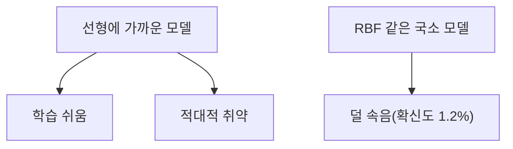

# 선형성 가설

> 신경망이 적대적 사례에 취약한 이유가 과도한 비선형성이 아니라 **고차원에서의 선형적 성질** 때문이라는 설명이다(Goodfellow 외, 2015).

## 쉽게 말하면
작은 변화를 수천 개 픽셀 하나하나에서 같은 방향으로 조금씩 더하면, 개별 변화는 안 보여도 총합은 커진다. 모델은 이 총합에 크게 반응한다.

## 자세히
(arXiv 1412.6572를 하위 에이전트가 읽은 노트 기준.)
- **논리**: 활성값 wᵀ(x+η)에서 η = sign(w)로 주면 활성이 ε·‖w‖₁ ≈ ε·m·n만큼 커진다(m = 평균 가중치 크기, n = 차원 수). 한 픽셀 변화량 ‖η‖∞는 ε로 고정인데 차원이 클수록 총 영향이 커진다. 논문은 이를 "우연한 스테가노그래피(accidental steganography)"라 부른다.
- **지지 수치**: 얕은 RBF 네트워크(비선형·국소적) ε=.25에서 오류 55.4%지만 오답 확신도는 **1.2%**뿐. maxout 12개 앙상블은 전체 앙상블 공격에 91.1%, 단일 구성원 공격에 87.9%. 얕은 softmax가 maxout과 같은 오답 클래스를 내는 비율 54.6%(둘 다 틀릴 때 84.6%), RBF는 16.0%(54.3%).
- **함의**: 비선형성이 강한 모델(RBF)은 덜 속지만 학습이 어렵다는 절충. 선형에 가까운 모델이 학습은 쉬우나 적대적 취약성이 크다.
- **한계(제안)**: 이후 연구는 이 설명이 일부만 맞는다고 논의한다(이번에 확인하지 않음).

## 그림으로 보기

## 예시
- 입력 차원이 784(MNIST)에서 150,528(224×224×3)로 커질 때 같은 ε의 영향을 계산해 보기.
- 교육 활용: "작은 것도 많이 모이면 크다"는 직관.

## 헷갈리는 것과 비교
| 개념 | 차이 |
|---|---|
| 선형성 가설 | 취약성의 원인 설명 |
| [FGSM](#fgsm) | 그 가설에서 나온 공격법 |
| 과적합 가설 | 비선형성·과적합이 원인이라는 초기 설명 |

## 더 읽을거리
- [Explaining and Harnessing Adversarial Examples (arXiv 1412.6572)](https://arxiv.org/abs/1412.6572) — 선형 설명.
