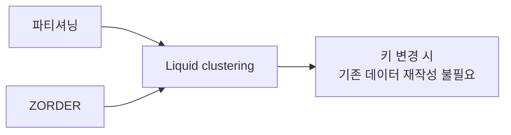
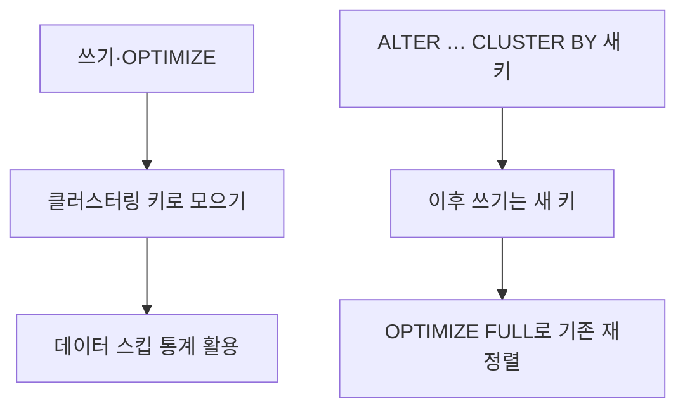

# Liquid clustering

> Databricks가 만든 데이터 배치 기법으로, **파티셔닝과 `ZORDER`를 대체**한다. 클러스터링 키로 데이터를 유사한 값끼리 모아 두며, **기존 데이터를 다시 쓰지 않고도 키를 바꿀 수 있다.**

## 쉽게 말하면
도서관 서가를 "청구기호순으로 한 번 고정"하면 분류 기준을 바꿀 때 책을 전부 옮겨야 한다. Liquid clustering은 "분류 기준을 바꾸면 새로 들어오는 책부터 새 기준으로 꽂고, 옛 책은 원할 때 천천히 옮기는" 방식에 가깝다.

## 자세히
(Databricks 공식 문서 "Use liquid clustering for tables"를 직접 읽었다. Databricks·Delta Lake 전용 기능이며 다른 엔진에 그대로 있는 기능이 아니다. 런타임 버전 조건은 문서 기준이며 바뀔 수 있다.)
- **켜는 법(문서)**
  - 새 테이블: `CREATE TABLE table1 (col0 INT, col1 STRING) CLUSTER BY (col0);`
  - 기존 비파티션 테이블: `ALTER TABLE <table_name> CLUSTER BY (<clustering_columns>)`
  - 키 자동 선택: `ALTER TABLE table1 CLUSTER BY AUTO;` (Runtime 15.4 LTS 이상, Unity Catalog 관리형 테이블)
  - 파티션 테이블 전환: `ALTER TABLE <table_name> REPLACE PARTITIONED BY WITH CLUSTER BY [( <clustering_columns> ) | AUTO]` (Runtime 18.1 이상)
  - 키 제거: `ALTER TABLE table_name CLUSTER BY NONE;`
- **파티셔닝·Z-order 대비 장점(문서)**: 클러스터링 키를 **데이터를 다시 쓰지 않고** 재정의 가능, 관리 노력 감소, 스트리밍 테이블·구체화 뷰에도 사용 가능, 카디널리티가 높은 필터와 쏠린 데이터(파티션 키가 너무 많거나 적은 파티션을 만드는 경우)에 더 낫다, 동시 쓰기와 접근 패턴 변화 지원.
- **한계(문서)**: 클러스터링 키는 **최대 4개**(10TB 미만 테이블에서 키가 더 많으면 단일 열 필터가 느려질 수 있음). **파티셔닝·`ZORDER`와 함께 쓸 수 없다.** 키는 통계가 수집된 열이어야 하며 기본은 앞 32개 열. 키 타입은 날짜·타임스탬프·문자열·정수·실수·소수 등이고 복합 타입·맵·배열 요소는 안 된다(구조체 필드는 점 표기). 테이블은 Delta writer 버전 7·reader 버전 3이 필요하며 프로토콜을 낮출 수 없다.
- **클러스터링이 일어나는 때(문서)**: 쓸 때(`INSERT INTO`, `CTAS`/`RTAS`, Parquet `COPY INTO`, `append`)는 데이터가 크기 임계치를 넘을 때만. `OPTIMIZE table_name;`는 점진적으로 클러스터링하고(예측 최적화가 자동 실행 가능, 아니면 정기 예약), `OPTIMIZE table_name FULL;`(Runtime 16.0 이상)은 기존 데이터를 재클러스터링하며 큰 테이블에선 몇 시간이 걸릴 수 있다.
- **키 바꾸기(문서)**: `ALTER TABLE table_name CLUSTER BY (new_column1, new_column2);` 이후 `OPTIMIZE`와 쓰기는 새 키를 쓰지만 기존 데이터는 `OPTIMIZE ... FULL` 전까지 다시 쓰이지 않는다. DataFrame `append`로는 키를 못 바꾼다.
- **권장(문서)**: Databricks는 **모든 신규 테이블**에 liquid clustering을 권한다. 특히 카디널리티 높은 필터, 큰 쏠림, 빠른 증가, 동시 쓰기, 다양한 질의 패턴. 마이그레이션 때는 파티션 열과 `ZORDER` 열을 클러스터링 키로 쓴다.
- **이 노드의 위치**: Z-order의 후속 대안이다. 세부 원리(공간 채움 곡선 등)는 이 문서에 없어 설명하지 않았다.

## 그림으로 보기



## 예시
```sql
CREATE TABLE events (event_ts TIMESTAMP, user_id STRING, event_type STRING)
CLUSTER BY (event_ts, user_id);
OPTIMIZE events;
```
- 교육 소재: "서가 기준을 나중에 바꿀 수 있다면 설계 부담이 어떻게 줄까?"

## 헷갈리는 것과 비교
| 개념 | 차이 |
|---|---|
| Liquid clustering | 키 변경이 쉬운 새 배치 기법, 파티션·ZORDER와 병용 불가 |
| [Z-order 클러스터링](#z-order-clustering) | 이전 방식, 키 변경 시 재작성 필요 |
| [파티셔닝과 가지치기](#data-partitioning-pruning) | 폴더로 나누는 전통 방식 |
| [데이터 스킵 통계](#data-skipping-statistics) | 클러스터링이 효과를 내는 기반 |

## 더 읽을거리
- [Use liquid clustering for tables (Databricks)](https://docs.databricks.com/aws/en/delta/clustering) — 문법·한계·권장(직접 읽음).
