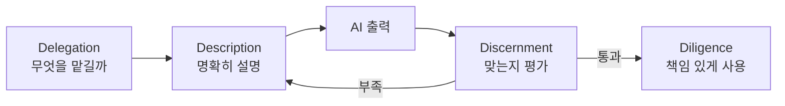
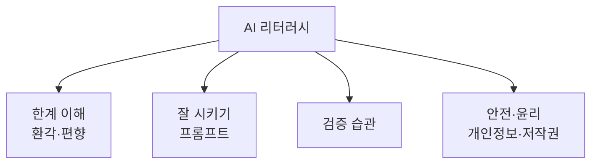

# AI 리터러시

> AI가 무엇을 잘하고 못하는지 알고, 결과를 비판적으로 검토하며 안전하게 쓰는 능력. "쓸 줄 안다"보다 "믿을 때와 의심할 때를 안다"에 가깝다.

## 쉽게 말하면
AI는 아주 빠르고 박학한 신입 인턴과 같다. 초안은 순식간에 가져오지만, 모르는 것도 자신 있게 말한다. 인턴에게 일을 맡길 때 무엇을 시킬지 정하고, 결과를 훑어 검수하고, 책임은 내가 지듯이 AI도 똑같이 대하는 것이 리터러시다.

## 자세히
- **LLM은 "그럴듯한 다음 말"을 만든다.** 사실 데이터베이스가 아니라 확률 모델이라서, 없는 사실·출처를 지어내는 [환각](#hallucination)이 구조적으로 생긴다. 완전히 없애기는 어렵다고 본다(여러 교육 자료의 공통 설명).
- **Anthropic 협력 AI Fluency 프레임워크**(Dakan·Feller, 2025, CC BY-NC-SA)는 4D를 핵심 역량으로 든다: Delegation(무엇을 맡길지), Description(어떻게 설명할지), Discernment(결과를 평가), Diligence(책임 있게 쓰기). 상호작용 방식은 자동화·에이전시·증강 세 가지로 나눈다.
- 2026년 연구는 "비판적 리터러시"를 그럴듯하지만 틀린 출력을 **탐지·평가·뒤집는** 능력으로 정의해 측정하려 한다(개념 모델 단계, 검증된 척도는 아님).
- 실무 습관: 출처를 요구하고 실제로 존재하는지 확인, 모델 여러 개로 교차 확인, 고위험 결정은 사람이 최종 검토, 민감 정보는 입력하지 않기.

## 그림으로 보기

## 예시
- 보고서 요약을 AI에게 시킨 뒤, 인용된 수치 두 개를 원문에서 직접 대조한다.
- 프롬프트 예: "확실하지 않은 부분은 '모름'이라고 표시하고, 근거 링크를 달아줘."

## 헷갈리는 것과 비교
| 개념 | 차이 |
| --- | --- |
| AI 리터러시 | 한계를 알고 비판적으로 쓰는 시민·직장인 공통 소양 |
| [프롬프트 엔지니어링](#prompt-engineering) | 잘 시키는 기술. 리터러시의 일부 |
| [환각](#hallucination) | 리터러시가 다루는 대표 위험 |

## 더 읽을거리
- [AI Fluency Framework](https://aifluencyframework.org/) — 4D 프레임워크 공식 사이트
- [A Guide for AI Literacy Efforts (Benton)](https://www.benton.org/blog/guide-ai-literacy-efforts) — 미국 노동부 AI 리터러시 프레임워크 해설(2026-02)
- [AI Literacy 101 (UW System)](https://www.wisconsin.edu/systemwide-it/2025/09/18/ai-literacy-101-what-every-professional-should-know-in-2025/) — 실무자용 입문
