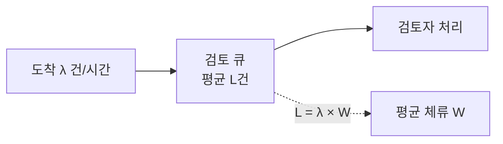
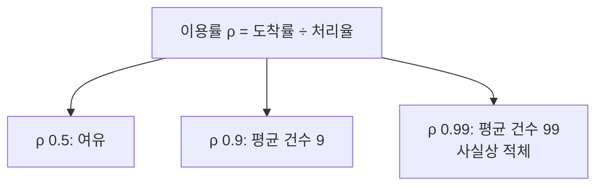

# Little의 법칙

> Little의 법칙은 안정된 시스템에서 "평균 대기·처리 중인 건수 = 도착률 × 평균 체류 시간"(L = λW)이라는 관계다. 검토 큐에서는 사람이 처리할 건수와 대기 시간을 서로 환산하는 기본 도구다. 도착률이 처리 능력에 가까워지면 대기가 무한히 늘어난다는 사실은 이 법칙이 아니라 대기행렬 이론의 별도 결과다.

## 쉽게 말하면
식당에 시간당 10팀이 오고 한 팀이 평균 30분 머문다면 가게 안에는 평균 5팀이 있다. 이 관계는 손님이 어떤 순서로 오든, 식사 시간이 어떻게 분포하든 장기 평균으로는 성립한다.

## 자세히
- **법칙(Wikipedia 열람)**: 장기 평균 기준 L = λW. L은 시스템 안의 평균 건수, λ는 실제로 들어온 평균 도착률, W는 한 건이 시스템에 머무는 평균 시간이다. 요구 조건은 시스템이 안정(stationary)·에르고딕이라는 것이고, 도착 분포·처리 시간 분포·처리 순서를 가리지 않는다. 용량이 유한하면 거절된 건은 λ에서 뺀다. 유한한 기간 데이터에는 추정식이 필요하다.
- **검토 큐에 적용(해석)**: 하루 3,000건이 검토 큐에 들어오고(λ=125건/시간) 평균 체류가 2시간이면 큐 안에는 평균 250건이 있다(L=125×2). 체류 시간 목표를 1시간으로 줄이려면 평균 건수를 125건 이하로 유지해야 한다.
- **포화에 가까워질 때(대기행렬 이론, Wikipedia 열람)**: 가장 단순한 M/M/1 모형에서 이용률 ρ=λ/μ가 1 미만이어야 안정하고, 평균 건수는 ρ/(1−ρ), 평균 체류는 1/(μ−λ)로 계산된다(문서는 분포만 주고 두 식은 거기서 유도한 값임). ρ가 1에 다가가면 둘 다 한없이 커진다. 예를 들어 ρ=0.9이면 평균 건수 9, ρ=0.99이면 99다. 도착이 규칙적이거나 처리 시간이 일정하면 수치가 다르다.
- **함의**: 검토자가 거의 100% 바쁜 큐는 대기가 폭증한다. 이관율을 높이면 도착률이 올라가 처리 능력에 가까워지기 쉽다. 용량에 여유를 두고 이관율 상한을 설정한다.
- **한계**: M/M/1은 도착이 무작위이고 처리 시간이 지수분포라는 가정이다. 실제 검토 업무는 피크 시간대와 건별 난이도 차이가 있어 시뮬레이션이 필요하다.

## 그림으로 보기

## 예시
- 콘텐츠 검수: 시간당 40건 도착, 검토자 1명이 시간당 45건 처리(ρ≈0.89)면 M/M/1 가정에서 평균 약 8건이 대기·처리 중이고 평균 체류는 12분(1/(45−40)시간)이다.
- 교육 활용: "검토자를 10% 줄이면 대기가 10% 늘까?"를 묻고, 포화 근처에서는 훨씬 더 늘 수 있음을 계산으로 보여 준다.

## 헷갈리는 것과 비교
| 개념 | 차이 |
| --- | --- |
| [검토 큐 설계](#review-queue-design) | 상위 주제. Little의 법칙은 그 크기 계산 도구 |
| 이용률 포화 효과(ρ→1) | 대기행렬 이론 결과. Little의 법칙은 건수·시간의 환산 관계 |
| [검토의 수확 체감](#diminishing-returns-review) | 검토 효과 곡선. 이 글은 대기 용량 |

## 더 읽을거리
- [Wikipedia: Little's law](https://en.wikipedia.org/wiki/Little%27s_law) — 정의·가정·예
- [Wikipedia: Queueing theory](https://en.wikipedia.org/wiki/Queueing_theory) — M/M/1 정상 분포
