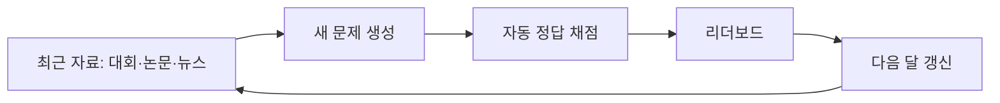
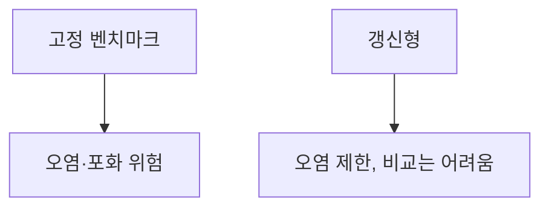

# 갱신형 벤치마크

> 정해진 문제 세트를 계속 쓰는 대신 **모델의 학습 마감 이후에 나온 최근 자료로 문제를 주기적으로 새로 만들어**, 시험 문제가 학습 데이터에 섞이는 오염(contamination)을 피하는 평가.

## 쉽게 말하면
수능 기출만 외운 학생은 기출 점수가 높아도 실력을 모른다. 갱신형은 매달 새 문제를 내서 외운 게 아니라 푼 것인지를 본다.

## 자세히
- 대표 사례 **LiveBench**(arXiv 2406.19314, 초록 읽음):
  - 오염 제한 설계: 최근 수학 경시대회, arXiv 논문, 뉴스, 데이터셋에서 문제를 가져오고, Big-Bench Hard·AMPS·IFEval의 더 어려운 버전도 포함.
  - **객관 채점**: 정답값과 자동 비교 → LLM 심판이나 사람 크라우드소싱의 편향을 피한다.
  - 범위: 수학·코딩·추론·언어·지시 따르기·데이터 분석.
  - **매월 갱신**, 시간이 지나며 더 어려운 과제 버전 추가.
  - 초록은 "LiveBench는 어렵고, 최상위 모델의 정확도가 70% 미만"이라고 밝힌다(논문 작성 시점 기준).
- 왜 필요한가: 고정 벤치마크는 쉽게 포화된다. HLE 논문은 MMLU 같은 인기 벤치마크에서 LLM이 90% 넘게 달성해 최신 능력을 가늠하기 어렵다고 말한다([평가 포화](#eval-saturation)).
- 한계(일반 논평, 이 출처로 확인한 것은 아님): 문제가 매번 바뀌면 시점 간 점수 비교가 어렵고, 최신 자료가 곧 학습에 포함될 수 있으며, 객관 채점이 가능한 과제로 범위가 좁아진다.

## 그림으로 보기

## 예시
- 새 모델 발표 직후 이번 달에 나온 경시 문제로 성능 확인.
- 교육: 사내 평가 세트를 분기마다 최신 사례로 교체하는 운영 원칙.

## 헷갈리는 것과 비교
| 개념 | 차이 |
|---|---|
| 갱신형 벤치마크 | 문제를 주기적으로 교체 |
| 고정 벤치마크 | 같은 문제 반복, 오염 위험 |
| [평가 포화](#eval-saturation) | 점수가 높아져 변별력을 잃음 |

## 더 읽을거리
- [LiveBench (arXiv 2406.19314)](https://arxiv.org/abs/2406.19314) — 설계와 70% 미만(초록 읽음).
- [Humanity's Last Exam](https://arxiv.org/abs/2501.14249) — 포화 문제 제기(검색 결과 확인).
