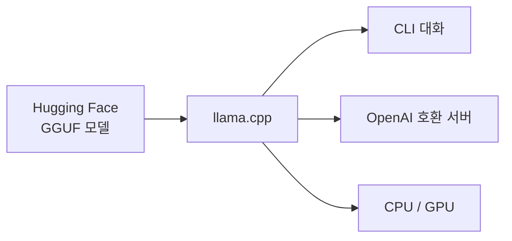

# llama.cpp

> C/C++로 쓴 오픈소스 LLM 추론 엔진. GGUF 모델을 CPU·여러 GPU에서 최소 설정으로 돌린다.

## 쉽게 말하면
무거운 서버 없이 내 노트북에서 모델을 돌리게 해 주는 가벼운 엔진이다. 자동차 엔진이라 하면 모델은 연료, GGUF는 연료통 규격이다.

## 자세히
저장소(ggml-org/llama.cpp) 설명 기준, 2026-11 확인:
- 목표: 최소 설정으로 LLM·VLM 추론. 기반은 ggml 라이브러리.
- 하드웨어: CPU(AVX·AVX2·AVX512·AMX, Apple silicon), GPU(CUDA, HIP, Metal, Vulkan, SYCL 등), 일부 NPU, 여러 기기에 걸친 RPC 백엔드.
- 양자화: 1.5~8비트 정수 양자화로 메모리와 속도 개선.
- 사용: 허깅페이스 GGUF를 `-hf <repo>`로 바로 받아 실행하는 cli, OpenAI 호환 API와 웹 UI를 제공하는 서버(페이지의 명령 이름 표기는 일관되지 않아 설치한 버전의 `--help`를 확인).
- Hugging Face 변환 스크립트로 자체 모델을 GGUF로 바꿀 수 있다.

## 그림으로 보기

## 예시
VRAM 8GB PC에서 4비트 양자화 GGUF 소형 모델을 받아 로컬 챗봇 서버로 띄우고, 기존 OpenAI 클라이언트의 주소만 바꿔 연결한다.

## 헷갈리는 것과 비교
| 개념 | 차이 |
| --- | --- |
| llama.cpp | 추론 엔진 |
| [GGUF](#gguf-format) | 엔진이 읽는 모델 파일 형식 |
| Ollama | llama.cpp 계열 위에 쓰기 쉽게 만든 관리 도구(일반 설명) |

## 더 읽을거리
- [ggml-org/llama.cpp](https://github.com/ggml-org/llama.cpp) — 공식 저장소
