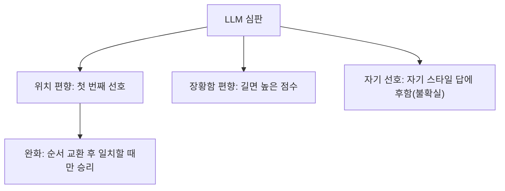

# LLM 주석 편향

> LLM을 채점자·라벨러(심판)로 쓸 때 **답이 놓인 위치, 답의 길이, 자기가 쓴 답**에 따라 판단이 기운다. 이런 편향은 합성 라벨과 그 라벨로 학습한 분류기에 그대로 전파되므로 사용 전에 점검해야 한다.

## 쉽게 말하면
심사위원이 먼저 읽은 답안을 후하게 보거나, 길고 장황한 답안을 더 좋다고 여기거나, 자기 스타일 답안에 점수를 더 주는 경향이 있다. 이 심사 기록으로 조교를 가르치면 조교도 같은 버릇을 배운다.

## 자세히
(Zheng 외 2023 "Judging LLM-as-a-Judge with MT-Bench and Chatbot Arena", arXiv 2306.05685 PDF 본문을 직접 읽음. 2023년 모델 기준 결과다)
- **위치 편향(position bias)**: 두 답을 비교할 때 순서에 영향을 받는다. 같은 질문에 GPT-3.5로 비슷한 답 두 개를 만들어(온도 0.7) 순서를 바꿔 판정시키니 시험한 LLM 심판 모두 강한 위치 편향을 보이고 대부분 **첫 번째 위치를 선호**했다. 순서를 바꿨을 때도 같은 결론을 내는 일관성이 **60%를 넘는 심판은 GPT-4뿐**이었다. 어시스턴트 이름을 바꾼 실험에서 Claude-v1은 이름(Assistant A) 선호도 보였다.
- **장황함 편향(verbosity bias)**: 더 길고 장황한 답을 선호한다. 번호 목록이 있는 MT-bench 답 23개에 같은 내용을 바꿔 쓴 목록을 앞에 덧붙여 불필요하게 길게 만든 "repetitive list" 공격에서 모든 시험한 LLM 심판이 속았고, GPT-4가 가장 잘 방어했다. 같은 답 두 개는 항상 동률로 판정해 보정은 정상이었다.
- **자기 선호 편향(self-enhancement)**: 사람 평가 대비 GPT-4는 자기 답의 승률이 약 10% 높고 Claude-v1은 약 25% 높았다. 그러나 다른 모델도 선호했고 GPT-3.5는 자기를 선호하지 않았으며, 표본이 적어 편향 여부를 **확정할 수 없다**고 저자들이 적었다.
- 그 밖: 수학·추론 문제 채점 능력이 제한적. 그럼에도 GPT-4 판정은 사람 평가와 **80% 이상 일치**(사람끼리의 일치 수준)로 보고됐다.
- 완화책(논문): **위치 교환** — 두 순서로 두 번 호출해 두 번 모두 우세할 때만 승리로, 불일치면 무승부로 처리하는 보수적 방식이나 무작위 배치. few-shot 예시와 참조 답 제공도 시험.
- 데이터 주석에 옮겨 쓰기(제안): 점수 매기는 절대 평가에도 길이·문체 편향이 있을 수 있다. 길이와 점수의 상관을 계산해 보고, 순서·표현을 바꿔 여러 번 채점해 일치도를 보며, 사람 정답 세트로 보정한다([주석 후 증류](#annotate-then-distill)).

## 그림으로 보기

## 예시
- 두 모델 답을 비교 채점할 때 (A,B)와 (B,A) 두 번 호출해 일관된 경우만 집계.
- 문서 품질 점수와 문서 길이의 상관계수를 구해 지나치게 높으면 길이 편향 의심.
- 교육: 심판도 편향된다는 평가 설계의 기본기.

## 헷갈리는 것과 비교
| 개념 | 차이 |
|---|---|
| 위치 편향 | 순서에 따라 판정이 바뀜 |
| 장황함 편향 | 길이가 길수록 선호 |
| 자기 선호 | 자기 출력을 선호(논문에서는 불확실) |
| [일관되지만 틀린 주석](#consistent-but-wrong) | 반복해도 같은 오류가 나오는 문제 |

## 더 읽을거리
- [Judging LLM-as-a-Judge with MT-Bench and Chatbot Arena (arXiv 2306.05685)](https://arxiv.org/abs/2306.05685) — 위치·장황함·자기 선호 편향 실험(PDF 본문 읽음).
