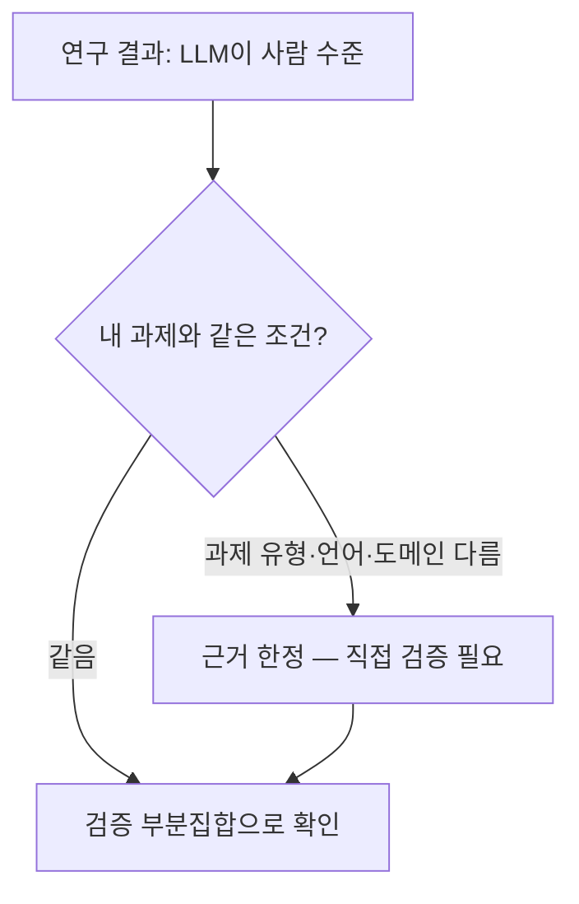
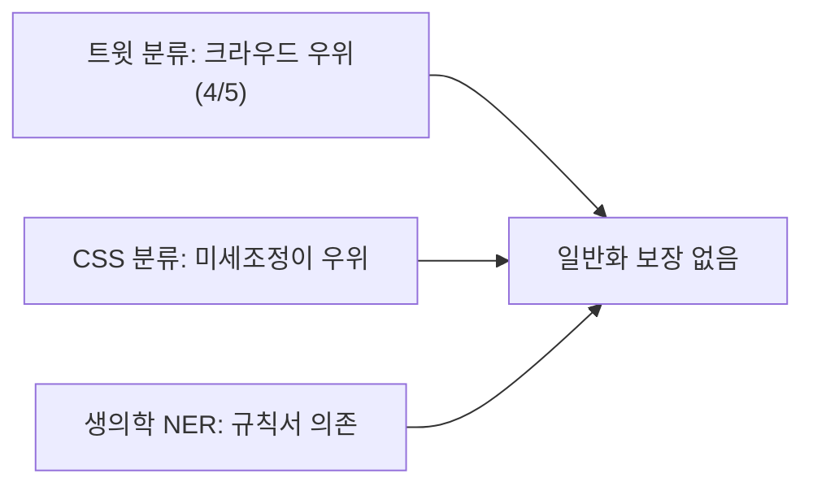

# LLM 라벨링 일반화 한계

> "LLM이 사람 라벨러를 대신할 수 있다"는 연구 결과는 **특정 과제·데이터·모델·시점**에서 나온 것이라, 내 도메인에 그대로 옮겨도 된다는 보장이 없다. 직접 검증하기 전까지는 근거가 한정된 주장으로 다룬다.

## 쉽게 말하면
어떤 요리사가 한식 5개 요리에서 사람 요리사보다 낫다고 입증됐다고 해서 일식·제과에서도 낫다고는 할 수 없다. 내 식당 메뉴로 시험해 봐야 한다.

## 자세히
(논문 초록과 HTML 본문을 직접 열어 확인한 근거만 정리. 모두 저자 보고이며 직접 재현하지 않음)
- **트윗 5개 주석 과제(Gilardi 등, arXiv 2303.15056)**: 2,382개 트윗에서 제로샷 ChatGPT가 크라우드워커보다 5개 과제 중 4개에서 정확했고, 주석당 비용이 0.003달러 미만이었다. 범위는 영어 소셜미디어 텍스트 분류(관련성·입장·주제·프레임)와 당시 모델이다.
- **계산사회과학 25개 벤치마크(Ziems 등, arXiv 2305.03514)**: 13개 언어 모델을 25개 영어 CSS 벤치마크에 제로샷으로 평가했다. **분류**에서는 LLM이 최고 성능의 미세조정 모델을 이기지 못했지만 사람과 "공정한 수준의 일치"에 도달했고, **생성**(설명)에서는 LLM 설명이 크라우드워커 기준 답보다 높게 평가되는 경우가 많았다. 권고는 LLM을 사람 주석 팀의 제로샷 보조 주석자로 쓰는 것이다.
- **생의학 NER 3개(arXiv 2605.20809, 2510.12835)**: NCBI Disease·BC5CDR·BioRED 같은 생의학 개체 인식에서 **원래 규칙서를 넣는 것**이 큰 이득이었으나(예: NCBI 0.46→0.73, GPT-5) 절대 점수는 과제·모델마다 달랐다(중재 후 GPT-5가 BC5CDR 0.86, BioRED 0.82, NCBI 0.76). 논문 한계: 생의학 NER 3개 데이터만 다뤘다.
- **세 결과가 말해 주는 것**: ① 과제 유형(분류·NER·생성)에 따라 LLM의 위치가 다르다 ② 규칙서 품질과 모델 종류가 큰 영향 ③ 사람 기준(골드)이 어떻게 만들어졌는지에 따라 "일치"의 의미가 달라진다. 서로 다른 연구를 하나의 수치로 평균 내 말할 수 없다.
- **내 도메인에 적용할 때 체크리스트(제안)**
  1. 과제 유형이 연구와 같은가(분류 vs 구간 추출 vs 생성).
  2. **언어·도메인**이 같은가(한국어, 전문 용어, 사내 용어 등).
  3. 사람 골드의 품질: [일치도](#target-agreement-setting)가 충분한가.
  4. 모델·프롬프트·규칙서가 같은가(모델이 바뀌면 재검증).
  5. **직접 검증**: [검증 부분집합](#llm-labeler-validation-subset)에서 신뢰구간으로 판단.
  6. 불확실 항목 처리([unknown 허용](#llm-unknown-option))와 사후 표본 점검.
- **시점의 문제**: 모델은 빠르게 바뀌므로 몇 달 전 결론이 지금 모델에 그대로 성립한다고 보지 않는다(일반 원칙).

## 그림으로 보기

## 예시
- 영어 트윗 연구 결과를 근거로 한국어 법률 문서 라벨링에 LLM을 투입하기 전, 전문가 라벨 300건으로 검증하고 일치율 신뢰구간 하한을 확인.
- 교육: 연구 결과를 인용할 때 "어떤 과제·데이터·모델에서"를 반드시 같이 말하는 습관.

## 헷갈리는 것과 비교
| 개념 | 차이 |
|---|---|
| 연구 결과 | 특정 조건에서 관측 |
| 일반화 | 다른 조건에서도 성립한다는 주장(검증 필요) |
| [LLM 검증 부분집합](#llm-labeler-validation-subset) | 내 조건에서 직접 확인 |
| 벤치마크 점수 | 특정 데이터의 결과 |

## 더 읽을거리
- [ChatGPT Outperforms Crowd-Workers for Text-Annotation Tasks (arXiv 2303.15056)](https://arxiv.org/abs/2303.15056) — 트윗 5개 과제(초록 확인).
- [Can Large Language Models Transform Computational Social Science? (arXiv 2305.03514)](https://arxiv.org/abs/2305.03514) — 25개 벤치마크 제로샷 평가(초록 확인).
- [Refining and Reusing Annotation Guidelines for LLM Annotation (arXiv 2605.20809)](https://arxiv.org/abs/2605.20809) — 생의학 NER 3개와 한계(본문 확인).
