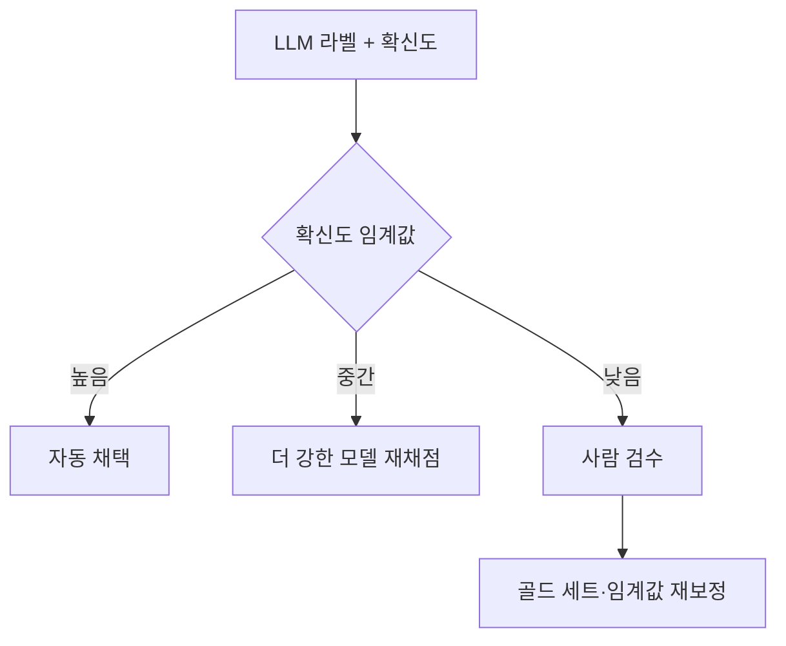
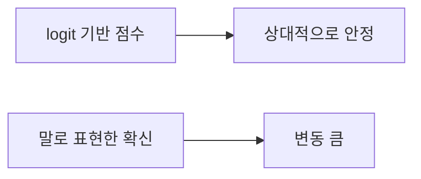

# 확신도 기반 사람 검수 분기

> LLM이 라벨을 달 때 **확신이 낮은(불확실한) 건만 사람에게 보내고** 나머지는 자동 채택해 비용을 줄이는 방식. 확신도 임계값을 어떻게 정하느냐에 따라 오류가 보장되기도, 무너지기도 한다.

## 쉽게 말하면
신입 직원이 "확실합니다"라고 한 건은 바로 처리하고 "잘 모르겠어요"라고 한 건만 선배가 보는 구조다. 신입이 자신감 과잉이라면 틀린 건이 그냥 통과하므로, 신입의 "확신"이 실제로 맞는지 먼저 점검해야 한다.

## 자세히
- **HyPAC(arXiv 2602.02550, 2026, 본문 앞 100,000자 직접 읽음)**: 불확실도 점수를 임계값 두 개로 나눠 입력을 비사고(non-thinking) LLM·사고(thinking) LLM·사람 세 곳 중 하나로 보낸다. 임계값은 중요도 샘플링한 위험 추정과 상한 신뢰구간으로 보정한 캘리브레이션 세트에서 정한다. 논문은 사용자가 정한 오류 허용치 ε을 확률 1−α 이상으로 지킨다는 **분포에 의존하지 않는 보장**을 주장한다. 초록 기준 MATH-500(Qwen3-4B Instruct·Thinking 조합)에서 오류 5% 미만을 유지하며 비용 **78.51% 절감**(logit 기반 점수, 표의 오류 약 4.00%). logit 기반 점수가 말로 표현한 확신(verbalized)보다 변동이 적고 보정 오류가 낮았다. 휴리스틱 방식인 CoAnnotating은 오류 목표를 지키지 못했다.
- **Confidence-Driven Inference(Gligorić 외, arXiv 2408.15204, 본문 직접 읽음)**: 모델이 답한 뒤 "맞을 확률"을 스스로 말하게 하고, 틀릴 확률이 높은 텍스트일수록 사람 주석 확률을 높인다. 파워 튜닝 파라미터 λ(0이면 LLM 무시, 1이면 전적으로 활용)로 분산을 최소화해 사람만 쓴 추정보다 나빠지지 않도록 한다. 신뢰구간 목표 90%를 5개 추정 과제에서 유지했고 LLM 단독 구간은 0%~약 70%로 크게 미달했다. GPT-4o로 유효 표본 크기 1,000을 얻는 데 사람 주석이 약 250~750개 필요해 **최소 25% 절감**. LLM-사람 일치도(κ)가 0.39~0.57로 보통 수준이었는데도 LLM 단독 추정은 방향이 뒤집히기도 했다.
- **주의점**: ① 단일 확신도 임계값만으로는 정확도가 보장되지 않는다(한 연구에서 0.9 임계값에서도 과제 중앙 정확도가 0.815였다는 검색 요약, 본문 미확인). ② 보정은 사람 정답이 있는 held-out 데이터로 해야 한다. ③ 두 논문의 절감 수치는 서로 다른 과제(수학 추론 vs 사회과학 텍스트 추정)라서 비교할 수 없다.
- **실무 절차(제안)**: 골드 세트로 확신도 보정 → 임계값을 오류 목표에 맞춰 선택 → 임계값 아래·불일치 건을 사람에게 → 주기적으로 골드로 재점검([사람 정답 세트 점검](#gold-set-check)).

## 그림으로 보기

## 예시
| 연구 | 결과(저자 보고) |
|---|---|
| HyPAC, MATH-500 | 오류 5% 미만 유지, 비용 78.51% 절감 |
| Confidence-Driven Inference | 사람 주석 최소 25% 절감, 90% 신뢰구간 유지 |
- 업무 장면: 고객 문의 분류에서 LLM 확신도가 0.7 미만이거나 두 모델 라벨이 다른 건만 상담 팀에 보내고, 매주 골드 100건으로 임계값을 점검한다.

## 헷갈리는 것과 비교
| 개념 | 차이 |
|---|---|
| 확신도 분기 | 불확실한 건만 사람에게 |
| [사람 정답 세트 점검](#gold-set-check) | 확신도 보정에 쓰는 기준 |
| [교차 모델 채점](#cross-model-annotation) | 여러 모델 의견 불일치로도 분기 가능 |
| [라벨링 총비용 계산](#total-labeling-cost) | 분기로 줄이는 비용을 따지는 틀 |

## 더 읽을거리
- [HyPAC (arXiv 2602.02550)](https://arxiv.org/abs/2602.02550) — 오류 보장 분기와 78.51% 절감(앞 100,000자 직접 읽음).
- [Can Unconfident LLM Annotations Be Used for Confident Conclusions? (arXiv 2408.15204)](https://arxiv.org/abs/2408.15204) — 확신도 기반 추론(직접 읽음).
