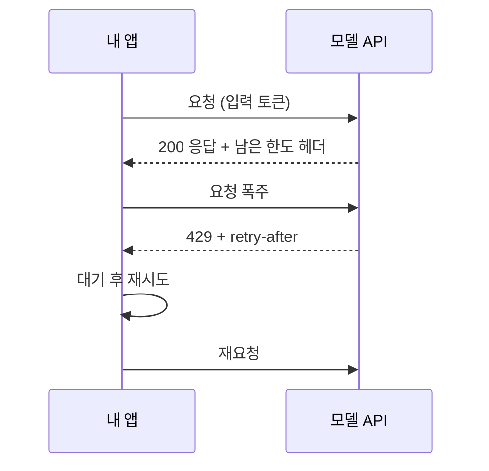

# LLM API 기초

> 코드에서 HTTP로 모델에 요청을 보내고 답을 받는 방식. 토큰 단위로 과금되고, 분당 호출량 제한(rate limit)이 있다.

## 쉽게 말하면
수도 계량기가 달린 수도꼭지다. 쓴 만큼(토큰) 요금이 나오고, 한 번에 틀 수 있는 물줄기(분당 한도)와 한 달 상한(지출 한도)이 있다. 한도를 넘으면 잠시 잠긴다(429 오류).

## 자세히
Claude API 문서(Rate limits) 기준:
- 한도는 **RPM**(분당 요청), **ITPM**(분당 입력 토큰), **OTPM**(분당 출력 토큰)으로 모델군별로 따로 잡힌다. 초과하면 HTTP 429와 어느 한도인지 설명이 온다.
- `retry-after` 헤더가 있으면 그 초만큼 기다렸다 재시도한다. 없는 429도 있다.
- 한도 방식은 **토큰 버킷**: 일정 시간마다 초기화되지 않고 계속 채워진다. 짧은 순간 몰리면 분당 합계가 안 넘어도 걸릴 수 있다.
- **캐시 인식**: 대부분 모델에서 캐시에서 읽은 입력 토큰은 ITPM에 안 센다. 반복 내용을 [프롬프트 캐싱](#prompt-caching)하면 실질 처리량이 올라간다(문서 예: 80% 적중이면 200만 한도로 약 1,000만 처리).
- 사용량 티어(Start/Build/Scale/Custom)가 있고 월 지출 상한이 있다(문서 기준 Start $500, Build $1,000, Scale $200,000). 상한 도달 시에도 429이지만 `retry-after`가 없다.
- 응답 헤더 `anthropic-ratelimit-*-remaining`으로 남은 양을 볼 수 있다.

## 그림으로 보기

## 예시
- 배치 요약 1만 건: 호출 사이 간격을 두고, 429가 오면 `retry-after`만큼 쉬고 재시도.
- 같은 긴 매뉴얼을 매번 붙인다면 캐시 표시로 입력 한도를 아낀다.

## 헷갈리는 것과 비교
| 개념 | 차이 |
| --- | --- |
| 분당 한도 | 속도 제한, 시간이 지나면 풀림 |
| 월 지출 한도 | 비용 상한, 다음 달까지 막힐 수 있음 |
| [로컬 LLM](#local-llm) | 한도 없음, 내 장비 한계 |

## 더 읽을거리
- [Rate limits (Claude Platform 문서)](https://platform.claude.com/docs/en/api/rate-limits) — RPM·ITPM·OTPM, 캐시, 헤더
