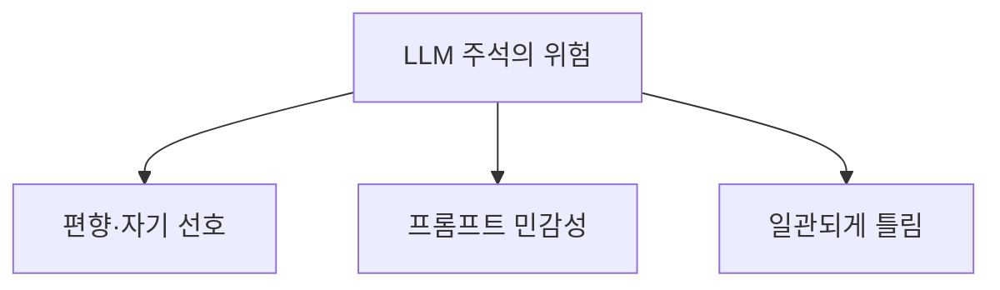

# LLM을 데이터 주석자로

> 사람 대신 LLM에게 대량의 데이터에 라벨·점수를 매기게 하는 방식이다. 큰 LLM이 일부에 주석을 달고 작은 분류기를 학습시켜 나머지를 처리하는 패턴이 특히 흔하다.

## 쉽게 말하면
수만 장의 답안지를 선생님 혼자 채점하기 어려우니, 채점 기준을 아는 조교(LLM)에게 먼저 맡기고 선생님은 일부만 다시 확인하는 것과 같다. 빠르고 싸지만, 조교의 채점 습관(편향)이 그대로 데이터에 남는다.

## 자세히
(FineWeb 논문 본문, Gilardi 등 논문 초록, LLM-as-a-Judge 서베이 초록을 직접 열어 확인.)
- **대규모 사례(FineWeb-Edu, arXiv 2406.17557)**: Llama-3-70B-Instruct가 46만 개 웹 페이지에 교육적 가치를 0~5점으로 매겼다. 가산식 점수 프롬프트가 가장 좋았고, 기술 문서만 높게 주지 않도록 초·중등 수준에 초점을 맞추게 했다. 이 주석으로 임베딩+선형 회귀 분류기를 학습해 15조 토큰 전체에 적용([교육 품질 분류기](#educational-quality-classifier)).
- **사람 라벨러와의 비교(Gilardi 등, arXiv 2303.15056, 초록)**: 트윗 2,382개 표본에서 ChatGPT의 제로샷 정확도가 크라우드워커보다 5개 과제 중 4개(관련성·입장·주제·프레임)에서 높았고, ChatGPT 실행 간 일치도는 모든 과제에서 크라우드워커와 훈련된 주석자보다 높았다. 건당 비용은 0.003달러 미만으로 MTurk보다 약 20배 저렴하다고 보고. 구체 정확도는 초록에 없다. 단일 모델·특정 시점·트윗 과제이므로 일반화는 금물(제안).
- **판정 신뢰성**: LLM-as-a-Judge 서베이(arXiv 2411.15594)는 LLM 평가자가 확장 가능하고 비용 효율적이며 일관된 평가를 줄 수 있지만 신뢰성에는 신중한 설계와 표준화가 필요하다고 정리한다(초록). 일관성 개선, 편향 완화, 평가 시나리오 적응 전략을 다룬다.
- **운영 패턴(제안)**: ① 사람이 소량 골든 라벨 작성 ② LLM 프롬프트를 골든과 비교해 개선([LLM 라벨러 프롬프트](#llm-labeler-guideline-prompt)) ③ LLM이 대량 주석 ④ 작은 분류기로 증류해 비용 절감 ⑤ 표본을 사람이 재검수해 오류율 보고.
- **위험(제안)**: LLM 편향·자기 선호, 프롬프트 민감성, 시험 세트 오염, 비용은 싸도 오류가 체계적이면 모델에 그대로 학습됨. 일치도는 높아도 정확하다는 뜻은 아니다(일관되게 틀릴 수 있음).

## 그림으로 보기

## 예시
- 사내 문의 로그 10만 건의 긴급도 라벨: 담당자 200건 골든 → LLM 프롬프트 튜닝 → 1만 건 LLM 주석 → 분류기 학습 → 나머지 적용, 월 1회 표본 100건 재검수.
- 교육 활용: "AI에게 평가 기준을 줄 때 루브릭을 어떻게 쓰는가"의 실습 — 평가 설계 교육과 직결.

## 헷갈리는 것과 비교
| 개념 | 차이 |
|---|---|
| LLM 주석자 | 데이터에 라벨·점수를 매김 |
| [LLM-as-Judge](#llm-as-judge) | 모델 출력의 품질을 평가 |
| [LLM 라벨러 프롬프트](#llm-labeler-guideline-prompt) | 규칙서를 프롬프트로 옮기는 설계 |
| [합성 데이터](#synthetic-data) | LLM이 새 데이터를 생성(주석과 다름) |

## 더 읽을거리
- [ChatGPT Outperforms Crowd-Workers for Text-Annotation Tasks (arXiv 2303.15056)](https://arxiv.org/abs/2303.15056) — 정확도·일치도·비용(초록 확인).
- [A Survey on LLM-as-a-Judge (arXiv 2411.15594)](https://arxiv.org/abs/2411.15594) — 신뢰성 전략(초록 확인).
- [The FineWeb Datasets (arXiv 2406.17557)](https://arxiv.org/abs/2406.17557) — Llama-3 주석 파이프라인(PDF 본문 확인).
