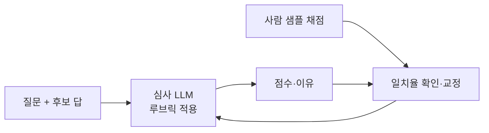
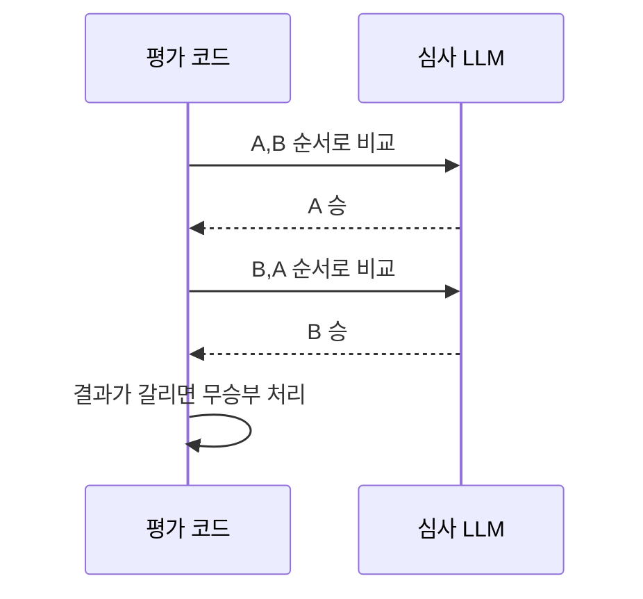

# LLM 심사위원

> 사람 대신 LLM이 다른 모델의 답을 채점하는 방법(LLM-as-a-Judge). 싸고 빠르지만 편향이 있어 사람 평가로 교정해야 한다.

## 쉽게 말하면
논술 채점을 조교 대신 AI 조교가 하는 것이다. 수천 장을 빠르게 매기지만, 먼저 본 답안에 후하거나 길게 쓴 글에 끌리는 버릇이 있을 수 있다. 그래서 사람 교수가 일부를 다시 채점해 AI 조교를 맞춰 본다.

## 자세히
Zheng 외 "Judging LLM-as-a-Judge with MT-Bench and Chatbot Arena"(2023, NeurIPS) 요약:
- 강한 심사 모델은 사람과 80% 이상 일치했고, 이는 사람끼리의 일치율과 비슷하다고 보고했다.
- **위치 편향**: 두 답을 나란히 줄 때 앞 자리를 선호. **장황함 편향**: 긴 답에 후함. **자기 선호 편향**: 자기 모델 답에 후함.
- 완화책(주로 2차 해설 기준): 순서를 바꿔 두 번 채점하고 일관된 경우만 인정, "길이를 보상하지 말라"고 지시, 루브릭을 차원별로 쪼개기, "모르겠음" 출구 제공.
- 방식: 단일 점수(루브릭), 쌍별 비교, 참조 답과 비교. Anthropic 글도 모델 채점기는 비결정적이라 사람 평가로 교정하라고 권한다.

## 그림으로 보기

## 예시
- 요약문 품질을 "정확성·간결성·누락 없음" 세 항목 1~5점 루브릭으로 채점시킨다.
- 프롬프트 A/B 비교: 같은 질문 100개 결과를 쌍별로 비교시키고 순서를 뒤집어 한 번 더 돌린다.

## 헷갈리는 것과 비교
| 개념 | 차이 |
| --- | --- |
| LLM 심사위원 | 모델이 채점 |
| 코드 채점기 | 단위 테스트·문자열 매칭, 객관적 |
| 사람 평가 | 비싸지만 기준점. 심사위원 교정용 |

## 더 읽을거리
- [Judging LLM-as-a-Judge (arXiv 2306.05685)](https://arxiv.org/abs/2306.05685) — 원 논문
- [Demystifying evals for AI agents](https://www.anthropic.com/engineering/demystifying-evals-for-ai-agents) — 모델 채점기 관리 요령
