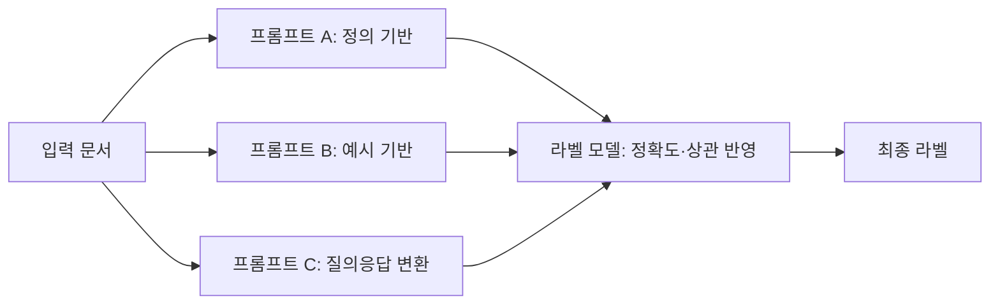
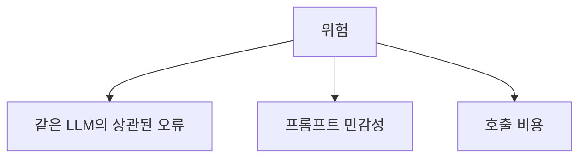

# LLM을 라벨링 함수로

> 프롬프트를 던져 LLM의 답을 라벨로 쓰는 것을 규칙 기반 라벨링 함수(LF)처럼 취급하는 방식이다. 서로 다른 프롬프트마다 하나의 LF로 보고, 약한 지도의 라벨 모델로 합쳐 개별 프롬프트의 오류를 줄인다.

## 쉽게 말하면
한 번 물어본 답은 틀릴 수 있다. 같은 질문을 표현만 바꿔 여러 번 묻고, 각 답의 신뢰도를 고려해 합치면 더 믿을 만한 답이 나온다. 각각의 질문 방식이 "의견 하나"이고 의견들을 정교하게 합치는 것이다.

## 자세히
(Arora 등의 「Ask Me Anything」 arXiv 2210.02441 초록을 직접 열어 확인.)
- **AMA(Ask Me Anything) 아이디어**: 완벽한 프롬프트 하나를 찾는 대신 **불완전한 여러 프롬프트를 결합**한다. 저자들은 출력을 고정된 선택지로 제한하는 프롬프트보다 **개방형 질의응답 형식**의 프롬프트가 대체로 잘 작동한다고 발견했다. 그래서 LLM 자신이 과제 입력을 질의응답 형식으로 바꾸게 한 뒤, 여러 개의 잡음 있는 예측을 모아 **약한 지도(weak supervision)로 합쳐** 최종 라벨을 만든다.
- **결과(초록)**: 125M~175B 파라미터의 여러 오픈소스 모델에서 few-shot 기준선보다 **평균 약 10.2%** 향상. 오픈소스 **GPT-J-6B가 20개 벤치마크 중 15개에서 few-shot GPT-3 175B와 같거나 더 낫다**.
- **LF로 보는 이유(제안)**: 각 프롬프트의 출력은 [라벨링 함수](#labeling-function)처럼 정확도·커버리지·상관이 다르다. 따라서 ① 프롬프트마다 정확도를 사람 라벨 개발 세트로 측정 ② 서로 다른 관점(키워드, 정의, 예시)의 프롬프트를 섞음 ③ 불확실하면 "unknown"으로 기권시킴([LLM 라벨러 프롬프트](#llm-labeler-guideline-prompt)) ④ [라벨 모델](#label-model-denoising)로 합침.
- **장점(제안)**: 규칙으로 쓰기 어려운 의미 판단을 LF로 만들 수 있고, 프롬프트 변형이 쉽다. **단점**: 호출 비용·지연, 프롬프트 민감성, 같은 LLM의 프롬프트들은 오류가 상관될 수 있다(모두 같은 방향으로 틀림), 시험 세트 오염.
- **검증**: 합친 라벨의 정확도를 사람이 라벨링한 소량으로 반드시 측정하고([작은 시험셋의 변동](#small-test-set-variance) 주의), 일치도가 낮은 프롬프트는 수정한다.

## 그림으로 보기



## 예시
```python
prompts = [
  "다음 문의가 환불 요청이면 yes, 아니면 no. 문의: {x}",
  "고객이 돈을 돌려받고 싶어 합니까? 문의: {x}",
  "이 문의는 환불에 대한 것입니까? 확실하지 않으면 unknown. 문의: {x}",
]
votes = [call_llm(p.format(x=x)) for p in prompts]   # 각 프롬프트 = LF 하나
```
(call_llm은 가상의 함수이며 직접 실행하지 않았다. 합치기는 [라벨 모델](#label-model-denoising) 참고.)
- 사내 문의 분류에서 프롬프트 5개의 결과를 라벨 모델로 합치고 사람 라벨 200건으로 정확도 확인.

## 헷갈리는 것과 비교
| 개념 | 차이 |
|---|---|
| LLM을 LF로 | 프롬프트별 출력을 약한 지도로 합침 |
| 단일 프롬프트 라벨링 | 한 프롬프트의 답을 그대로 사용 |
| [LLM을 데이터 주석자로](#llm-as-data-annotator) | LLM 주석 전반(LF 구조는 하나의 방식) |
| 앙상블 | 여러 모델의 예측 결합(같은 발상) |

## 더 읽을거리
- [Ask Me Anything: A simple strategy for prompting language models (arXiv 2210.02441)](https://arxiv.org/abs/2210.02441) — 프롬프트 결합·약한 지도(초록 확인).
