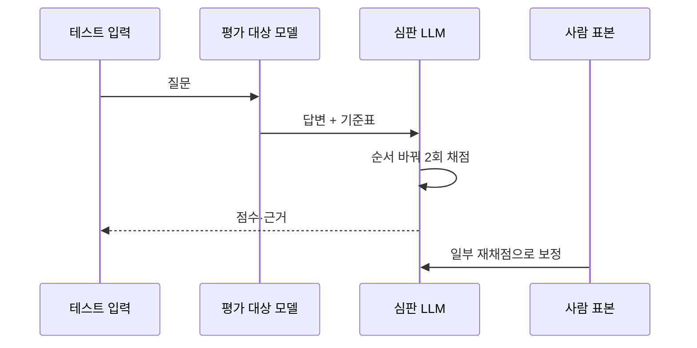
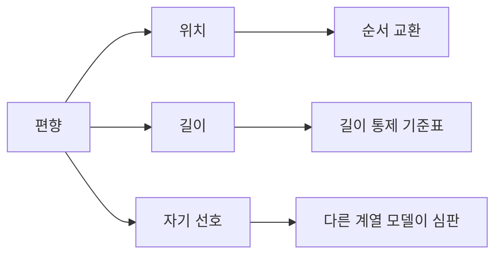

# LLM auto-rater

> 사람 대신 LLM이 AI 답변을 채점하게 하는 평가 방식(LLM-as-a-judge). 싸고 빠르지만 편향이 있어 사람 채점과 맞춰 보정해야 한다.

## 쉽게 말하면
논술 1,000장을 선생님 한 명이 채점하기엔 벅차서, 채점 기준표를 쥔 조교에게 맡기는 것과 같다. 조교는 빠르지만 첫 답안을 좋게 보거나 긴 글을 좋아하는 버릇이 있다. 그래서 일부는 선생님이 다시 채점해 조교와 얼마나 맞는지 확인한다.

## 자세히
- **방식**: 질문과 답변(들)·채점 기준을 LLM에 주고 점수나 승패를 받는다. 형태는 쌍 비교(A vs B), 단일 채점(1~5점), 기준표(rubric) 채점.
- **근거 연구**: Zheng 외(2023, MT-Bench·Chatbot Arena 논문)에서 GPT-4 판정이 전문가 투표와 85%(동점 제외, 1턴) 일치했고, 사람끼리는 81%였다. 단 소규모(80문항) 벤치마크의 원시 일치율이다.
- **알려진 편향**: 먼저 나온 답을 선호(위치 편향), 긴 답 선호(길이 편향), 자기 모델 답 선호.
- **완화**: 순서를 바꿔 두 번 묻고 두 번 모두 이길 때만 승으로 인정, 기준표를 구체화, 판정 근거를 먼저 쓰게 하기.
- **보정**: 사람이 채점한 표본 일부와 비교한다. 단순 일치율은 우연 일치를 포함하므로 Cohen's kappa 같은 보정 지표가 더 엄밀하다(한 벤더 블로그 주장: 일치율이 21개 판정 모델을 33~41점 과대평가, 벤더 자료라 참고용).
- 2026년 논문 주장: 통제된 쌍에서는 위치 편향이 작고, 순서가 바뀌면 판정이 뒤집히는 민감도가 동점 처리에서 더 문제.

## 그림으로 보기

## 예시
- 챗봇 새 프롬프트 vs 옛 프롬프트: 200개 질문에 쌍 비교, 순서 교환 후 승률 집계. 50개는 사람이 따로 채점해 일치도를 기록.
- 기준표: "근거 인용 있음 1점, 사실 오류 없음 1점, 형식 준수 1점"처럼 0/1 항목으로 쪼개면 점수가 안정된다.

## 헷갈리는 것과 비교
| 개념 | 차이 |
| --- | --- |
| 벤치마크(MMLU 등) | 정답이 고정된 시험, 자동 채점 |
| LLM auto-rater | 정답이 열린 답변을 LLM이 채점 |
| 사람 평가 | 기준이지만 비싸고 느림, auto-rater의 보정 기준 |
| [신뢰도 보정](#confidence-calibration) | 모델 확신도 보정, 이쪽은 심판 점수를 사람과 맞춤 |

## 더 읽을거리
- [Zheng et al., Judging LLM-as-a-Judge (2023)](https://arxiv.org/pdf/2306.05685) — 85% vs 81% 일치, 편향 분류
- [Judging the Judges: Bias Mitigation (2026)](https://arxiv.org/pdf/2604.23178) — 완화 전략 비교(검색 결과 요약 확인)
- [Kili: LLM-as-a-Judge Validity](https://kili-technology.com/blog/data-story-who-judges-the-judge-llm-as-a-judge) — 일치율 과대평가 지적(벤더 블로그)
