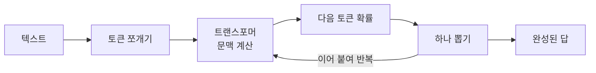
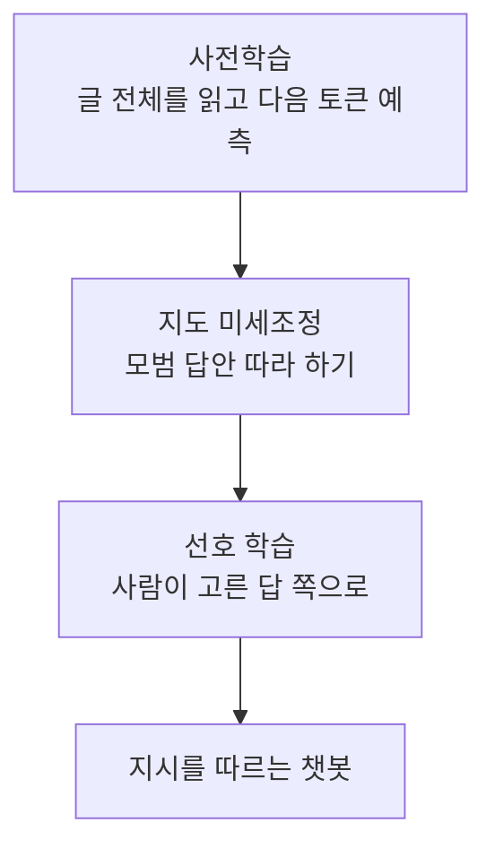

# LLM과 생성형 AI

> LLM(대규모 언어 모델)은 방대한 글을 읽고 "다음에 올 토큰"을 맞히도록 학습한 모델이다. 이 능력을 확장해 글·코드·답변을 만들어 내는 AI를 생성형 AI라 부른다.

## 쉽게 말하면
스마트폰 자동완성을 상상해 보자. "오늘 점심은"까지 치면 "김치찌개"를 추천한다. LLM은 이 자동완성을 인터넷 규모의 글로 훈련해, 한 단어가 아니라 보고서 한 편을 이어 쓸 만큼 키운 것이다. 지식 창고가 아니라 "그럴듯하게 이어 쓰는 기계"에 가깝다. 그래서 유창하지만 가끔 지어낸다([환각](#hallucination)).

## 자세히
- **핵심 부품**: 글을 토큰 조각으로 쪼개고([토큰](#token-tokenization)), [트랜스포머](#transformer-attention) 신경망이 앞 문맥을 보며 다음 토큰의 확률을 계산한다. 이 계산을 한 토큰씩 반복해 문장이 된다.
- **만들어지는 3단계**([학습 3단계](#llm-training-stages)):
  1. 사전학습 — 정답표 없이 글만 읽으며 다음 토큰 예측(자기지도 학습). 시간·전력·돈이 가장 많이 든다.
  2. 지도 미세조정 — 사람이 쓴 모범 답안으로 "지시를 따르는 법"을 배운다.
  3. 선호 학습 — 사람이 매긴 답변 순위로 더 선호되는 답으로 다듬는다. OpenAI의 InstructGPT 논문(2022-03, arXiv 2203.02155)이 이 방식(RLHF)을 보여 주었다.
- **구조 종류**: 인코더 전용(BERT류, 분류·이해), 디코더 전용(GPT류, 생성), 인코더-디코더(T5류, 번역·요약). 오늘날 대화형 LLM은 대부분 디코더 전용이다.
- **한 번에 볼 수 있는 길이**가 정해져 있다([컨텍스트 윈도우](#context-window)). 답이 매번 조금씩 다른 이유는 확률로 뽑기 때문이다([온도](#temperature-sampling)).
- **생성형 AI**는 LLM 외에 이미지·음성·영상 생성 모델까지 포함하는 더 넓은 말이다([멀티모달](#multimodal)).

## 그림으로 보기

## 예시
- 같은 질문을 두 번 던지면 문장이 달라진다 → 확률로 다음 토큰을 뽑기 때문.
- "2026년 최신 뉴스 알려줘"가 틀리는 이유 → 학습 시점 이후를 모른다([지식 기준일](#knowledge-cutoff)). 검색을 연결하거나 문서를 붙여 준다([RAG](#rag)).
- 프롬프트 요령은 [프롬프트 엔지니어링](#prompt-engineering).

## 헷갈리는 것과 비교
| 개념 | 차이 |
| --- | --- |
| LLM | 텍스트(와 코드)를 다루는 언어 모델 |
| 생성형 AI | 텍스트·이미지·음성 등 새 결과물을 만드는 AI 전체 |
| 챗봇(ChatGPT·Claude) | LLM에 대화 화면·도구·안전장치를 얹은 제품 |
| 검색엔진 | 있는 문서를 찾아 줌. LLM은 학습한 패턴으로 문장을 생성 |

## 더 읽을거리
- [Attention Is All You Need (arXiv 1706.03762)](https://arxiv.org/abs/1706.03762) — 2017-06 트랜스포머 원논문
- [Training language models to follow instructions with human feedback (arXiv 2203.02155)](https://arxiv.org/abs/2203.02155) — InstructGPT, 사람 피드백 학습
- [Hugging Face LLM Course: How do Transformers work?](https://huggingface.co/learn/llm-course/chapter1/4) — 사전학습·미세조정·구조 종류 정리
