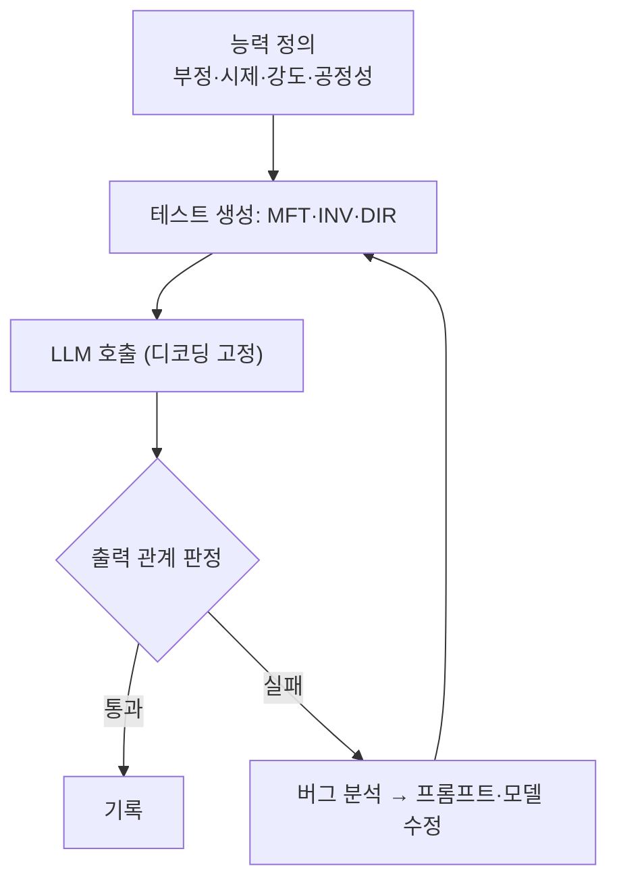
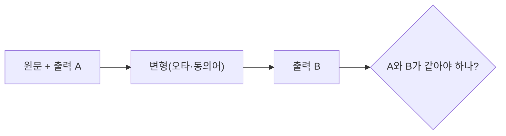

# LLM 행동 테스트

> CheckList의 행동 테스트(능력별 테스트 케이스)를 **생성형 언어 모델에 적용하는 방법**이다. 정답이 하나로 정해지지 않는 자유 서술 출력에서는 "정답과 같은가"보다 **입력을 바꿨을 때 출력이 지켜야 할 관계**(불변·방향성)를 점검하는 방식이 쓰인다.

## 쉽게 말하면
식당 직원 교육에서 "손님이 말투를 바꿔도 같은 주문을 받아야 한다"(불변), "손님이 '매운 맛 빼 주세요'라고 하면 덜 매워야 한다"(방향성)처럼 **상황을 바꿔 가며 행동 규칙을 지키는지 확인**하는 것이다. 정답표가 없어도 규칙만 있으면 점검할 수 있다.

## 자세히
(CheckList 논문 개요는 상위 노드에서 확인, 적용 사례는 Racharak 등의 MMT4NL(arXiv 2504.18827 v3, 2025-09) PDF를 직접 읽어 확인. 사용 모델 호출은 직접 하지 않았다.)
- **CheckList의 세 가지 테스트 유형(MMT4NL 논문의 설명)**: **MFT**(최소 기능 테스트: 특정 능력만 점검하는 간단한 사례), **INV**(불변 테스트: 의미를 바꾸지 않는 변형 후 출력이 같아야 함), **DIR**(방향성 기대 테스트: 변형 후 출력이 특정 방향으로 변해야 함, 예: 부정 표현을 덧붙이면 감성이 더 긍정이 되면 안 됨). INV와 DIR은 정답 라벨 없이 원문과 변형의 관계만 보면 된다.
- **LLM에 적용한 사례(MMT4NL)**: 원본 테스트 세트에서 **변형(metamorphic) 사례**를 만들어 프롬프트의 버그를 찾는다. 감성 분석과 질의응답에서 **GPT-4o와 Gemini-2.0-Flash**를 API로 호출해 시험했다. 결과: 원본 입력 정확도는 두 모델 86~94%, 변형 입력의 zero-shot 통과율은 GPT-4o 84~88%, Gemini-2.0-Flash 74~90%. GPT-4o는 분류 체계(Taxonomy)·견고성·시간 변형 항목에서 오류가 가장 많았고(50건 중 8건), Gemini는 시간 변형에서 13건이었다. 원샷·퓨샷 프롬프트로 통과율이 일부 올랐다. 구체 버그 예: 동작 동사를 바꾸면 실패율이 높았다(GPT-4o 7건 중 5건, Gemini 8건 중 5건 실패), "I'm really hungry"는 중립으로 맞혔다가 강도 수식어를 바꾸면 달라지는 식의 사례.
- **직접 계산(통계적 주의)**: 위 통과율은 항목당 50건 규모다. 50건 중 44건 통과(88%)의 95% Wilson 구간은 약 0.76~0.94, 37건(74%)은 약 0.60~0.84로 **GPT-4o와 Gemini의 차이는 구간이 크게 겹쳐 단정하기 어렵다**. 행동 테스트는 모델 순위가 아니라 **실패 사례 발견** 도구로 쓰는 편이 안전하다([작은 집단의 불확실성](#small-subgroup-uncertainty)의 논리와 같다).
- **생성형 모델 적용 시 설계(제안, 논문에서 직접 확인되지 않은 부분은 표시)**
  1. **출력을 비교 가능한 형태로 제한**: 정해진 라벨(긍정/중립/부정)이나 JSON 필드로 답하게 하거나 정규식·키워드 검사로 채점. 자유 서술은 판정 모델(LLM-as-judge)이나 사람 채점 필요(판정 자체도 검증 필요).
  2. **MFT**: 규칙을 정확히 알 수 있는 단순 문항(부정·시제·어휘 등) 대량 생성.
  3. **INV**: 오타·말투·동의어·이름 바꾸기(성별·국적 등 보호 속성 포함) 후 답이 같은지.
  4. **DIR**: 부정어·강도 수식어를 넣고 점수·태도가 기대 방향으로 변하는지.
  5. **비결정성**: 같은 입력도 샘플링에 따라 달라질 수 있으므로 **디코딩 설정(온도 등)을 고정**하고 필요하면 여러 번 호출해 통과 비율로 판정(이 부분은 확인한 논문에는 없음). 단일 호출 통과 확률이 0.9라면 5번 모두 통과할 확률은 0.59다(직접 계산).
  6. **프롬프트 버전별 결과를 저장**해 변경이 회귀를 만드는지 확인(소프트웨어 테스트의 회귀 테스트).
- **한계**: 변형 규칙을 자동 생성하면 의미가 달라진 비현실적 문장이 섞일 수 있다(논문도 오류 사례를 수동으로 점검했다고 적는다). 모델 버전이 자주 바뀌므로 수치는 날짜와 함께 기록한다.

## 그림으로 보기

## 예시
- 고객 문의 분류 LLM에 "환불해 주세요"를 오타("환불해 쥬세요"), 존댓말/반말로 바꿔 넣고 같은 분류가 나오는지(INV), "정말 화가 났다"를 추가하면 긴급도가 내려가지 않는지(DIR) 확인.
- 교육 소재: AI 도구 도입 때 "정확도 몇 %" 대신 "무엇이 바뀌면 무너지는가"를 묻는 체크리스트 만들기.

## 헷갈리는 것과 비교
| 개념 | 차이 |
|---|---|
| LLM 행동 테스트 | 변형 후 출력 관계를 점검 |
| [CheckList 행동 테스트](#checklist-behavioral-testing) | 방법론 원형(전통 NLP 모델 대상) |
| 벤치마크 평가 | 정해진 문제집의 평균 점수 |
| 레드팀 | 해로운 출력을 적대적으로 유도(목적이 다름) |

## 더 읽을거리
- [Test It Before You Trust It (arXiv 2504.18827)](https://arxiv.org/abs/2504.18827) — MMT4NL, GPT-4o·Gemini-2.0-Flash에 변형 테스트 적용(PDF 직접 확인).
- [Beyond Accuracy: Behavioral Testing of NLP Models with CheckList (arXiv 2005.04118)](https://arxiv.org/abs/2005.04118) — 원 논문(상위 노드에서 확인).
