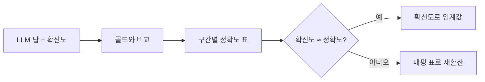
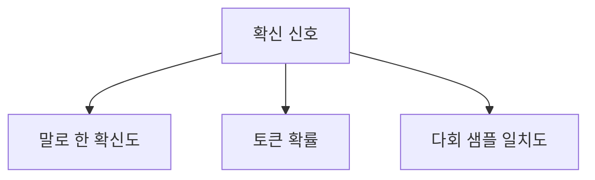

# LLM 확신도 보정

> LLM 확신도 보정은 LLM이 말하거나 내부적으로 갖는 "이 답이 맞을 확률"이 실제로 맞는 비율과 얼마나 일치하는지를 재고 맞추는 일이다. 보정이 잘 돼 있어야 확신도로 자동 확정과 사람 검수를 가를 수 있다.

## 쉽게 말하면
"90% 확실해요"라고 말하는 사람의 답이 실제로 10번 중 9번 맞아야 그 말을 믿고 쓸 수 있다. 말은 90%인데 6번만 맞으면 확신의 눈금이 틀린 저울이다.

## 자세히
- **연구 근거(Kadavath 외, Anthropic 2022, arXiv 2207.05221 초록)**: 큰 모델은 적절한 형식으로 제시된 다양한 객관식·참/거짓 문제에서 잘 보정돼 있다고 한다. P(True)는 모델이 개방형 질문에 답을 제안한 뒤 그 답이 맞을 확률을 스스로 추정하는 방식으로, 여러 과제에서 성능·보정·규모 확장성이 고무적이었고 자기 답을 판단하기 전에 자신이 낸 여러 샘플을 함께 고려하면 자기 평가가 좋아진다. P(IK)는 특정 답 없이 "이 질문의 답을 아는 확률"을 예측하도록 훈련한 것으로 성능이 좋고 일부 과제 간 일반화되지만 새 과제에서는 보정이 흔들린다. 관련 자료를 문맥에 주면 P(IK)가 적절히 올라간다. 이는 해당 모델·과제에서의 결과이며 라벨링 과제와 다른 모델에는 직접 확인이 필요하다(해석).
- **측정 방법(해석)**: 골드 라벨이 있는 표본에서 확신도 구간별(0.5~0.6, …, 0.9~1.0) 실제 정확도를 비교한다([신뢰도 다이어그램](#reliability-diagram), [ECE](#expected-calibration-error)). 말로 하는 확신도("90% 확실")와 토큰 확률, 여러 번 샘플링한 일치도([LLM 자기 일관성](#llm-self-consistency))를 각각 비교해 어떤 신호가 더 맞는지 본다.
- **보정이 안 맞을 때(해석)**: ① 골드에서 구간별 정확도로 매핑 표를 만들어 확신도를 다시 환산 ② 임계값을 확신도가 아니라 골드로 잰 정확도 곡선에서 정한다([위험-커버리지 트레이드오프](#risk-coverage-tradeoff)) ③ 프롬프트·모델이 바뀌면 다시 측정.
- **주의(해석)**: 확신도의 형식(숫자, 말, 토큰 확률)에 따라 보정 정도가 다르다. 한 번 맞았다고 다른 과제에도 맞는다고 믿지 않는다. 위 논문도 P(IK)가 새 과제에서 보정이 흔들린다고 한다.

## 그림으로 보기

## 예시
- 확신도 0.9~1.0이라고 한 라벨 200개 중 정답이 164개(82%)라면 "0.9 이상"은 실제 82%로 환산해서 쓴다(가정한 예).
- 교육 활용: 학습자가 구간별 표를 직접 만들고 확신도와 정확도의 차이를 그래프로 그린다.

## 헷갈리는 것과 비교
| 개념 | 차이 |
| --- | --- |
| 보정 | 확신도와 실제 정확도의 일치 |
| 정확도 | 맞춘 비율 |
| [신뢰도 다이어그램](#reliability-diagram) | 보정을 그리는 그래프 |
| [위험-커버리지 트레이드오프](#risk-coverage-tradeoff) | 보정된 확신도로 거절 기준 설정 |

## 더 읽을거리
- [Language Models (Mostly) Know What They Know (arXiv 2207.05221)](https://arxiv.org/abs/2207.05221) — P(True)·P(IK)와 보정
