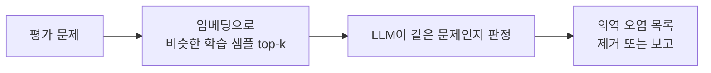
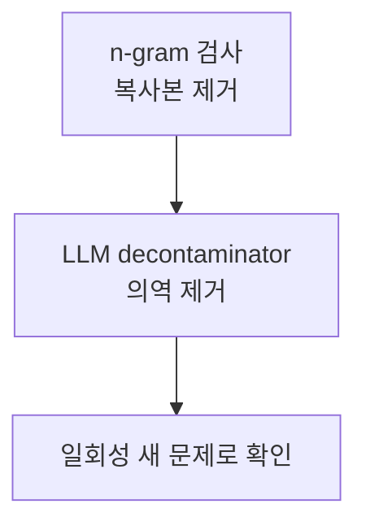

# LLM decontaminator

> LLM decontaminator는 학습 데이터에서 평가 문제와 뜻이 같은 샘플(의역·번역 포함)을 찾는 오픈소스 도구다. 평가 문제마다 비슷한 학습 샘플 후보를 먼저 찾고, 그 후보가 정말 같은 문제인지 LLM이 판정한다.

## 쉽게 말하면
감독관이 연습 문제집 수만 쪽을 훑는데, 시험 문제와 "비슷해 보이는 쪽"을 먼저 몇 개 골라 놓고, 똑똑한 조교에게 "이 쪽이 시험 문제를 말만 바꾼 것 맞나요?"라고 물어 확인하는 방식이다. 글자 비교는 못 잡는 바꿔 쓴 문제를 조교가 이해해서 잡는다.

## 자세히
- **출처와 목적(lm-sys/llm-decontaminator 저장소 README, 열람)**: "Rethinking Benchmark and Contamination for Language Models with Rephrased Samples" 논문의 도구로, 데이터셋 안에 벤치마크의 의역 샘플이 얼마나 있는지 계량하고 제거하게 한다.
- **구조(해석, README는 세부를 설명하지 않음)**: 파일 이름(`vector_db.py`, `llm_detect.py`)과 `--top_k` 옵션으로 보아 임베딩 검색으로 상위 k개 후보를 뽑고 LLM이 판정하는 2단계로 추정된다. README는 임베딩 모델이나 판정 LLM을 명시하지 않으며, `OPENAI_API_KEY` 설정 안내로 보아 OpenAI 모델을 쓰는 듯하지만 확인하지 못했다.
- **사용 순서(README)**: ① Python 3.9 환경에 `pip install -r requirement.txt` ② 학습·평가 세트를 한 줄에 `{"text": ...}`인 JSONL로 변환 ③ `main.py`에 `--train_path`, `--test_path`, `--output_path`, `--data-type`, `--top_k`를 지정해 실행 ④ `f1score/` 스크립트로 MMLU·HumanEval 결과 재현. 이 글에서 직접 설치·실행하지는 않았다.
- **발견된 오염(README 표, 열람)**: HumanEval과의 의역 겹침은 The Stack 4G 부분집합 18.9%, StarCoder-Data 15.9%, CodeExercise-Python 15.9%, CodeAlpaca 12.8%, RedPajama 16G 부분집합 8.5%, Evol-Instruct-Code 7.9%. MATH 테스트와의 겹침은 MathInstruct 약 15%(표가 잘려 정확치는 확인 못 함), MATH 학습 세트 1.6%. MMLU 관련 데이터는 0.5% 수준이었다. 코드·수학 데이터가 MMLU 관련 데이터보다 훨씬 오염이 많았다.
- **한계(해석)**: LLM 판정은 비용이 들고 판정 자체가 틀릴 수 있다. 그래서 n-gram 검사로 명백한 복사를 먼저 거르고 이 도구는 남은 후보에 쓰는 편이 효율적이다([n-gram 겹침 검사](#ngram-overlap-test)).

## 그림으로 보기

## 예시
- 코드 모델을 학습하기 전에 HumanEval을 `test`, 학습 코드를 `train`으로 지정해 의역 겹침이 몇 %인지 측정하고 그 샘플을 뺀다.
- 교육 활용: README의 표를 보고 "어느 종류 데이터가 왜 더 오염됐을까"를 토론한다.

## 헷갈리는 것과 비교
| 개념 | 차이 |
| --- | --- |
| [n-gram 겹침 검사](#ngram-overlap-test) | 문자열, 빠르고 싸지만 의역 놓침 |
| LLM decontaminator | 의미 판정, 비용 큼 |
| [의미적 중복 제거](#semantic-deduplication) | 임베딩 거리만으로 판단 |
| [의역 샘플 오염](#rephrased-sample-contamination) | 이 도구가 대응하는 문제 |

## 더 읽을거리
- [lm-sys/llm-decontaminator](https://github.com/lm-sys/llm-decontaminator) — 사용법과 오염 비율 표
- [논문 (arXiv 2311.04850)](https://arxiv.org/abs/2311.04850) — 의역 오염의 영향
