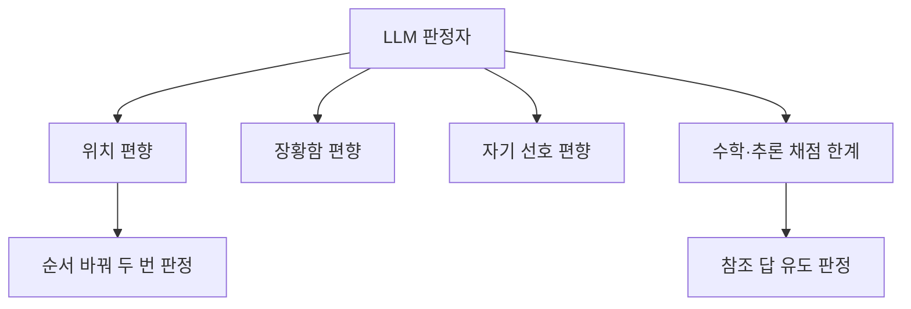

# LLM 평가자 편향

> LLM에게 답변을 채점시킬 때 나타나는 **위치 편향·장황함 편향·자기 선호 편향·수학/추론 채점 한계**다. 사람 표본과 대조하고 완화책을 함께 써야 한다.

## 쉽게 말하면
심사위원이 첫 번째로 본 작품을 더 좋게 보거나, 말이 긴 작품에 점수를 더 주거나, 자기가 만든 작품에 후하거나, 수학 문제를 직접 못 풀면서 채점하는 것과 같다. 이런 습관을 알고 점수를 해석해야 한다.

## 자세히
(Zheng 외, "Judging LLM-as-a-Judge with MT-Bench and Chatbot Arena"(NeurIPS 2023 Datasets & Benchmarks, arXiv 2306.05685 v4) PDF를 직접 읽었다. 2023년 GPT-4·Claude-v1·GPT-3.5 기준이며 지금 모델은 다를 수 있다.)
- **위치 편향(논문)**: 판정자가 특정 **위치**의 답을 선호. 비슷한 두 답의 순서를 바꿔도 같은 결론을 내는 **일관성**을 재면 대부분의 판정자가 첫 번째를 선호하며 **일관성이 60%를 넘는 것은 GPT-4뿐**.
- **장황함 편향(논문)**: 더 길고 장황한 답을 선호. "반복 리스트 공격"(목록을 바꿔 쓴 중복 항목을 앞에 붙임, 23개 답)에서 판정자 실패율은 **Claude-v1 91.3%, GPT-3.5 91.3%, GPT-4 8.7%**.
- **자기 선호 편향(논문)**: 사람 대비 GPT-4는 자기에게 **승률 10%p**, Claude-v1은 **25%p** 높게 줬다. 그러나 다른 모델도 선호했고 GPT-3.5는 자기 선호가 없었다. 저자들은 **데이터가 적고 차이가 작아 편향 여부를 단정할 수 없다**고 한다.
- **수학·추론 채점 한계(논문)**: GPT-4가 풀 수 있는 기초 수학도 채점을 틀리는 경우.
- **완화책(논문)**: ① **위치 바꿔 두 번 판정**해 두 순서에서 모두 우세할 때만 승리, 불일치는 무승부(보수적) 또는 위치 무작위화 ② **few-shot 판정자** — GPT-4 일관성 **65.0%→77.5%**지만 정확도가 오른 것은 아니고 프롬프트가 길어져 호출 비용 **4배** ③ **CoT·참조 답 유도 판정자**: 판정자가 먼저 독립적으로 답을 만든 뒤 참조로 제시. 수학 10문제 실패율 **70%→15%**. CoT만으로는 판정자가 주어진 답과 같은 실수를 반복하는 경우 있음.
- **사람과의 일치(논문)**: MT-bench에서 GPT-4와 사람 전문가의 비동점 일치율 **85%**, 사람끼리는 **81%**. 사람과 GPT-4가 갈릴 때 사람이 GPT-4 판단을 합리적이라 본 경우 **75%**, 입장을 바꾼 경우 **34%**. 이 때문에 "확장 가능한 평가 방법"으로 제안한다.
- **다중 턴(논문)**: 두 턴을 두 프롬프트로 나누면 판정자가 이전 응답을 정확히 찾지 못해 오판하는 사례가 있어 **전체 대화를 한 프롬프트에** 보이는 방식이 낫다.

## 그림으로 보기

## 예시
- 사내 챗봇 두 버전을 비교할 때 A/B 순서를 바꿔 두 번 채점하고, 둘 다에서 이긴 경우만 승리로 센다(논문 방식, 제안).
- 수학·계산 문제는 판정자가 먼저 풀게 한 뒤 참조 답과 비교(논문 방식).

## 헷갈리는 것과 비교
| 편향 | 증상 | 완화 |
|---|---|---|
| 위치 | 첫 번째/특정 위치 선호 | 순서 교환 |
| 장황함 | 긴 답 선호 | 길이 통제, 강한 판정자 |
| 자기 선호 | 자기 모델 선호 | 다른 모델·사람 표본 |
| [판정 프롬프트 버전](#judge-prompt-versioning) | 판정 도구 관리 |

## 더 읽을거리
- [Zheng et al. (2023) — Judging LLM-as-a-Judge](https://arxiv.org/abs/2306.05685) — 직접 읽음.
