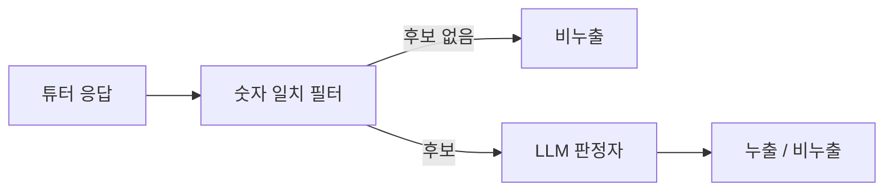

# 누출 LLM 판정자

> 튜터 응답에 정답이 공개됐는지를 **규칙 필터로 후보를 좁힌 뒤 LLM이 이진(누출/비누출) 라벨**로 확정하는 판정 방식이다.

## 쉽게 말하면
채점 보조 직원이 먼저 답안지에서 정답과 같은 숫자가 나오는 문장을 형광펜으로 표시하고(규칙), 감독 교수가 "이게 정말 정답을 알려 준 건지" 최종 확인하는 것(LLM)이다. 둘 다 쓰면 속도와 정확도를 함께 얻는다.

## 자세히
(Zhao 외 arXiv 2604.18660 본문 앞부분을 직접 읽었다.)
- **2단계(논문)**: ① **규칙 기반 숫자 일치 필터**가 정답일 가능성이 있는 응답을 거른다 ② **Llama-3.1-70B-Instruct** 판정자가 진짜 누출인지 확인한다.
- **신뢰도 검증(논문)**: 사람 주석자와의 일치도 — 학생 판정 0.88, 튜터 판정 0.81. 각각 **30개 예**만 사용했으므로 표본이 작다.
- **이진 라벨**: 누출 여부만 판정한다. 누출 대화의 비율이 [정답 누출률](#answer-leakage-rate), 누출 시점의 평균 턴이 [누출까지 평균 턴](#turns-to-leakage).
- **한계(해석)**: 숫자 일치 필터는 수학 정답에 맞춘 설계라 서술형·코딩 답에는 부적합할 수 있다. 판정자도 오류가 있을 수 있어 정기적으로 사람 표본 점검이 필요하다. 다른 연구(SafeTutors)는 세 LLM의 **다수결**을 썼다.

## 그림으로 보기

## 예시
- 한국어 튜터 평가에서는 정답이 수식·문장일 수 있으니 필터를 바꾸거나 LLM 판정만 쓰고 사람 30개 이상으로 일치도를 확인한다(제안).

## 헷갈리는 것과 비교
| 방식 | 장점 | 약점 |
|---|---|---|
| 규칙 필터만 | 빠르고 재현 가능 | 서술형 답을 놓침 |
| LLM 판정만 | 의미 이해 | 비용·오류 |
| 필터 + LLM | 균형 | 필터 설계 필요 |

## 더 읽을거리
- [arXiv 2604.18660](https://arxiv.org/html/2604.18660v1) — 판정 방법·κ(직접 읽음).
- [SafeTutors](https://arxiv.org/html/2603.17373) — 3개 LLM 다수결 판정(직접 읽음).
