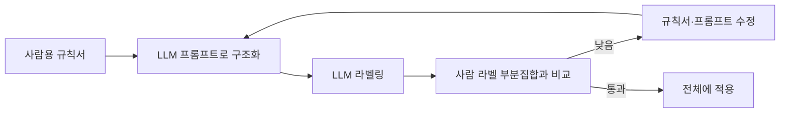
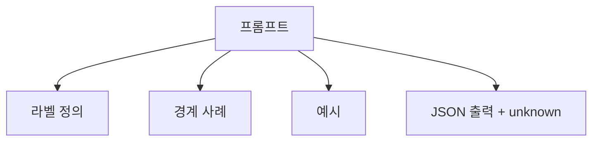

# LLM 라벨러 프롬프트

> 사람 라벨러를 위해 만든 규칙서를 LLM이 따를 수 있는 구조화된 지시(프롬프트)로 옮겨, LLM이 데이터를 라벨링하게 하는 방법이다. 사람이 라벨링한 일부로 검증하는 절차가 함께 필요하다.

## 쉽게 말하면
신입 라벨러에게 규칙서를 주고 시범 라벨링을 시켜 본 뒤 틀린 곳을 알려 주는 과정을, 신입 대신 LLM에게 똑같이 하는 것이다. 규칙서가 모호하면 사람도 LLM도 헷갈린다.

## 자세히
(arXiv 초록 2건을 직접 열어 확인, 나머지는 검색 결과 요약.)
- **규칙서 재활용 연구(arXiv 2510.12835)**: 사람용 규칙서를 LLM 중재(moderation) 과정으로 명시적·구조화된 지시로 바꾸는 "moderation-oriented" 방법. NCBI Disease Corpus(생의학 텍스트)에서 재활용한 규칙서가 LLM 라벨러를 효과적으로 이끌었고, 실무적 어려움도 드러났다고 보고.
- **정제·재사용 연구(arXiv 2605.20809)**: 초기 라벨링 프로젝트 단계를 흉내 내는 반복적 중재 프레임워크. 생의학 NER 데이터 3종(NCBI Disease, BC5CDR, BioRED)과 GPT·Gemini·DeepSeek 계열 모델 3종에서 세 가설(규칙서 통합이 돕는다, 추론 최적화 모델이 유리하다, 최소 감독으로도 중재가 가능하다)이 지지됐으나 개선 여지가 크다고 밝혔다. 초록에 성능 수치는 없다.
- **검색 결과의 다른 연구(미확인 수치)**: 반복 정제된 규칙서가 일회성 규칙서보다 LLM-사람 일치도(카파)를 0.1~0.5 높였다는 보고가 있으나 원문을 열어 확인하지 못했다. few-shot 효과는 과제별로 일관적이지 않다는 서베이 요약도 있다.
- **프롬프트 구성(제안)**: ① 과제 목적 ② 라벨 정의(포함·제외 기준) ③ 경계 사례 결정([경계 사례 기록](#guideline-edge-case-log)) ④ 대표 예시 ⑤ 출력 형식(JSON)과 "불확실하면 unknown" 허용.
- **검증(제안·검색 결과 권고)**: 사람이 라벨링한 부분집합에서 LLM의 일치도를 먼저 재고, 통과하면 나머지에 적용. 일치도가 낮은 라벨은 규칙서를 고치고 재시도.
- 한계: 사례가 생의학 NER에 치우쳐 있어 다른 도메인으로 일반화될지는 불확실.

## 그림으로 보기



## 예시
```text
당신은 고객 문의 분류 라벨러입니다. 라벨: 문의/불만/칭찬/기타.
- 질문과 불만이 함께 있으면 '문의'를 우선한다(규칙 E-014).
- 판단이 어려우면 "unknown".
출력: {"label": "...", "reason": "한 줄"}
```
- 사람 100건으로 일치도 확인 후 2만 건에 적용, 일치도 낮은 라벨만 사람이 재검수.

## 헷갈리는 것과 비교
| 개념 | 차이 |
|---|---|
| LLM 라벨러 | 규칙서를 따르는 모델이 라벨링 |
| 사람 라벨러 | 규칙서 학습 후 직접 라벨링 |
| [경계 사례 기록](#guideline-edge-case-log) | 프롬프트에 넣을 결정 모음 |
| [이중 라벨링과 판정](#double-annotation-adjudication) | LLM을 한 명의 라벨러로 두고 판정 가능 |

## 더 읽을거리
- [Repurposing Annotation Guidelines to Instruct LLM Annotators (arXiv 2510.12835)](https://arxiv.org/abs/2510.12835) — 초록 확인.
- [Refining and Reusing Annotation Guidelines for LLM Annotation (arXiv 2605.20809)](https://arxiv.org/abs/2605.20809) — 초록 확인.
