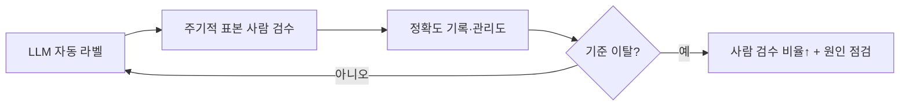
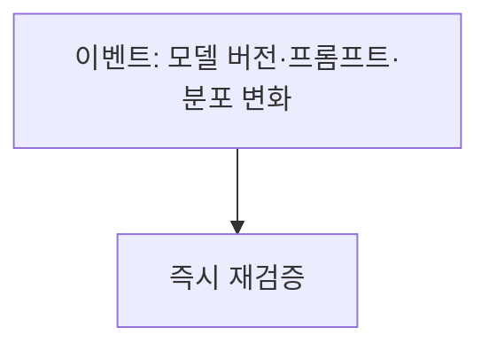

# LLM 라벨 사후 점검 주기

> LLM 라벨러를 도입해 자동 라벨링을 시작한 뒤에도 주기적으로 표본을 사람이 검수해 정확도가 유지되는지 재확인하는 일이다. 모델 버전·프롬프트·입력 분포가 바뀌면 처음 검증한 정확도가 더 이상 맞지 않을 수 있기 때문이다.

## 쉽게 말하면
신입 직원이 처음 한 달 평가를 통과했다고 그 뒤로 점검을 안 하지 않는다. 정기적으로 일부 업무를 확인해야 어느 날 실력이 떨어졌을 때 알아챈다.

## 자세히
- **감시 원리(Wikipedia, Control chart·CUSUM)**: 기준선과 한계선을 정하고 이탈을 규칙으로 감시하며, 3σ 한계에서도 약 370점마다 우연 신호가 난다. 정상일 때 ARL은 오경보, 이상일 때 ARL은 탐지 지연이다. 자세한 도구는 [라벨링 관리도](#control-chart-for-labeling), [누적합(CUSUM) 감시](#cusum-for-agreement)에 있다.
- **직접 시뮬레이션(기준 정확도 0.90, 0.85로 하락, 주당 사람이 검수하는 표본 수 n, 경보 기준은 한 주 표본 정확도가 0.90 − 2σ 미만, 각 3,000회)**:

| 주당 검수 표본 | 경보 기준 | 정상일 때 오경보(주당) | 0.85로 하락 시 그 주에 경보 |
| --- | --- | --- | --- |
| 50 | 0.815 | 0.025 | 0.210 |
| 100 | 0.840 | 0.042 | 0.426 |
| 200 | 0.858 | 0.027 | 0.594 |
| 400 | 0.870 | 0.022 | 0.856 |

  정확도가 5%p 떨어지는 변화는 주 50~100개 표본으로는 한 주에 잡을 확률이 21~43%뿐이다. 주 400개면 86%다. 한 달치(400개)를 모아서 한 번에 평가해도 감지 0.852·오경보 0.023으로 비슷하다. 점검 주기를 길게 잡는다면 표본을 모아 한 번에 크게 보는 방식이 유리하고, 짧게 잡으려면 표본이 작아도 누적(CUSUM)·이동 평균으로 보완한다. (가정한 시뮬레이션이다.)
- **점검 일정(해석)**: ① 적용 직후에는 점검 표본을 늘리고(초기 몇 주) 안정되면 줄인다([신규 라벨러 투입 시 이중 비율](#new-annotator-onboarding-ratio)과 같은 원리) ② 모델 버전 변경·프롬프트 개정·입력 분포 변화가 있을 때는 정해진 주기와 상관없이 즉시 재검증 ③ 점검 표본은 무작위 + 확신도 낮은 구간을 더 뽑는 층화([품질 표본 추출 계획](#quality-sampling-plan)) ④ 결과는 대시보드·관리도에 기록하고([주간 일치도 대시보드](#weekly-agreement-dashboard)) 기준 이탈 시 사람 검수 비율을 올린다([재보정 조건](#recalibration-trigger)).
- **주의(해석)**: 점검용 사람 라벨도 완벽하지 않다. 점검 표본을 이중 검수하고 기준을 보수적으로 둔다. 보류 세트로 개발에 쓴 샘플은 점검에서 재사용하지 않는다([프롬프트 튜닝용 보류 세트](#holdout-set-for-prompt-tuning)).

## 그림으로 보기

## 예시
- 주 200개 표본, 기준 정확도 0.90, 한 주 표본 정확도가 0.858 미만이면 경보. 모델 버전이 바뀌면 그 주 표본을 400개로 늘린다.
- 교육 활용: 표본 수별 감지 확률 표를 직접 시뮬레이션해 보고 팀의 검수 예산을 정한다.

## 헷갈리는 것과 비교
| 개념 | 차이 |
| --- | --- |
| 사후 점검 주기 | 도입 후 정기적 재검증 |
| [LLM 라벨러 검증 표본](#llm-labeler-validation-subset) | 도입 전 정확도 검증 |
| [라벨링 관리도](#control-chart-for-labeling) | 감시 규칙 |
| [탐지 지연과 비용](#detection-delay-tradeoff) | 점검 투자와 지연의 교환 |

## 더 읽을거리
- [Control chart (Wikipedia)](https://en.wikipedia.org/wiki/Control_chart) — 한계선과 오경보 간격
- [CUSUM (Wikipedia)](https://en.wikipedia.org/wiki/CUSUM) — ARL과 작은 변화 탐지
