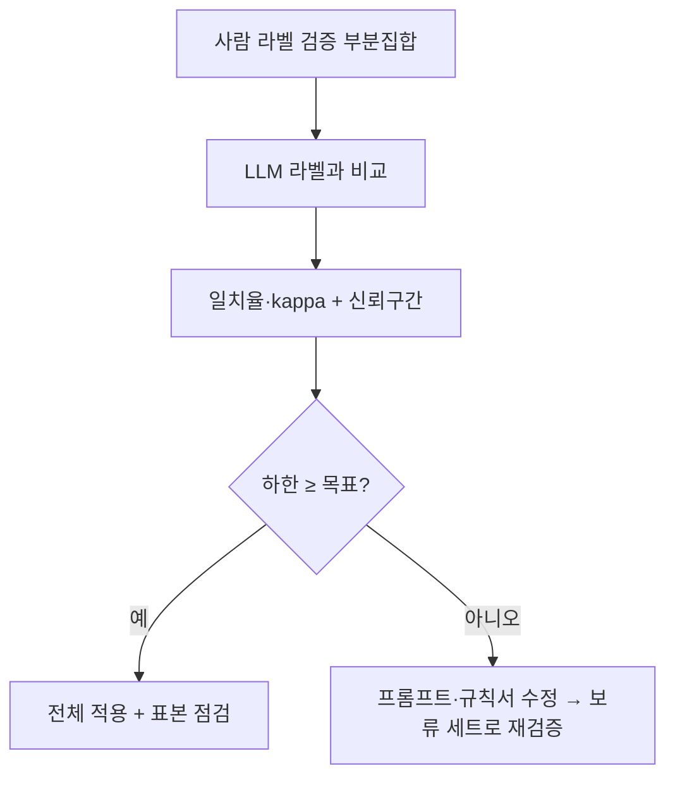
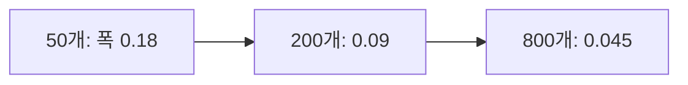

# LLM 라벨러 검증용 부분집합

> LLM에게 대량 라벨링을 맡기기 전에 **사람이 라벨한 작은 부분집합에서 LLM의 일치도를 재고**, 목표에 신뢰구간까지 넘으면 전체에 적용하는 절차다. 부분집합이 작으면 일치도 추정이 흔들려 "통과/실패" 판정을 믿을 수 없다.

## 쉽게 말하면
신입 직원에게 일을 통째로 맡기기 전에 사람이 검수한 시험 문제 몇십~몇백 개를 풀게 해 보는 것이다. 문제 수가 너무 적으면 운이 좋아 합격했는지 실력인지 알 수 없다.

## 자세히
- **근거 연구**: Gilardi 등(arXiv 2303.15056 초록 확인)은 트윗 2,382개에 대한 다섯 주석 과제(관련성·입장·주제·프레임 등)에서 제로샷 ChatGPT가 크라우드워커보다 5개 과제 중 4개에서 정확했고, 자기 일관성(여러 번 돌릴 때 일치)이 크라우드워커·훈련된 주석자보다 높았으며, 주석당 비용이 0.003달러 미만으로 MTurk의 약 1/20이라고 보고했다(저자 보고, 해당 과제·모델·시점 한정). 그러나 도메인·규칙서가 달라지면 결과가 달라지므로 **내 과제에서 직접 검증**해야 한다.
- **절차(제안)**
  1. 사람이 라벨(필요하면 [판정](#adjudicator-role)까지)한 **검증 부분집합**을 만든다. 본 데이터에서 무작위로, 클래스 분포를 대표하게.
  2. LLM 프롬프트([LLM 라벨러 프롬프트](#llm-labeler-guideline-prompt))로 같은 항목을 라벨.
  3. LLM-사람 일치율·kappa, 클래스별 혼동을 계산하고 [낮은 일치도 진단](#low-agreement-diagnosis)을 적용.
  4. 목표(예: 일치율 0.85)와 **신뢰구간 하한**을 비교해 통과 여부 판단.
  5. 통과하면 전체에 적용하되 [표본 이중 라벨링](#sampled-double-annotation) 방식의 사후 점검을 유지.
  6. 개발에 쓴 검증 항목은 프롬프트 튜닝 후에는 **보류 세트**로 분리해 과적합을 방지(프롬프트를 검증 항목에 맞춰 고치면 점수가 부풀려진다).
- **직접 계산(95% Wilson 신뢰구간, 관측 일치율 0.88일 때)**: 검증 30개 0.703~0.947(폭 0.244), 50개 0.762~0.944, 100개 0.802~0.930, 200개 0.828~0.918, 400개 0.844~0.908, 800개 0.856~0.901(폭 0.045).
- **판정 규칙의 검출력(시뮬: "신뢰구간 하한 ≥ 0.85면 통과")**: 실제 일치율 0.88이면 통과 확률이 검증 50개 5%, 200개 24%, 800개 69%. 실제 0.92면 50개 22%, 200개 88%, 800개 100%. 실제 0.85 이하이면 통과 확률은 거의 0(오통과를 막음). 즉 **목표보다 약간 높은 정도의 LLM은 검증 세트가 수백 개 이상이어야 통과로 확인**된다. 하한 기준은 보수적이며 비용과 위험에 맞춰 조정한다.
- **함정**: 검증 항목이 쉬운 샘플만 포함, 클래스 불균형(희귀 클래스는 항목이 적어 추정 불안정), 사람 라벨의 노이즈(사람 쪽 기준이 틀리면 LLM 평가도 틀린다), 시간이 지나 모델·가이드가 바뀌면 재검증 필요.

## 그림으로 보기

## 예시
- 고객 문의 분류를 LLM에게 맡기기 전, 전문가가 라벨한 300건에서 일치율 0.91(하한 0.87)을 확인하고 전체 5만 건에 적용, 매주 100건을 사람이 재검수.
- 교육: AI 도입 시 "작은 시험 → 신뢰구간 → 확대"라는 검증 절차 설명.

## 헷갈리는 것과 비교
| 개념 | 차이 |
|---|---|
| 검증 부분집합 | LLM의 라벨 품질을 재는 사람 라벨 세트 |
| 프롬프트 개발 세트 | 프롬프트를 고치는 데 쓰는 항목(보류 세트와 분리) |
| [골든 문항](#golden-items) | 크라우드 작업자 점검용 정답 문항 |
| [목표 일치도](#target-agreement-setting) | 통과 기준 |

## 더 읽을거리
- [ChatGPT Outperforms Crowd-Workers for Text-Annotation Tasks (arXiv 2303.15056)](https://arxiv.org/abs/2303.15056) — 정확도·자기 일관성·비용 비교(초록 확인).
- [Repurposing Annotation Guidelines to Instruct LLM Annotators (arXiv 2510.12835)](https://arxiv.org/abs/2510.12835) — 규칙서를 LLM 지시로 전환(초록 확인).
