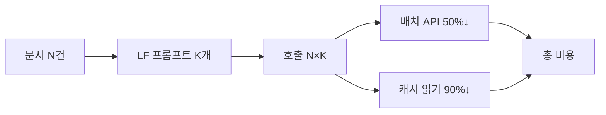
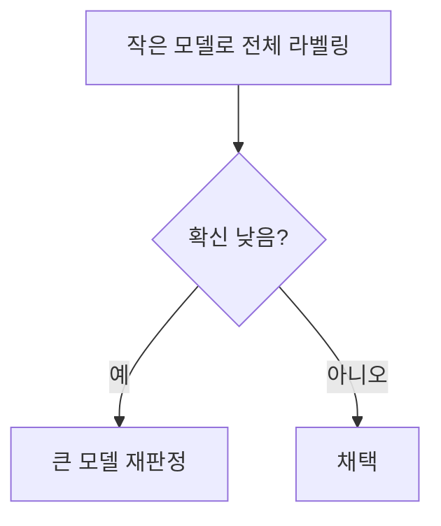

# LLM LF 비용과 지연

> LLM을 라벨링 함수(LF)로 쓰면 **데이터 수 × 프롬프트 수만큼 호출**이 일어나므로 비용과 시간이 빠르게 커진다. 모델 크기 선택, 배치 API, 프롬프트 캐시로 관리한다.

## 쉽게 말하면
전문 번역가에게 문서 10만 장을 5번씩 읽히면 청구서가 상당하다. 그래서 쉬운 문서는 값싼 번역가에게, 급하지 않은 일은 야간 대량 처리 요금제로, 반복되는 지시문은 미리 외워 둔 요금으로 처리해 비용을 줄인다.

## 자세히
(Anthropic 가격 문서 platform.claude.com 2026-11-22 확인본을 직접 열었고, 총액은 직접 계산. 가격은 자주 바뀐다. 비용은 Anthropic 가격 기준이며 다른 제공사는 확인하지 않았다.)
- **호출 수**: 호출 수 = 데이터 N × LF(프롬프트) 수 K. 10만 건에 LF 5개면 **50만 호출**이다. [LLM을 라벨링 함수로](#llm-as-labeling-function)는 같은 LLM의 여러 프롬프트를 LF로 합친다.
- **가격표(문서, $/백만 토큰)**
  | 모델 | 입력 | 출력 | 배치 입력/출력 | 캐시 읽기 |
  |---|---|---|---|---|
  | Claude Haiku 5.5(프롬프트 10만 토큰 이하) | 0.10 | 0.50 | 0.05 / 0.25 | 0.01 |
  | Claude Sonnet 5.5 | 2 | 10 | 1 / 5 | 0.10 |
  | Claude Opus 5.5 | 4 | 20 | 2 / 10 | 0.20 |
  - **배치 API**: 비동기 처리로 입력·출력 모두 50% 할인(문서). 캐시 할인과 **함께 적용**된다고 문서가 설명한다.
  - **프롬프트 캐시**: 5분 캐시 쓰기는 입력가의 1.25배, 캐시 읽기는 모델에 따라 0.1배(Sonnet 5.5·Opus 5.5는 0.05배). 한 번 읽으면 5분 캐시 쓰기 비용을 회수한다고 문서가 설명한다. 어떤 길이부터 캐시가 되는지(최소 길이) 조건은 이번에 확인하지 못했다.
  - 새 토크나이저(Claude 4.7 이후 모델)는 같은 글에 약 30% 더 많은 토큰을 만든다고 문서가 밝힌다 — 한국어 비용을 예상할 때 토큰 수를 직접 세어 본다.
- **직접 계산(가정: 10만 건 × LF 5개, 호출마다 문서 300토큰 + 공통 지시문 500토큰 + 출력 20토큰)**
  | 모델 | 표준 | 배치 | 지시문 캐시 읽기 | 배치+캐시 |
  |---|---|---|---|---|
  | Haiku 5.5 | $45 | $22.5 | $22.5 | $11.2 |
  | Sonnet 5.5 | $900 | $450 | $425 | $212.5 |
  | Opus 5.5 | $1,800 | $900 | $850 | $425 |
  모델 선택만으로 40배, 배치+캐시로 추가 4배 가까이 차이가 난다. 캐시 쓰기 첫 호출 비용은 무시했다. 모델이 작을수록 정확도가 낮을 수 있으므로 비용만 보고 고르지 않는다(개발 세트로 LF별 정확도 측정, [합친 라벨 검증](#label-model-validation)).
- **지연**: 배치는 즉시 응답이 아니므로 대화형 사전 라벨링에는 맞지 않고 오프라인 대량 라벨링에 맞는다. 배치 처리 시간 보장은 이번에 확인하지 못했다. 속도 한도는 사용 등급(Start/Build/Scale)에 따라 다르다고 문서가 안내한다.
- **절감 전략(제안)**: ① 값싼 모델로 먼저 전체를 돌리고 불확실한 것만 큰 모델 ② 같은 문서를 여러 프롬프트에 쓸 때는 공통 부분을 앞에 두어 캐시 ③ [약한 LF 제거](#lf-pruning)로 쓸모없는 프롬프트 줄이기 ④ 중복 문서를 먼저 제거 ⑤ 출력은 짧은 라벨만 받기 ⑥ 비용 상한 경보와 소규모 시험 실행으로 먼저 단가 확인.

## 그림으로 보기

## 예시
- 상담 문의 10만 건을 감정·긴급도·주제 3개 LF로 라벨링: 작은 모델 배치 호출로 1,000건만 먼저 시험 실행해 실제 토큰 수와 단가를 확인한 뒤 전체 실행.
- 교육 소재: "LLM 호출 수 = 데이터 × 프롬프트"라는 공식을 가격표와 함께 계산하는 실습.

## 헷갈리는 것과 비교
| 개념 | 차이 |
|---|---|
| LLM LF 비용·지연 | 호출 수가 곱해져 커지는 비용 관리 |
| [LLM을 라벨링 함수로](#llm-as-labeling-function) | 프롬프트를 LF로 쓰고 합치는 방법 |
| [약한 LF 제거](#lf-pruning) | 쓸모없는 LF를 빼 호출 수 줄임 |
| [LLM 라벨러 프롬프트](#llm-labeler-guideline-prompt) | 지침을 프롬프트로 쓰는 법 |

## 더 읽을거리
- [Claude 가격 문서](https://platform.claude.com/docs/en/about-claude/pricing) — 모델별 가격, 배치 50% 할인, 캐시 배수(2026-11-22 직접 확인).
