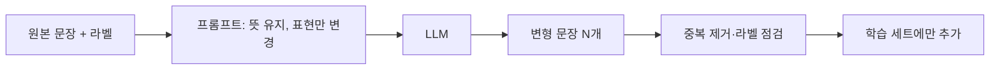
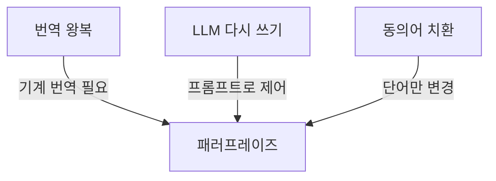

# LLM 패러프레이즈 증강

> 번역 모델 대신 LLM에게 "뜻은 그대로, 표현만 바꿔 다시 써 줘"라고 시켜 학습 문장을 여러 개로 늘리는 텍스트 증강 기법이다. 라벨이 적은 분류 문제에서 특히 쓴다.

## 쉽게 말하면
고객 문의 예문이 10개뿐일 때, 말 잘하는 조수에게 "이 문장을 말투만 바꿔 5가지로 다시 써 줘"라고 부탁하는 것과 같다. 번역 왕복은 정해진 기계가 돌려 쓰지만, LLM은 지시(프롬프트)로 말투·길이·난이도를 조절할 수 있다.

## 자세히
(arXiv 초록 2건을 직접 열어 확인. 초록에는 구체 수치가 없다.)
- **AugGPT(arXiv 2302.13007)**: ChatGPT로 학습 문장 하나를 의미는 같고 표현이 다른 여러 문장으로 다시 쓰고, 이를 하위 모델 학습에 쓴다. 소량 라벨 텍스트 분류(few-shot)가 대상이다. 저자 주장: 기존 증강법보다 정확도와 증강 샘플 분포가 낫다.
- **사전학습 모델 조건부 증강(Kumar 외, arXiv 2003.02245)**: GPT-2·BERT·BART에 라벨을 문장 앞에 붙여 새 문장을 생성. 세 벤치마크의 저자원 설정에서 BART(seq2seq)가 다른 증강법보다 낫다고 보고. 다양성과 라벨 보존 정도가 모델마다 다르다고 분석.
- **절차(제안)**: ① 프롬프트로 N개 변형 생성 ② 원문과 너무 비슷한 것·중복 제거 ③ 라벨이 유지되는지 표본 점검 ④ 원본 단위로 학습/시험을 먼저 나눈 뒤 학습 쪽에만 추가.
- **위험(제안)**: LLM이 의미를 바꾸거나 부정문을 뒤집음, 말투가 모델 특유 문체로 쏠림(다양성 부족), 시험 세트와 닮은 문장이 섞이는 누수([증강본 그룹 누수](#augmentation-group-leak)).

## 그림으로 보기

## 예시
- 프롬프트: "다음 문의를 의도는 그대로 두고, 5가지 말투로 다시 써 줘. 각 줄에 하나씩.\n배송이 너무 늦어요"
- 교육 활용: 라벨 10개 → 증강 50개로 분류기 정확도가 어떻게 달라지는지 비교하는 실습.

## 헷갈리는 것과 비교
| 개념 | 차이 |
|---|---|
| LLM 패러프레이즈 | 기존 문장을 다시 쓰기. 라벨 유지가 목표 |
| [합성 데이터](#synthetic-data) | 새 문장을 처음부터 생성(라벨도 함께) |
| [번역 왕복](#back-translation) | 번역 모델로 우회해 다시 쓰기 |

## 더 읽을거리
- [AugGPT (arXiv 2302.13007)](https://arxiv.org/abs/2302.13007) — ChatGPT로 few-shot 텍스트 분류 증강.
- [Data Augmentation using Pre-trained Transformer Models (arXiv 2003.02245)](https://arxiv.org/abs/2003.02245) — GPT-2·BERT·BART 비교.
