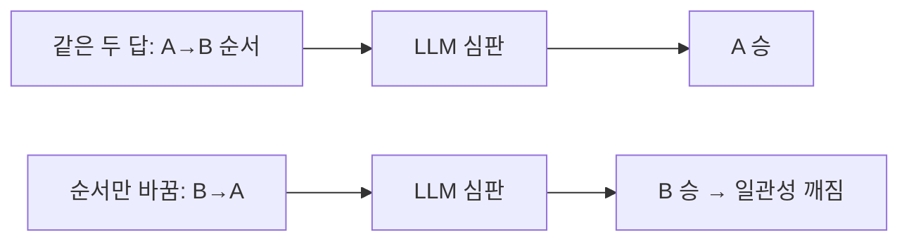
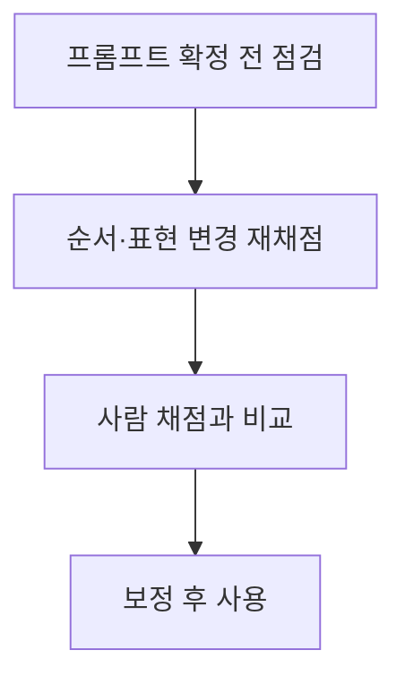

# LLM 채점 일관성

> LLM에게 문서나 답변을 채점시킬 때 **같은 입력이어도 순서·표현·길이에 따라 점수가 흔들릴 수 있다.** 그래서 프롬프트를 확정하기 전에 일관성을 점검하고, 사람 채점과 비교해 보정한다.

## 쉽게 말하면
심사위원이 같은 답안을 "첫 번째로 볼 때"와 "두 번째로 볼 때" 다른 점수를 주고, 글이 길면 더 후하게 준다면 심사 결과를 그대로 믿을 수 없다. 흔들림을 재 보고 기준을 다듬어야 한다.

## 자세히
- 출처: Zheng 외, *Judging LLM-as-a-Judge with MT-Bench and Chatbot Arena*(arXiv 2306.05685, 본문 읽음). 초록: 강한 LLM 심판(GPT-4)은 통제·크라우드소싱 인간 선호와 **80% 넘게 일치**했고 이는 사람끼리의 일치 수준과 같다고 보고한다. 동시에 **위치 편향·장황함 편향·자기 선호 편향과 제한된 추론 능력** 같은 한계를 조사하고 완화책을 제안한다.
- **위치 편향**: 두 답변의 순서를 바꿨을 때 심판이 같은 결론을 내는 비율(일관성)이 심판·프롬프트마다 크게 달랐다. 논문 Table 2(80개 질문 설정):
  | 심판 | 프롬프트 | 순서를 바꿔도 일관 | 첫째 답 편향 | 둘째 답 편향 |
  |---|---|---|---|---|
  | Claude-v1 | 기본 | 23.8% | 75.0% | 0.0% |
  | Claude-v1 | 이름 변경 | 56.2% | 11.2% | 28.7% |
  | GPT-3.5 | 기본 | 46.2% | 50.0% | 1.2% |
  | GPT-3.5 | 이름 변경 | 51.2% | 38.8% | 6.2% |
  | GPT-4 | 기본 | 65.0% | 30.0% | 5.0% |
  | GPT-4 | 이름 변경 | 66.2% | 28.7% | 5.0% |
  - 읽는 법: 가장 일관된 GPT-4도 **세 번 중 한 번(약 35%)은 순서를 바꾸면 결과가 달라졌고**, 프롬프트에서 단순히 어시스턴트 이름을 바꾸는 것만으로 Claude-v1의 일관성이 23.8%에서 56.2%로 변했다. 오래된 모델 이름이므로 현재 모델에는 그대로 적용하지 말고 **개념과 점검 방법**을 참고한다.
- **장황함 공격**: "반복 목록" 공격에서 Claude-v1·GPT-3.5는 23개 답변 중 91.3%에서 실패(내용 없이 길기만 해도 높게 평가), GPT-4는 8.7%만 실패했다(Table 3).
- **추론 한계와 완화**: 수학 문제 10개에서 틀린 답을 맞다고 판정한 실패율이 기본 프롬프트에서 20개 중 14, 사고 연쇄(CoT)에서 6, **참조 정답을 주었을 때 3**으로 줄었다(Table 4). 정답 참조·근거 생성이 일관성을 높인다.
- 점검 절차(제안, 이 논문의 점검을 문서 점수 매기기에 옮김): ① 같은 문서를 **순서·표현·길이를 바꿔** 여러 번 채점해 점수의 변동 폭을 본다 ② 사람이 같은 표본을 채점해 상관·일치율을 계산 ③ **보정 표본**(점수별 사람 확인 예시)을 프롬프트에 넣거나 임계값을 조정 ④ 출력 형식 오류율 추적 ⑤ 모델·프롬프트를 바꿀 때마다 재검증. FineWeb-Edu처럼 소수 주석으로 분류기를 학습하는 경우 주석 품질이 이후 전체 필터를 좌우한다([루브릭을 프롬프트로](#rubric-to-prompt)).
- 한계: 위 수치는 2023년 논문의 특정 모델·질문 설정(작은 표본 80개·23개·10개)이며 최신 모델에서는 다를 수 있다. 문서 채점과 답변 비교는 과제 성격이 다르다(추정).

## 그림으로 보기

## 예시
- 문서 100개를 순서를 섞어 3번 채점해 점수 표준편차가 큰 문서를 사람이 다시 확인.
- 교육: "LLM 채점은 쉬운 자동화처럼 보이지만 검증이 필요하다"는 사례.

## 헷갈리는 것과 비교
| 개념 | 차이 |
|---|---|
| 일관성 | 같은 입력(순서·표현 변경)에서 같은 결론인가 |
| 정확성 | 사람 정답과 맞는가 |
| 위치 편향 | 순서에 따라 선호가 달라지는 편향 |
| 장황함 편향 | 긴 답을 더 높게 평가하는 편향 |

## 더 읽을거리
- [Judging LLM-as-a-Judge (arXiv 2306.05685)](https://arxiv.org/abs/2306.05685) — 편향 분석·Table 2~4(읽음).
