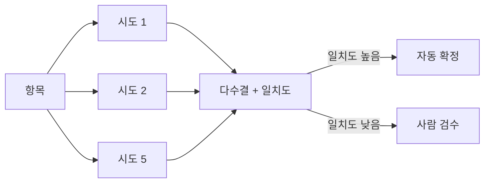
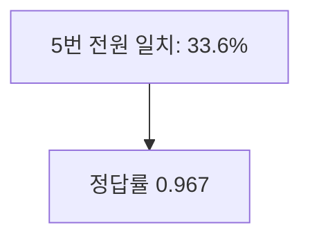

# LLM 자기 일관성

> LLM 자기 일관성은 같은 항목을 LLM에게 여러 번(무작위성을 켜고) 라벨링시켜 답이 얼마나 같은지를 보는 방법이다. 답이 흔들리는 항목은 모호하거나 어려운 항목일 가능성이 높아 사람 검수 대상으로 올릴 수 있고, 다수결로 최종 답을 정할 수도 있다.

## 쉽게 말하면
같은 문제를 같은 학생에게 다섯 번 풀게 했을 때 매번 같은 답이면 그 답을 믿을 만하고, 풀 때마다 다르면 그 문제에서는 이 학생의 답을 믿기 어렵다.

## 자세히
- **연구 근거(Wang 외, arXiv 2203.11171 초록)**: 자기 일관성(self-consistency)은 사고 사슬(chain-of-thought) 프롬프트의 탐욕 디코딩을 대체하는 방식으로, 여러 서로 다른 추론 경로를 샘플링한 뒤 가장 일관되게 나오는 답을 고른다. 산술·상식 벤치마크에서 사고 사슬 대비 GSM8K +17.9%, SVAMP +11.0%, AQuA +12.2%, StrategyQA +6.4%, ARC-challenge +3.9%를 보고한다. 핵심 직관은 복잡한 문제가 여러 방법으로 풀려도 같은 정답으로 모인다는 것이다. 이 수치는 해당 벤치마크·모델에서의 결과이며 라벨링 과제에는 직접 검증이 필요하다(해석).
- **라벨링에 쓰는 두 방식(해석)**: ① 다수결로 답 결정 ② 일치도(몇 번 같은 답이 나왔나)를 확신 신호로 사용해 낮으면 사람 검수.
- **직접 계산(가정: 항목 난이도 세 종류가 같은 비율, LLM이 한 번 맞힐 확률이 쉬움 0.95·중간 0.70·어려움 0.50, 시도는 독립)**:

| 시도 횟수 | 다수결 정확도 |
| --- | --- |
| 1 | 0.717 |
| 3 | 0.759 |
| 5 | 0.779 |
| 9 | 0.800 |

  5번 시도해 전부 같은 답을 낸 항목은 전체의 33.6%이고, 그 항목들의 정답률은 0.967이다. 전원 일치를 "확신 높음" 신호로 쓰면 이 가정에서는 약 3분의 1을 거의 자동 처리하고 나머지를 사람이 볼 수 있다. 독립 가정이 핵심이며, 같은 모델이 같은 이유로 반복해 틀리는 항목(체계적 오류)에는 효과가 없다. 실제로는 [Condorcet 배심 정리](#condorcet-jury-theorem)의 한계처럼 상관된 오류가 남는다.
- **운영(해석)**: ① 무작위성(temperature)을 0보다 크게 설정 ② 횟수(3~5)와 비용(호출 수×단가) 균형 ③ 같은 항목의 일치도를 기록해 낮은 것은 [판정 인터페이스](#adjudication-interface)로 보냄 ④ 골드에서 일치도와 정확도의 관계를 확인해 임계값 설정([LLM 라벨러 검증 표본](#llm-labeler-validation-subset)).

## 그림으로 보기

## 예시
- 같은 문장을 5번 라벨링시켜 `긍정 5회`면 확정, `긍정 3·중립 2`이면 검수 큐로 보낸다.
- 교육 활용: 같은 프롬프트를 여러 번 실행해 일치도가 낮은 문장의 공통점을 찾는다.

## 헷갈리는 것과 비교
| 개념 | 차이 |
| --- | --- |
| LLM 자기 일관성 | 같은 모델이 여러 번 낸 답의 일치 |
| [자기 일관성 점검](#self-consistency-check) | 사람 라벨러가 시간 간격 두고 다시 라벨 |
| [Condorcet 배심 정리](#condorcet-jury-theorem) | 독립 투표자 다수결의 이론 |
| 확신도 자기 보고 | 모델이 말한 확신, 보정이 필요 |

## 더 읽을거리
- [Self-Consistency Improves Chain of Thought Reasoning in Language Models (arXiv 2203.11171)](https://arxiv.org/abs/2203.11171) — 여러 추론 경로를 샘플링해 일관된 답 선택
