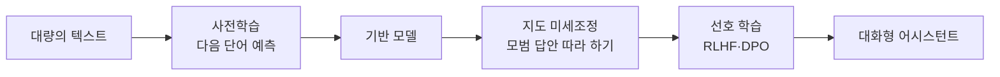
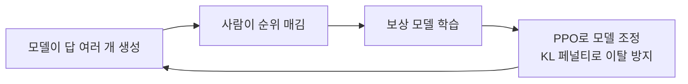

# LLM 학습 3단계

> LLM은 보통 ① 대량의 글로 다음 단어 맞히기(사전학습) → ② 정답 예시로 지시 따르기 배우기(지도 미세조정) → ③ 사람의 선호로 답변 다듬기(RLHF 등)의 세 단계를 거쳐 만들어진다.

## 쉽게 말하면
사람으로 치면 먼저 책을 엄청 많이 읽어 언어 감각을 익히고(사전학습), 선생님이 보여 주는 모범 답안을 따라 쓰며 "질문엔 이렇게 답한다"를 배운 뒤(미세조정), 마지막으로 여러 답안 중 어느 쪽이 더 낫다는 평가를 받으며 태도를 다듬는 과정이다. 사전학습만 마친 모델은 아는 건 많아도 질문에 답하기보다 글을 이어 쓰기만 한다.

## 자세히
- **1단계 사전학습(pretraining)**: 무작위 가중치에서 시작해 방대한 텍스트로 학습한다. 사람이 라벨을 달 필요 없는 자기지도(self-supervised) 방식이며, 목표는 다음 단어 예측(causal LM) 또는 가려진 단어 맞히기(masked LM). 큰 코퍼스로 몇 주씩 걸리는 가장 비싼 단계다(Hugging Face LLM Course).
- **2단계 지도 미세조정(SFT, fine-tuning)**: 사전학습 모델에 사람이 쓴 (질문, 좋은 답) 데이터로 추가 학습한다. 사전학습보다 데이터·시간·연산이 훨씬 적게 든다.
- **3단계 선호 학습(RLHF 등)**: RLHF는 세 부분이다. ⓐ 사전학습(+SFT)된 모델 준비 ⓑ 같은 질문의 여러 답에 사람이 순위를 매겨 **보상 모델**(답의 점수를 내는 모델)을 학습 — 점수를 직접 매기면 일관성이 낮아 순위를 쓴다 ⓒ 보상 모델 점수를 보상으로 PPO 같은 강화학습으로 모델을 조정하되, **KL 페널티**로 원래 모델에서 너무 멀어지지 않게 묶는다(Hugging Face 블로그). 이 방식이 InstructGPT(2022)에서 널리 알려졌다.
- 최근에는 보상 모델 없이 선호 쌍으로 직접 학습하는 DPO 같은 변형도 쓴다(주장: 더 단순해 많이 채택됨; 모델마다 세부 레시피는 비공개가 많다).

## 그림으로 보기

## 예시
- 기반 모델에 "프랑스의 수도는"만 주면 문장을 이어 쓰지만, 지시 튜닝된 모델은 "파리입니다"라고 답한다.
- 같은 질문에 답 A(장황)·B(간결)를 보여 주고 B를 고르게 하면, 모델은 점점 간결한 답을 낸다.

## 헷갈리는 것과 비교
| 개념 | 차이 |
| --- | --- |
| 사전학습 | 라벨 없는 대량 텍스트, 가장 비쌈 |
| 미세조정 | 적은 정답 데이터로 특정 행동·분야 학습 |
| [RLHF](#rlhf) | 사람 선호를 보상으로 쓰는 강화학습 |
| [프롬프트](#llm-basics) | 학습이 아니라 입력으로 행동 유도, 가중치 불변 |

## 더 읽을거리
- [Hugging Face LLM Course: Transformers, what can they do?](https://huggingface.co/learn/llm-course/chapter1/4) — 사전학습과 미세조정 정의
- [Hugging Face: Illustrating RLHF](https://huggingface.co/blog/rlhf) — RLHF 3단계 그림 설명
