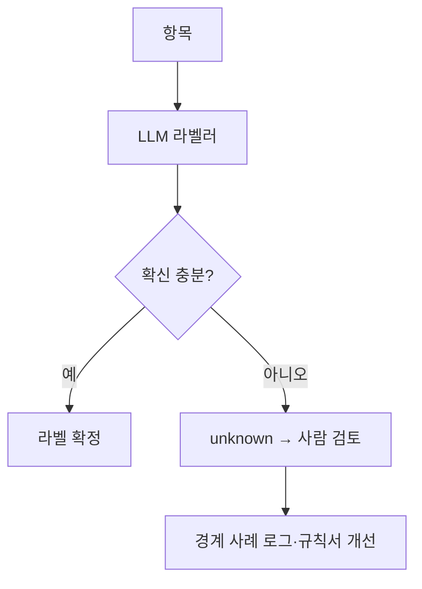
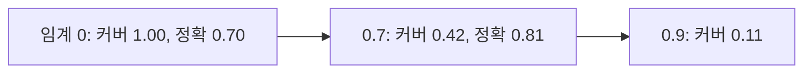

# unknown 허용 출력

> LLM 라벨러에게 **"확신이 없으면 라벨 대신 `unknown`(보류)을 내라"**는 선택지를 주는 설계다. 억지로 라벨을 고르게 하는 대신 불확실한 항목을 사람에게 넘겨 전체 품질을 높이고, 대신 자동 처리 범위(coverage)는 줄어든다.

## 쉽게 말하면
자신 없는 답을 억지로 쓰게 하는 시험 대신 "모르겠음" 칸을 두고, 모르겠음으로 표시된 문제만 선생님이 직접 채점하는 방식이다. 쓴 답은 더 믿을 만해지고 선생님 일은 늘어난다.

## 자세히
- **개념적 근거**: 선택적 분류(selective classification, reject option)는 오류를 줄이기 위해 일부 입력을 분류하지 않고 거절하는 방식이다. Geifman & El-Yaniv(arXiv 1705.08500 초록 확인)는 심층 신경망에 이를 적용해 사용자가 목표 위험(오류율)을 정하면 그것을 높은 확률로 보장하도록 입력을 거절하며, ImageNet top-5 오류 2%를 99.9% 확률로 보장하면서 약 60%의 테스트 커버리지를 유지했다고 보고한다. 거절을 늘리면 받아들인 항목의 정확도는 오르지만 **커버리지가 줄어드는** 위험-커버리지 트레이드오프다.
- **직접 시뮬레이션(분류기 기반, 4클래스 합성 6,000개, 로지스틱 회귀의 5-폴드 확률. LLM이 아니라 일반 분류기이며 신뢰도 임계값으로 보류하는 구조만 재현)**
  | 보류 임계(신뢰도 미만) | 커버리지 | 답한 항목 정확도 | 사람에게 가는 비율 |
  |---|---|---|---|
  | 없음(0) | 1.00 | 0.702 | 0% |
  | 0.5 | 0.81 | 0.743 | 18% |
  | 0.6 | 0.61 | 0.781 | 38% |
  | 0.7 | 0.42 | 0.810 | 57% |
  | 0.8 | 0.25 | 0.827 | 74% |
  | 0.9 | 0.11 | 0.793 | 89% |
  임계를 올리면 정확도는 오르다가 너무 높으면(0.9) 오히려 떨어졌다(남은 항목 수가 적고 모델 과신 구간). **정확도가 오르는 대신 커버리지가 급감**한다.
  - 보류 항목을 정확도 0.95의 사람이 처리한다고 가정한 최종 정확도: 보류 없음 0.702, 임계 0.5에서 0.782(사람 19%), 0.7에서 **0.891**(사람 58%), 0.9에서 0.933(사람 89%). 사람 비율과 품질 목표 사이에서 비용을 보고 임계를 정한다.
- **LLM 프롬프트 설계(제안)**: ① 출력 JSON에 `label`과 `unknown` 허용, 이유 한 줄 ② 언제 unknown인지 구체 기준(규칙서에 없는 사례, 두 라벨 모두 가능) ③ 항상 unknown을 고르지 않도록 예시 포함 ④ unknown 비율을 모니터링(너무 높으면 규칙서 문제, 너무 낮으면 억지 라벨).
- **한계**: LLM이 말하는 "확신"은 실제 정확도와 어긋날 수 있다(보정 문제). 따라서 unknown 선택과 정답률의 관계를 **검증 부분집합에서 직접 재야** 한다([검증 부분집합](#llm-labeler-validation-subset)). unknown 항목은 [판정](#adjudicator-role)·[경계 사례 로그](#edge-case-log-template)로 연결해 규칙서 개선 재료로 쓴다.

## 그림으로 보기



## 예시
```json
{"label": "환불", "unknown": false, "reason": "환불 요청이 명시됨"}
{"label": null, "unknown": true, "reason": "결제 오류와 환불 요청이 함께 있어 규칙서에 경계 사례 없음"}
```
- unknown이 많이 나오는 클래스 쌍을 모아 규칙서에 경계 규칙을 추가.
- 교육: "모르면 모른다고 하게 하는 설계"가 신뢰성의 핵심임을 설명.

## 헷갈리는 것과 비교
| 개념 | 차이 |
|---|---|
| unknown 허용 | 불확실하면 보류 |
| 강제 선택 | 항상 라벨을 하나 고름 |
| [판단 불가 선택지](#cannot-decide-option) | 사람 라벨러에게도 주는 같은 개념 |
| 환각 | 모르는데 그럴듯하게 답함(unknown이 완화) |

## 더 읽을거리
- [Selective Classification for Deep Neural Networks (arXiv 1705.08500)](https://arxiv.org/abs/1705.08500) — 거절 옵션과 위험-커버리지(초록 확인).
- [ChatGPT Outperforms Crowd-Workers for Text-Annotation Tasks (arXiv 2303.15056)](https://arxiv.org/abs/2303.15056) — LLM 주석 품질 비교(초록 확인).
