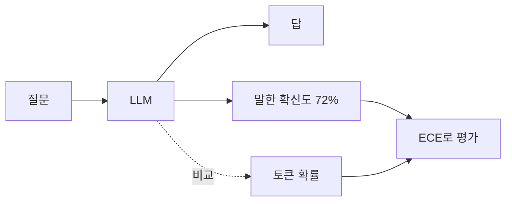

# LLM의 말로 한 확신도

> LLM에게 "이 답이 맞을 확신이 몇 %인가?"를 말로 쓰게 해서 얻는 확신도다. Tian 외(EMNLP 2023)는 RLHF로 다듬은 모델에서는 이렇게 말로 묻는 확신도가 토큰 확률보다 더 잘 보정되는 경우가 많다고 보고했다.

## 쉽게 말하면
시험 직후 학생에게 "방금 푼 문제, 맞았을 것 같다고 몇 %나 확신해?"라고 물어보는 것이다. 연필을 굴리는 확률(토큰 확률)을 들여다보는 것보다, 학생이 자기 답을 점검해 말한 숫자가 실제 정답률에 더 가까울 때가 있다는 발견이다. 단 학생이 자신만만한 말투로 틀릴 수도 있다.

## 자세히
- 논문: *Just Ask for Calibration* (Tian 외, 2023, arXiv 2305.14975, EMNLP 2023).
- 대상: ChatGPT·GPT-4·Claude, 벤치마크 TriviaQA·SciQ·TruthfulQA.
- 주요 결과: 말로 표현한 확신도가 조건부 토큰 확률보다 보정이 대체로 좋았고, 기대 보정 오차([ECE](#expected-calibration-error))가 상대 약 50% 줄어든 경우가 많았다(초록 기준. 모델별 세부 수치는 이번에 직접 확인하지 못함).
- 배경: 이전 연구는 RLHF 모델의 확률이 심하게 틀어진다고 봤다(토큰 확률이 극단으로 쏠림). 그래서 확률 대신 말로 묻는 전략을 시험한 것이다.
- 다중 답안 프롬프트(여러 후보와 각각의 확률을 내게 함)가 보정에 도움이 됐다는 보고가 있으나, 사고 연쇄(CoT) 프롬프트는 일관되게 도움이 되지 않았다(검색 요약 기준, 세부 미확인).
- 실무 주의:
  - 모델·태스크·프롬프트 표현에 따라 결과가 달라지므로 자기 데이터로 [신뢰도 곡선](#reliability-diagram)을 그려 확인한다.
  - 말한 확신도는 "자신 있다" 말투에 편향될 수 있다(주장: 일반적 관찰).
  - 확신도가 낮을 때 사람 검토로 넘기는 규칙에 쓰기 좋다.
  - [환각](#hallucination) 완화 장치의 하나로 쓰되, 단독으로는 보증이 안 된다.

## 그림으로 보기

## 예시
프롬프트: "답을 쓰고, 그 답이 맞을 확률을 0~100%로 마지막 줄에 `Confidence: N%`로 써라."
확신도 < 60%인 답은 자동 응답 대신 사람에게 넘긴다.

## 헷갈리는 것과 비교
| 개념 | 차이 |
| --- | --- |
| 말로 한 확신도 | 모델이 텍스트로 답한 숫자 |
| 토큰 확률(logprobs) | 다음 토큰 확률 — RLHF 모델에선 극단으로 쏠리기 쉬움 |
| [LLM-as-judge](#llm-as-judge) | 다른 모델이 답을 평가 |
| [환각](#hallucination) | 확신도가 낮을 때 경고 신호로 사용 |

## 더 읽을거리
- [Just Ask for Calibration (arXiv 2305.14975)](https://arxiv.org/abs/2305.14975) — 초록: 말로 한 확신도가 토큰 확률보다 낫다는 결과
