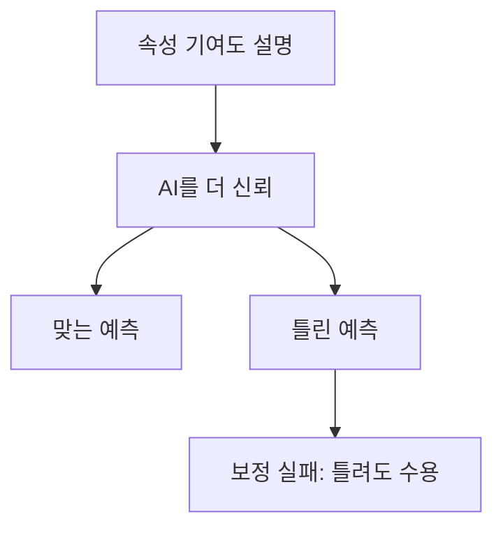

# 국소 설명의 한계

> 예측 하나하나에 대해 **"어떤 속성이 얼마나 기여했는지"를 보여 주는 설명**(국소 설명)이, 사람의 AI 신뢰 보정에 도움이 된다는 기대가 실험에서는 확인되지 않았다.

## 쉽게 말하면
의사가 "이 환자는 나이가 많고 혈압이 높아서 위험하다고 봤습니다"라고 설명하면 믿음이 가지만, 설명이 길고 그럴듯하면 틀린 판단에도 믿음이 간다. 설명이 있다고 해서 "언제 믿고 언제 의심할지"를 알게 되는 것은 아니다.

## 자세히
(Zhang 외 2020 PDF의 실험 2와 관련 연구 부분을 직접 읽었다. **실험 2는 참가자가 9명**으로 작아 결론이 제한적이다.)
- **설계(실험 2)**: 실험 1과 같은 과제에서 확신도 대신 **Shapley 방식의 속성 기여도 막대그래프**를 보여 줌(주황=소득 50K 초과 쪽, 파랑=이하 쪽). 완전 모델·예측 표시 조건만 시험했고 참가자는 **9명**.
- **신뢰(논문)**: 설명은 AI 확신 수준별 신뢰에 영향을 주지 못했다. "switch percentage"(AI를 따라 바꾸는 비율)는 확신도 조건이 기준 조건(p=.011)과 설명 조건(p<.001)보다 유의하게 높았지만 **설명 조건은 기준과 차이가 없었다**(p=.66). 가설 H3(설명이 신뢰 보정을 돕는다)은 기각됐다.
- **정확도**: 인간 평균 63%, AI 75%. AI 보조 정확도는 조건 간 유의한 차이가 없었다.
- **선행 연구 비판(논문)**: Lai·Tan 연구에서 설명이 신뢰와 정확도를 높였지만, 거기서 AI가 사람을 크게 앞섰기(87% vs 51%) 때문에 AI의 장점을 드러내는 모든 특성이 신뢰를 올렸을 수 있다. 오히려 **맞든 틀리든 AI 예측 수용을 높였다**면 신뢰 보정이 아니라는 지적이다.
- **교훈(해석)**: 설명 UI를 넣었다고 과의존이 줄었다고 보지 말고, 정답/오답 사례를 나눠 수용률을 측정한다.

## 그림으로 보기

## 예시
- 신용 평가 AI에 설명 화면을 넣은 뒤, 틀린 추천에 대한 수용률이 줄었는지 따로 측정한다(제안).

## 헷갈리는 것과 비교
| 개념 | 차이 |
|---|---|
| [확신 점수](#confidence-score-display) | 신뢰 보정에 효과(이 연구) |
| 국소 설명 | 이 실험에서는 보정 효과 없음 |
| [AI 과소의존](#undertrust-ai) | 맞는 조언을 거부 |

## 더 읽을거리
- [Zhang, Liao, Bellamy (2020)](https://arxiv.org/abs/2001.02114) — 직접 읽음.
