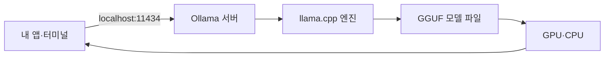

# 로컬 LLM 실행

> 클라우드 API 대신 내 PC에서 오픈 가중치 모델을 직접 돌리는 방법. 대표 도구가 Ollama와 llama.cpp다.

## 쉽게 말하면
식당에서 배달 주문(API)하는 대신 집 주방에서 직접 요리하는 것이다. 재료비(API 요금)는 없고 데이터가 밖으로 안 나가지만, 주방 크기(GPU)가 모델 크기를 정하고 최고급 요리는 어렵다.

## 자세히
Ollama GitHub README 기준:
- MIT 라이선스, 백엔드로 llama.cpp 사용.
- 설치: macOS/Linux `curl -fsSL https://ollama.com/install.sh | sh`, Windows PowerShell `irm https://ollama.com/install.ps1 | iex`, 또는 Docker 이미지 `ollama/ollama`.
- 실행: `ollama run gemma4` 처럼 모델 이름으로 대화. 모델 목록은 ollama.com/library(Qwen, DeepSeek, gpt-oss, Gemma 등).
- 로컬 API: `http://localhost:11434`, 예) `POST /api/chat`에 `model`·`messages`·`stream`을 보낸다. Python `pip install ollama`, JS `npm i ollama`.
- 장점: 비용 없음·개인정보 보호·오프라인. 단점: [VRAM](#gpu-basics) 한계, 최상위 클라우드 모델보다 품질·속도가 낮을 수 있음.
- 모델 이름에 붙은 크기와 [양자화](#quantization) 태그로 내 GPU에 맞는 것을 고른다.

## 그림으로 보기


## 예시
```bash
ollama run gemma4
curl http://localhost:11434/api/chat -d '{"model":"gemma4","messages":[{"role":"user","content":"하늘은 왜 파란가요?"}],"stream":false}'
```
- 민감한 사내 문서 요약을 로컬 모델로 처리한다.

## 헷갈리는 것과 비교
| 개념 | 차이 |
| --- | --- |
| 로컬 LLM | 내 장비·무료·품질 제한 |
| [LLM API](#llm-api-basics) | 남의 서버·종량제·최상위 모델 |
| [오픈 vs 폐쇄 모델](#open-vs-closed-models) | 로컬 실행은 오픈 가중치만 가능 |

## 더 읽을거리
- [ollama/ollama (GitHub)](https://github.com/ollama/ollama) — 설치·API
