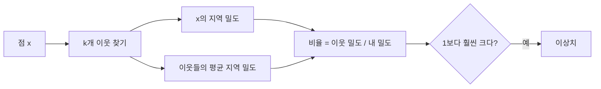

# LOF (Local Outlier Factor)

> LOF는 한 점의 지역 밀도를 가까운 이웃들의 밀도와 비교해, 이웃보다 훨씬 희박한 점을 이상치로 보는 알고리즘이다.

## 쉽게 말하면
번화가에서 한 칸 떨어진 가게는 괜찮지만, 같은 거리만큼 떨어진 시골 가게는 이웃과 비슷하게 한적하다. 절대 거리가 아니라 "이웃에 비해 얼마나 외로운가"를 재는 방식이다.

## 자세히
scikit-learn 문서(2026-11 확인):
- LOF 점수 = 이웃들의 평균 지역 밀도 ÷ 자기 지역 밀도. 정상은 이웃과 밀도가 비슷하고, 이상은 밀도가 훨씬 낮다. 전역이 아니라 이웃 대비 고립도를 보므로 **밀도가 다른 군집**을 다룰 수 있다.
- `n_neighbors`: 기본 20이 일반적, 이상치가 10% 넘으면 35처럼 크게. 군집 최소 크기보다 크고, 근처의 지역 이상치 수보다 작게.
- **모드**: 기본은 outlier detection(`fit_predict`, 학습 데이터만 점수 `negative_outlier_factor_`, 더 음수일수록 이상). `novelty=True`면 새 데이터에 `predict`·`decision_function`·`score_samples`를 쓰고 `fit_predict`는 불가. 주의: `novelty=True`에서 학습 데이터에 그 메서드를 쓰면 결과가 틀린다.
- `contamination`을 주면 해당 백분위를 `offset_` 임계값으로 사용.
- 선택 가이드(문서): Isolation Forest는 고차원 범용, LOF는 지역 밀도가 다양할 때.

## 그림으로 보기


## 예시
```python
from sklearn.neighbors import LocalOutlierFactor
lof = LocalOutlierFactor(n_neighbors=20, contamination=0.1)
labels = lof.fit_predict(X_train)
scores = lof.negative_outlier_factor_
```
지역별로 거래 규모가 다른 매출 데이터에서 "그 지역 기준" 이상 거래 탐지.

## 헷갈리는 것과 비교
| 개념 | 차이 |
|---|---|
| LOF | 지역 밀도 비교, 이웃 기반 |
| [Isolation Forest](#isolation-forest) | 무작위 분할로 고립 정도 측정 |
| EllipticEnvelope | 정규분포 가정 |
| [이상치 처리](#outlier-handling) | 상위 주제 |

## 더 읽을거리
- [scikit-learn: Novelty and Outlier Detection](https://scikit-learn.org/stable/modules/outlier_detection.html) — LOF 파라미터와 모드.
