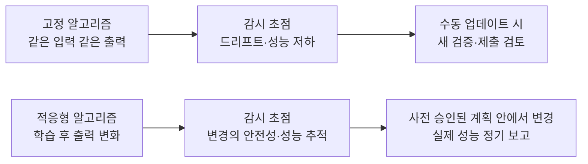

# 고정 vs 지속 학습 AI 감시

> 배포 후 알고리즘이 바뀌지 않는 **고정(locked)** AI와, 새 데이터로 스스로 학습해 행동이 바뀌는 **적응형·지속 학습(adaptive, continuously learning)** AI는 시판 후 감시 방식이 달라진다. 고정은 성능 드리프트를, 지속 학습은 변경 자체의 안전을 함께 봐야 한다.

## 쉽게 말하면
고정 AI는 출고된 계산기처럼 같은 입력에 늘 같은 답을 내서, 문제는 "세상이 바뀌어 안 맞게 되는 것"이다. 지속 학습 AI는 쓰면서 배우는 직원이라, 어제와 오늘 같은 질문에 다른 답을 낼 수 있어 "배운 내용이 맞는가"까지 감시해야 한다.

## 자세히
출처: FDA 토론 문서 "Proposed Regulatory Framework for Modifications to AI/ML-Based SaMD"(2019, PDF 내려받아 읽음, 이후 2021 Action Plan 등으로 발전한 초기 문서이며 PCCP는 이후 법·지침으로 이어짐), 검색 요약.
- **정의(FDA 2019)**: **고정(locked)** 알고리즘은 같은 입력에 늘 같은 결과를 내고 사용하면서 변하지 않는다. 예: 정적 룩업 테이블, 결정 트리, 복잡한 분류기. 업데이트와 검증은 수동 절차를 쓸 수 있다. **적응형** 알고리즘은 정의된 학습 과정으로 행동을 바꾸며, 같은 입력에 대해 변경 전후 출력이 달라질 수 있다. 변경은 잘 정의된, 때로는 완전 자동인 과정으로 구현·검증된다.
- **스펙트럼**: 두 가지가 이분법이 아니라 고정에서 지속 학습까지의 스펙트럼이며, 데이터 관리·재학습·성능 평가의 공통 고려사항이 전체에 적용된다고 문서가 설명한다.
- **적응 과정의 두 단계**: 알고리즘이 변경 방식을 **학습**하고(새 입력 유형이나 새 증례 추가), 새 버전을 배포하는 **업데이트**.
- **감시의 차이(2019 문서가 제안한 TPLC 틀의 요지)**: 제조사가 AI/ML 기기를 모니터링하고, 변경 개발·검증·실행에 위험 관리를 적용하며(SaMD 사전 명세와 알고리즘 변경 프로토콜), **시판 후 실제 성능 보고**로 투명성을 높인다. 제조사가 승인된 사전 명세·변경 프로토콜에 따라 시행한 업데이트와 성능 지표를 FDA에 **정기 보고**하는 것을 기대한다고 쓴다. 이는 제안 단계의 문서이며 현재의 PCCP 체계와 용어가 다르다.
- **현재 상황(검색 요약)**: 현재 FDA 허가 AI 기기의 대부분은 고정 알고리즘이라는 설명이 있다. 이 노드에서 확인하지 못한 점: 지속 학습 기기가 실제로 허가된 사례와 현행 감시 요건.
- **자동 vs 수동 변경**: 현행 PCCP 지침은 변경이 자동이든 수동이든 다룬다([AI PCCP 최종 지침](#pccp-ai-final-guidance)).

## 그림으로 보기

## 예시
- 고정형 영상 AI: 1년 뒤 새 장비 도입으로 입력 분포가 달라지면 [데이터 드리프트](#data-drift)를 감시해 재검증 여부를 판단.
- 지속 학습형: 병원 데이터로 매주 재학습한다면 변경마다 성능 평가와 허용 기준 통과 여부를 기록하고 미달이면 배포하지 않는다([해결 불가 실패 처리](#unresolvable-failure-handling)).

## 헷갈리는 것과 비교
| 개념 | 차이 |
|---|---|
| 고정 알고리즘 | 배포 후 변하지 않음, 수동 업데이트 |
| 적응형 알고리즘 | 정의된 학습 과정으로 행동이 바뀜 |
| [모델 드리프트 모니터링](#model-drift-monitoring) | 환경 변화로 인한 성능 저하 감시, 두 유형 모두 필요 |
| [변경 관리 계획(PCCP)](#pccp) | 변경을 사전 승인받는 제도 |

## 더 읽을거리
- [Proposed Regulatory Framework for Modifications to AI/ML-Based SaMD (FDA 토론 문서, 2019)](https://www.fda.gov/media/122535/download) — 고정·적응형 정의와 TPLC 제안(내려받아 확인)
- [AI Post-Market Surveillance: Locked vs. Continuous Learning (IntuitionLabs)](https://intuitionlabs.ai/articles/post-market-surveillance-ai-locked-continuous-learning) — 검색 결과로만 확인
