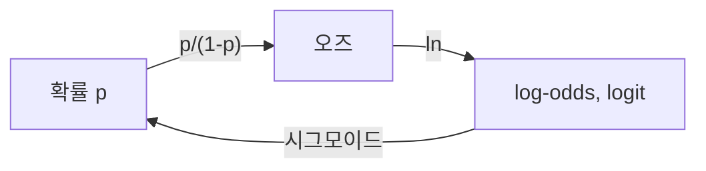

# log-odds

> 확률 p의 오즈(odds) p/(1−p)에 로그를 씌운 값, 곧 통계에서의 logit = ln(p/(1−p)). 0~1 확률을 −∞~+∞ 실수로 옮긴다.

## 쉽게 말하면
경마의 배당률처럼 "이길 확률 대 질 확률"의 비를 쓰고(오즈), 그 비에 로그를 씌워 대칭적인 점수로 만든 것이다. 확률 50%면 0점, 이기는 쪽이 유력할수록 양수로, 질 쪽이 유력할수록 음수로 커진다.

## 자세히
Logit 위키(확인 2026-11-12) 기준.
- 정의: logit(p) = ln(p/(1−p)). p=0.5 → 0.
- 역함수는 표준 로지스틱(시그모이드) 함수 σ(x)=1/(1+e^(−x)) (expit이라고도 함).
- 로지스틱 회귀에서 logit이 **링크 함수**(베르누이 분포의 정준 링크)다: 입력의 선형결합 = log-odds.
- 작은 확률을 곱하는 대신 log-odds를 **더하면** 수치적으로 안정적이다(상태 추정 알고리즘 예).
- 딥러닝에서 말하는 "로짓"은 softmax 전 원점수라 같은 이름이지만 엄밀히는 다른 개념이다. 이진 분류에서는 두 정의가 일치한다(sigmoid 전 점수가 log-odds). 위키 글은 softmax 로짓은 다루지 않는다.

## 그림으로 보기

## 예시
- p=0.8 → 오즈 4 → log-odds ≈ 1.386. p=0.2 → ≈ −1.386(부호만 반대).
- 로지스틱 회귀 계수 β=0.7은 "변수가 1 늘면 log-odds가 0.7 증가(오즈가 약 2배)".

## 헷갈리는 것과 비교
| 개념 | 차이 |
|---|---|
| 확률 | 0~1 |
| 오즈 | 0~∞ |
| log-odds | −∞~∞ |
| [로짓(딥러닝)](#logits) | softmax 전 원점수. 이진이면 log-odds와 같음 |

## 더 읽을거리
- [Logit — Wikipedia](https://en.wikipedia.org/wiki/Logit) — 정의, 역함수, 로지스틱 회귀
