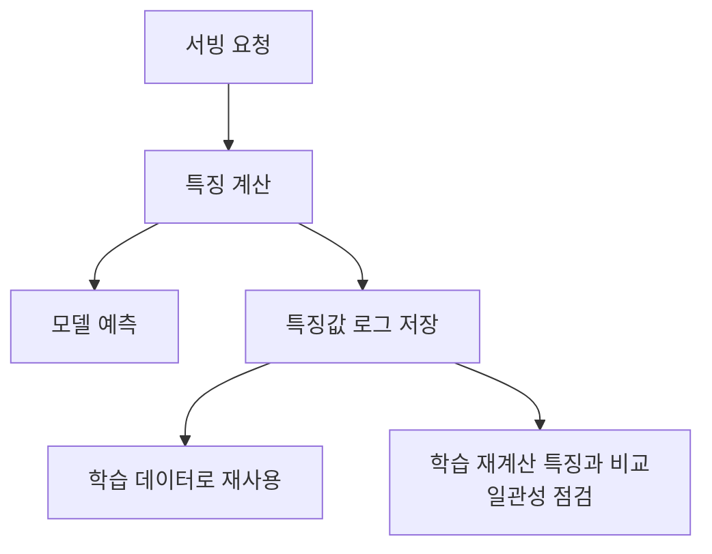
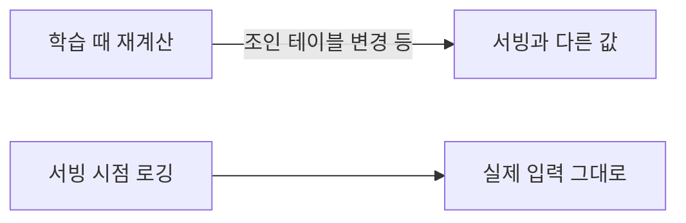

# 서빙 특징 로깅

> 모델이 서비스 중 예측할 때 **실제로 입력받은 특징값을 그 시점에 그대로 기록**해 두고, 이를 학습·검증에 다시 쓰는 방법이다. 학습 때 재계산한 특징이 서빙 때와 달라지는 문제(훈련-서빙 편향)를 막는 가장 직접적인 방법으로 꼽힌다.

## 쉽게 말하면
요리 대회에서 심사위원이 맛본 접시 사진을 그 자리에서 찍어 두는 것이다. 나중에 집에서 같은 레시피로 다시 만들어 비교하면 재료나 불 세기가 달라 같은 맛이 안 난다. 그 자리에서 찍은 사진이 가장 믿을 만한 증거다.

## 자세히
- **Google "Rules of Machine Learning"의 규칙 29(직접 확인)**: 서빙 시점에 쓴 특징을 로그로 남기고 학습에 재사용하라. 일부만 로깅해도 학습과 서빙의 **일관성을 점검**할 수 있다고 한다.
- **훈련-서빙 편향의 정의와 원인(같은 문서)**: 학습 때 성능과 서빙 때 성능의 격차. 원인은 ① 학습·서빙 파이프라인의 데이터 처리 방식 차이 ② 학습과 서빙 사이에 바뀌는 데이터 ③ 모델과 이를 쓰는 시스템 사이의 피드백 고리.
- **로깅이 도움이 되는 이유**: 특히 규칙 31(변하는 테이블 조인)에서, 학습과 서빙 양쪽에서 테이블을 조인하면 테이블 내용이 바뀔 수 있는데 서빙 시점에 특징을 로깅하면 이를 피한다. 느리게 바뀌는 테이블을 스냅샷하는 방법은 도움이 되지만 완전한 해결은 아니라고 한다([조인 테이블 스냅샷](#table-join-snapshot)).
- **관련 규칙**: 규칙 30(샘플링된 데이터는 샘플링 확률의 역수로 가중. 30% 샘플링이면 가중치 10/3), 규칙 32(학습·서빙 코드 공유), 규칙 33(과거 데이터로 학습하고 이후 데이터로 시험). 가중에 대한 일반 설명은 [편향 샘플링과 가중치 복원](#biased-sampling-reweighting).
- **도구 확인 결과**: Feast의 Python 피처 서버 문서에는 **감사 로깅**(`feature_server.metrics.audit_logging: true`로 켜며 기본 꺼짐, 온라인 호출당 엔티티 수·피처 뷰·피처 수·상태·지연 등을 JSON으로 출력)이 있지만, 나열된 필드에 **특징값**이 없고 목적이 감사·관측이라 이것만으로 학습-서빙 비교에는 부족하다고 문서에서 판단된다. 피처 값 로깅 기능은 해당 페이지에서 확인되지 않아, 필요하면 별도 문서를 보거나 직접 구현해야 한다(이 글의 확인 범위).
- **고려사항(해석)**: 로그에는 개인정보가 포함될 수 있으니 보관 기간·접근 권한을 정하고, 저장 비용 때문에 샘플링할 때는 가중치를 기록한다.

## 그림으로 보기

## 예시
- 추천 모델이 서빙 때 쓴 "최근 7일 클릭 수"를 로그로 저장하고 학습에서도 같은 값을 사용.
- 교육 소재: 같은 사용자에 대해 학습 재계산 값과 로그 값이 다르게 나온 사례를 비교.

## 헷갈리는 것과 비교
| 개념 | 차이 |
|---|---|
| 서빙 특징 로깅 | 서빙 때 입력을 그대로 기록 |
| 감사 로그 | 호출 메타데이터(누가·언제), 값은 없을 수 있음 |
| [조인 테이블 스냅샷](#table-join-snapshot) | 변하는 테이블을 고정 |
| [TFDV 스키마 환경](#tfdv-schema-environments) | 학습·서빙 데이터 검증 |

## 더 읽을거리
- [Rules of Machine Learning (Google)](https://developers.google.com/machine-learning/guides/rules-of-ml) — 규칙 29~33, 37(직접 확인).
- [Feast Python feature server 문서](https://docs.feast.dev/reference/feature-servers/python-feature-server) — 감사 로깅 설명(직접 확인, 특징값 로깅은 확인되지 않음).
