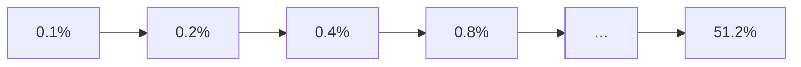
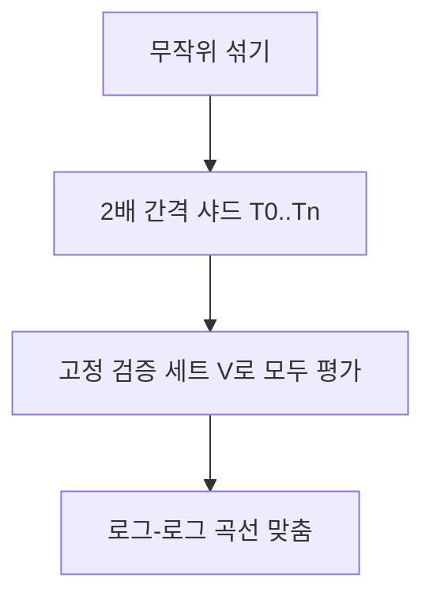

# 로그 간격 표본 크기

> 학습 곡선을 측정할 때 학습 데이터 크기를 **선형이 아니라 약 2배씩(0.1%, 0.2%, 0.4%, …) 기하급수로** 늘려 2~3자릿수를 덮는 방법. 멱법칙 곡선은 로그-로그에서 직선이라 로그 간격이어야 모든 구간이 고르게 측정된다.

## 쉽게 말하면
지도 축척을 정할 때 서울에서 부산까지를 1cm씩 재지 않고 1m, 10m, 100m, 1km처럼 단위를 곱해 가며 재는 것과 같다. 데이터가 10배가 될 때 오류가 어떻게 변하는지가 핵심이라 곱셈으로 늘린 점이 필요하다.

## 자세히
(Hestness 외, arXiv 1712.00409 3절 본문 확인)
- **논문의 방법**: ① 학습 세트 T를 **무작위로 섞어** 부분집합(샤드)이 T와 같은 분포를 갖게 한다 ② T를 **2~3자릿수 범위에 걸쳐 대략 2배씩** 나눈다(예: T₀는 T의 0.1%, T₁은 0.2%, T₂는 0.4% …) ③ **하나의 고정 검증 세트 V**로 모든 크기의 모델을 평가(V는 어떤 샤드와도 겹치지 않고 일반화 오류를 낮은 분산으로 근사할 만큼 커야 함) ④ 데이터셋 크기를 **모델이 실제로 관측한 양**으로 센다(예: 문자 언어 모델이 긴 시퀀스를 잘라 버리면 버려진 부분은 크기에 넣지 않음).
- **예: 논문의 실제 범위**: Billion Word 언어 모델은 데이터의 **0.1%~40%**, ImageNet ResNet은 클래스당 **1장(0.08%)~800장(62%)** 샤드.
- **직접 계산한 2배 간격 10점**: 0.1%, 0.2%, 0.4%, 0.8%, 1.6%, 3.2%, 6.4%, 12.8%, 25.6%, 51.2% — 10번의 학습으로 **약 2.7자릿수**(0.1%~51.2%)를 덮는다. 같은 10번을 **선형 간격**(0.1%에서 약 5.7%p씩)으로 쓰면 0.1, 5.8, 11.5, … 처럼 작은 크기 구간에 점이 **하나뿐**이라 곡선의 초반(best-guessing·멱법칙 시작)을 놓친다.
- **로그 간격의 이유**
  1. 멱법칙 ε = a·m^β + γ는 로그-로그에서 직선이라, 점이 로그축에서 고르게 놓여야 기울기(β)를 안정적으로 추정.
  2. 데이터가 2배가 될 때의 이득을 직접 비교 가능.
  3. 큰 크기 학습은 비싸므로 점 수를 줄이면서도 범위를 넓힘.
- **실무 팁(권장)**
  1. 각 크기마다 **여러 시드/무작위 부분집합**을 뽑아 평균·분산을 보고(점 하나는 잡음).
  2. 가장 작은 크기는 클래스·집단이 모두 포함될 만큼은 필요(희귀 클래스 [층화](#stratified-metric-undefined-fix)).
  3. 모델 크기·하이퍼파라미터를 데이터 크기마다 다시 튜닝(논문은 샤드별 최적 모델 탐색).
  4. 검증 세트는 고정하고 [신뢰구간](#independent-test-ci)을 표시.
- **한계**: 2배 간격이 곡선의 굴곡을 놓칠 만큼 거칠 수 있다(필요하면 √2배). 샤드는 서로 중첩된 부분집합(작은 것이 큰 것에 포함)으로 만들 수도 있고 독립 추출도 가능하며, 논문은 무작위로 섞은 뒤 순서대로 나누는 방식을 따른다.

## 그림으로 보기



## 예시
```python
import numpy as np
fracs = 0.001 * 2.0 ** np.arange(10)          # 0.1% … 51.2%
rng = np.random.default_rng(0); idx = rng.permutation(len(train))
errors = []
for f in fracs:
    sub = idx[: int(f * len(train))]
    errors.append(1 - fit_and_score(train[sub], val))     # 고정 val
```
- 사내 분류 데이터 10만 건: 100, 200, 400, …, 51,200건으로 학습해 곡선을 그리고 추가 수집 효과를 예측.

## 헷갈리는 것과 비교
| 간격 | 장점 | 단점 |
|---|---|---|
| 선형 | 단순 | 작은 크기 구간 부족 |
| 로그(2배) | 로그-로그 직선 추정에 적합 | 굴곡 놓칠 수 있음 |
| √2배 | 더 촘촘 | 비용 증가 |
| [점근 오류](#asymptotic-error) | 곡선에서 추정하는 γ | 범위에 민감 |

## 더 읽을거리
- [Deep Learning Scaling is Predictable, Empirically (arXiv 1712.00409)](https://arxiv.org/abs/1712.00409) — 3절 데이터 샤드·고정 검증 세트 방법(PDF 본문 확인).
