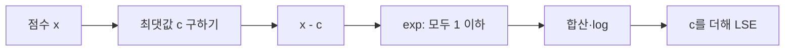

# log-sum-exp 안정화

> log-sum-exp(LSE)는 log(Σ exp(xᵢ))를 오버플로·언더플로 없이 계산하는 요령이다. 최댓값을 먼저 빼고 계산하면 softmax와 교차 엔트로피가 안전해진다.

## 쉽게 말하면
아주 큰 숫자끼리 비율만 알고 싶을 때, 전부 "1등 기준"으로 환산하면 계산이 쉬워진다. 1000점과 1001점을 그대로 e의 거듭제곱으로 올리면 컴퓨터가 숫자를 못 담지만, 1등을 0점으로 맞추고 -1점으로 바꾸면 문제가 없다. 비율은 변하지 않는다.

## 자세히
- 정의: LSE(x) = log Σ exp(xₙ). 정규화 확률은 pᵢ = exp(xᵢ − LSE(x)).
- 문제: np.exp(1000)은 inf, np.exp(-1000)은 0이 된다. inf는 nan으로 번지고, 전부 0이면 0으로 나눈다.
- 핵심 항등식: LSE(x) = c + log Σ exp(xₙ − c). c = max(x)로 잡으면 가장 큰 항이 exp(0)=1이라 합이 1 이상이고 오버플로가 없다. 아주 작은 항은 0이 되지만 기여가 미미해 괜찮다.
- 예: x=[1000,1000,1000]을 그대로 쓰면 inf, 안정화하면 [0.333, 0.333, 0.333].
- 이것이 곧 [소프트맥스](#softmax)의 안정 구현이다. 딥러닝 라이브러리의 cross-entropy 함수가 로짓을 직접 받는 이유도 로그와 softmax를 합쳐 LSE로 한 번에 계산해 안정성을 얻기 위해서다.

## 그림으로 보기


## 예시
```python
from scipy.special import logsumexp
import numpy as np
x = np.array([1000., 1000., 1000.])
np.exp(x - logsumexp(x))   # [0.333, 0.333, 0.333]
```
손실이 nan이 되면 softmax를 직접 구현했는지 의심한다.

## 헷갈리는 것과 비교
| 개념 | 차이 |
| --- | --- |
| LSE | 안정화된 log-합-exp 계산 |
| [소프트맥스](#softmax) | LSE로 구하는 정규화 확률 |
| [로짓](#logits) | LSE에 들어가는 원점수 |
| [교차 엔트로피](#cross-entropy) | 로짓+LSE로 안정적으로 계산 |

## 더 읽을거리
- [The Log-Sum-Exp Trick (Gregory Gundersen)](https://gregorygundersen.com/blog/2020/02/09/log-sum-exp/) — 유도와 코드 예
