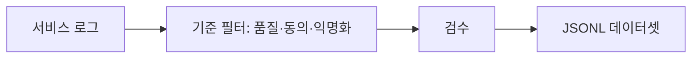

# 로그를 데이터셋으로

> 실제 서비스의 **사용 로그에서 기준을 만족하는 응답만 골라** 학습·평가 데이터셋으로 만드는 방법이다.

## 쉽게 말하면
식당이 손님 주문 기록 중 잘 나간 메뉴와 칭찬받은 응대만 모아 신입 교육 자료로 쓰는 것이다.

## 자세히
(OpenAI 미세조정 가이드를 직접 읽었다. 개인정보 처리·동의 절차는 이 문서의 해당 부분을 확인하지 못했다.)
- **문서의 제안**: 예시는 과거 데이터, 전문가 작성, 로그된 데이터에서 만든다.
- **증류(문서)**: 더 큰 모델(예: gpt-4.1)의 응답을 캡처해 **기준에 맞는 것만 남기고**, 더 작은 모델(예: gpt-4.1-mini)을 그 데이터로 학습.
- **저장 기간(문서)**: Responses API의 응답은 기본 **30일** 저장.
- **보류 세트(문서)**: 평가용 보류 세트는 학습 세트에서 떼되 입력·응답의 다양성이 비슷해야 한다.
- **주의(해석)**: 개인정보·민감정보를 제거하고 데이터 사용 동의를 확인한다. 로그의 오답이 학습에 들어가지 않도록 [adjudication](#adjudication) 같은 검수 절차를 둔다.

## 그림으로 보기

## 예시
- 상담 챗봇 로그에서 고객이 "해결됨"으로 평가한 대화만 추려 요약 모델 학습용 데이터로 만든다(제안).

## 헷갈리는 것과 비교
| 개념 | 차이 |
|---|---|
| 로그→데이터셋 | 실사용 데이터 활용 |
| 증류 | 큰 모델의 응답으로 작은 모델 학습 |
| 합성 데이터 | 모델이 새로 생성 |

## 더 읽을거리
- [OpenAI — Supervised fine-tuning](https://developers.openai.com/api/docs/guides/supervised-fine-tuning) — 직접 읽음.
