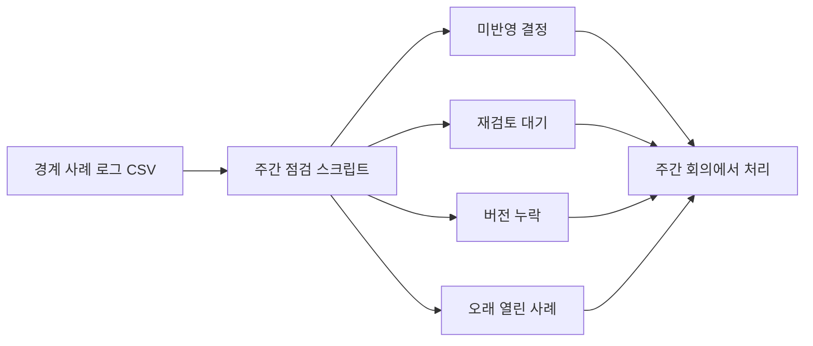
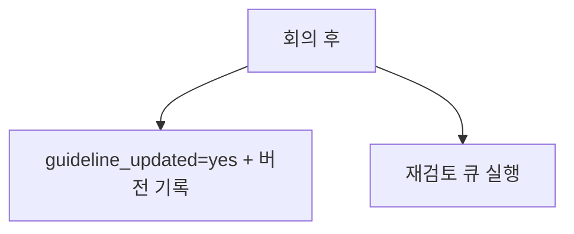

# 경계 사례 로그 주간 점검

> 경계 사례 로그 주간 점검은 로그 표(CSV)를 주 1회 자동으로 훑어 규칙서에 반영되지 않은 결정, 재검토가 밀린 기존 라벨, 데이터가 빠진 행, 오래 열려 있는 사례를 뽑아 주는 작은 스크립트와 회의 절차다.

## 쉽게 말하면
도서관 반납함을 매주 비우듯, 경계 사례 장부에서 "아직 처리 안 된 것"만 자동으로 꺼내 회의 탁자에 올려 놓는 일이다. 사람은 목록만 보고 결정하면 된다.

## 자세히
- **로그 열(이 지도의 [경계 사례 로그 양식](#edge-case-log-template)에서)**: `id, date, decision, reason, guideline_updated, guideline_version_added, relabel_needed, relabel_query, status` 등. 이 열이 고정돼 있어야 점검이 자동화된다.
- **직접 실행한 점검(pandas, 가상 4건 `E-014~E-017`, 기준일 2026-11-25)**:

| 점검 | 조건 | 결과 |
| --- | --- | --- |
| 규칙서 미반영 | `guideline_updated == "no"` | E-015, E-016 |
| 재검토 대기 | `relabel_needed == "yes"` 이고 `status == "open"` | E-015, E-016 |
| 반영했는데 버전 누락 | `guideline_updated == "yes"` 이고 버전 비어 있음 | E-017 |
| 오래 열린 사례 | `status == "open"` 이고 14일 이상 | E-015 |

  핵심 코드 모양: `df[(df.relabel_needed=="yes") & (df.status=="open")]`처럼 조건마다 괄호로 묶어 `&`로 잇는다(pandas 문서의 권고, [재검토 검색식](#relabel-query)).
- **주간 절차(해석)**: ① 월요일 아침 스크립트 실행 → 점검 결과 4개 목록 ② 판정자가 5~10분에 걸쳐 각 항목 처리(반영·재검토 실행·종결) ③ 반영하면 `guideline_updated=yes`와 버전 기록, [규칙 변경 전파](#rule-change-propagation) 시작 ④ 재검토 큐는 `relabel_query`로 대상을 뽑는다 ⑤ 점검 결과 건수를 기록해 추세를 본다(쌓이면 운영 문제).
- **주의(해석)**: 자동 점검은 열이 채워져 있다는 전제다. 필수 열이 비어 있으면 점검에서 빠지므로 필수 열 누락 점검을 첫 단계로 둔다.

## 그림으로 보기

## 예시
- 월요일 점검 결과가 "미반영 2건, 재검토 대기 2건"이면 해당 4건만 회의에서 다룬다.
- 교육 활용: 학습자가 가상 로그 CSV를 만들고 점검 조건을 직접 써 본다.

## 헷갈리는 것과 비교
| 개념 | 차이 |
| --- | --- |
| 주간 점검 | 로그에서 미처리 항목을 뽑는 정기 절차 |
| [경계 사례 로그 양식](#edge-case-log-template) | 로그의 열 구성 |
| [재검토 검색식](#relabel-query) | 재검토 대상 기존 라벨을 찾는 쿼리 |
| [규칙 변경 전파](#rule-change-propagation) | 반영한 규칙을 배포하는 절차 |

## 더 읽을거리
- [pandas Boolean indexing 가이드](https://pandas.pydata.org/docs/user_guide/indexing.html#boolean-indexing) — 조건 결합 방식
