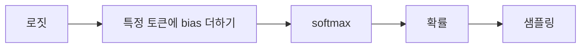
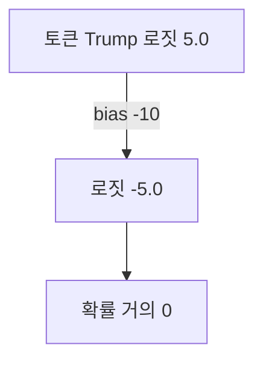

# logit bias

> 다음 토큰을 고르기 전에 특정 토큰의 로짓에 값을 더해(+) 잘 나오게, 빼서(−) 덜 나오게 만드는 출력 조절 기법.

## 쉽게 말하면
오디션 점수표에서 심사위원이 몰래 특정 후보에게 +10점, 어떤 후보에게 −10점을 얹는 것이다. 환산(softmax) 전에 점수를 만지니 최종 확률이 따라 움직인다. 아주 큰 감점이면 그 후보는 사실상 탈락이다.

## 자세히
- 동작은 **가산(additive)**: 해당 토큰 로짓 + bias. softmax 전에 적용되어 확률이 바뀐다.
- Hugging Face Transformers의 `SequenceBiasLogitsProcessor`(문서 확인 2026-11-12): `sequence_bias=[[token_ids, bias], ...]`. 토큰 1개짜리는 항상 적용되고, 여러 토큰 시퀀스는 **그 시퀀스를 완성할 수 있는 마지막 토큰**에만 적용된다. 양수는 선호, 음수는 억제. 여러 토큰을 선호할 땐 beam search를 권한다.
- `NoBadWordsLogitsProcessor`(`bad_words_ids`)는 지정 시퀀스를 "절대 선택하지 않게" 막는다(구현상 큰 음수 편향일 것으로 보이나 문서에 명시 없음).
- **토큰화 함정**: "Trump"와 " Trump"(앞 공백)는 다른 토큰이다. 문장 중간 단어는 공백 포함 토큰에 편향을 걸어야 효과가 있다.
- OpenAI API에도 `logit_bias` 파라미터가 있는 것으로 알려져 있으나(주장: 토큰 ID별 −100~100) 이번에 공식 문서가 403으로 열리지 않아 확인하지 못했다.
- 용도: 금칙어 차단, 분류 라벨 토큰만 허용, 특정 어휘 선호.

## 그림으로 보기



## 예시
```python
def tok(w): return tokenizer([w], add_special_tokens=False).input_ids[0]
model.generate(**inputs, sequence_bias=[[tok(" Trump"), -10.0]])
```
분류 프롬프트에서 "예"·"아니오" 토큰에 +bias를 주고 나머지를 억제해 답을 둘 중 하나로 고정한다.

## 헷갈리는 것과 비교
| 개념 | 차이 |
|---|---|
| logit bias | 토큰별 점수에 값을 **더함** |
| [온도 스케일링](#temperature-scaling) | 전체 로짓을 T로 **나눔** |
| 금칙어 필터(후처리) | 생성 후 검사. logit bias는 생성 중 개입 |
| [로짓](#logits) | 편향을 더하는 대상 |

## 더 읽을거리
- [HF Generation utilities](https://huggingface.co/docs/transformers/main/en/internal/generation_utils) — SequenceBias·NoBadWords·Temperature 프로세서
