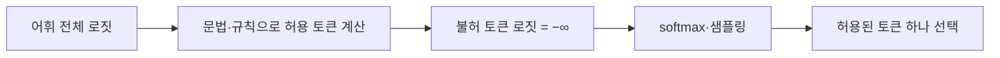

# 로짓 마스킹 (Logit Masking)

> 다음 토큰을 고르기 직전에, 허용되지 않는 토큰의 점수(로짓)를 사실상 −∞로 만들어 선택지에서 제거하는 기법으로, 구조화 출력의 핵심 원리다.

## 쉽게 말하면
시험 답안지의 보기 중 규칙에 어긋나는 번호를 미리 지워 두고 고르게 하는 것이다. 모델은 남은 보기 안에서만 가장 그럴듯한 걸 고르므로 형식을 어길 수 없다.

## 자세히
- LLM은 토큰마다 어휘 전체에 대한 점수(로짓)를 내고 softmax·샘플링으로 한 개를 뽑는다. 마스킹은 이 단계에서 불허 토큰의 로짓을 −∞로 바꿔 확률을 0으로 만든다(일반 원리).
- Hugging Face `generate()`는 `logits_processor`에 사용자 정의 `LogitsProcessor`를 넣어 다음 토큰 분포를 가공할 수 있고(문서, 2026-11 확인), `stopping_criteria`로 종료 조건도 바꾼다. 생성 제어용 라이브러리로 Outlines(JSON 등 제약 생성), SynCode(문법 기반), NVIDIA logits-processor-zoo가 소개된다.
- llama.cpp는 [GBNF 문법](#grammar-constrained-llamacpp)으로 같은 일을 한다. 현재까지 생성된 문자열 상태에서 문법상 가능한 다음 토큰만 허용한다.
- 한계: 마스크는 형식만 보장하고 내용의 정확성은 보장하지 않는다. 너무 강한 제약은 모델이 원하는 답을 못 내 품질을 떨어뜨릴 수 있다(일반 관찰).

## 그림으로 보기

## 예시
JSON을 `{`로 시작해야 할 때 첫 토큰으로 `{` 외에는 모두 마스킹 → 설명 문장으로 시작하는 실수가 원천 차단된다.

## 헷갈리는 것과 비교
| 개념 | 차이 |
|---|---|
| 로짓 마스킹 | 생성 중 불허 토큰 제거 |
| 프롬프트로 형식 요청 | 모델이 따르길 바랄 뿐 보장 없음 |
| [구조화 출력 디코딩](#structured-output-decoding) | 마스킹을 응용한 상위 개념 |
| [logit_bias](#logit-bias) | 사용자가 특정 토큰 점수를 가감하는 API 설정 |

## 더 읽을거리
- [Text generation (Hugging Face)](https://huggingface.co/docs/transformers/llm_tutorial) — `logits_processor`와 제약 생성 라이브러리 목록.
