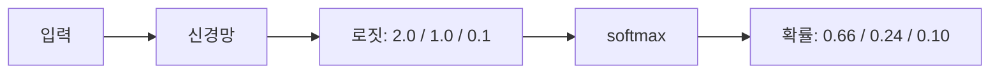
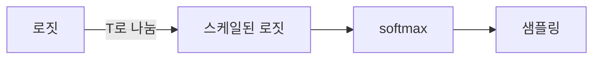

# 로짓

> 신경망 출력층이 softmax나 sigmoid를 거치기 **전**에 내놓는 원점수(raw score). 어떤 값이든 될 수 있고 합이 1일 필요도 없다.

## 쉽게 말하면
오디션 심사위원이 후보마다 "점수"를 적은 종이다. 점수는 90점, -5점처럼 제각각이다. 이 점수를 "우승 확률 63%, 19%…"로 바꿔 주는 환산표가 [소프트맥스](#softmax)다. 환산 전의 점수가 로짓이다.

## 자세히
- 보통 마지막 층의 `w·x + b`(클래스마다 하나)가 로짓이다. 범위 제한이 없다(음수도 가능).
- softmax는 각 로짓을 지수화해 합으로 나눈다 → 모든 클래스 확률의 합이 1.0. Google ML Crash Course 예: 사과 0.19·오렌지 0.12·배 0.63·포도 0.06. 반면 클래스마다 sigmoid를 쓰면 각각 독립 확률이라 합이 1이 아니다(예 1.43).
- 로짓 사이의 **차이**가 확률을 정한다. 모든 로짓에 같은 값을 더해도 softmax 결과는 같다.
- LLM의 temperature는 로짓을 T로 나눈 뒤 softmax한다(일반 정의). 로짓 [2.0, 1.0, 0.1]에서 T=1이면 확률 [0.659, 0.242, 0.099], T=0.5면 [0.864, 0.117, 0.019]로 첫 후보가 더 뚜렷해진다(직접 계산).
- 학습 시 손실 함수는 수치 안정성 때문에 보통 로짓을 직접 받는다(예: PyTorch `CrossEntropyLoss`는 로짓 입력). 이 부분은 프레임워크 관례.

## 그림으로 보기

## 예시
- LLM이 다음 토큰을 고를 때 어휘 수만큼(수만 개)의 로짓이 나오고, softmax 확률에서 하나를 뽑는다.
- `logits = model(x); loss = nn.CrossEntropyLoss()(logits, y)` — 확률이 아니라 로짓을 넣는다.

## 헷갈리는 것과 비교
| 개념 | 차이 |
|---|---|
| 로짓 | 변환 전 원점수, 범위 무제한 |
| [소프트맥스](#softmax) 출력 | 합이 1인 확률 |
| sigmoid 출력 | 클래스별 독립 0~1 확률 |
| 통계의 logit(log-odds) | 이름은 같지만 정의가 약간 다름: log(p/(1-p)) |

## 더 읽을거리
- [Google ML Crash Course: Multi-class](https://developers.google.com/machine-learning/crash-course/neural-networks/multi-class) — softmax와 sigmoid의 차이, 예시 수치
