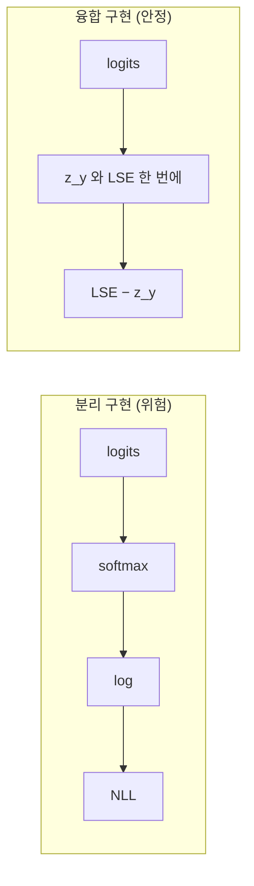

# 교차 엔트로피 융합 구현

> 교차 엔트로피 손실을 softmax → log → 음의 로그 가능도로 따로 계산하지 않고, 로짓(logits)을 받아 log-softmax와 NLL을 한 번에 계산하는 구현이다. [log-sum-exp](#log-sum-exp) 안정화가 안에 들어 있어 overflow·nan이 없다.

## 쉽게 말하면
계산기에 "먼저 지수로 올리고, 나눈 뒤, 다시 로그를 취하라"고 시키면 중간 숫자가 폭발한다. 처음부터 "정답 점수 − 전체 점수의 로그합"이라는 한 줄 공식으로 바꾸면 폭발할 일이 없다. 융합 구현이 바로 그 한 줄 공식이다.

## 자세히
- 정답 클래스 y의 손실: `−log softmax(z)_y = −z_y + LSE(z)`. softmax 확률을 만들지 않고 로짓에서 바로 구한다.
- 분리 구현(softmax 후 log)의 문제: softmax가 0에 가까운 값을 내면 `log(0) = −inf`가 되고, 큰 로짓은 exp 단계에서 overflow가 난다.
- PyTorch `nn.CrossEntropyLoss`는 **확률이 아니라 원시 로짓**을 입력으로 받는다. 안에서 LogSoftmax와 NLLLoss를 합쳐 계산한다(공식 문서 설명). 그래서 모델 끝에 softmax를 또 붙이면 이중 적용이 되어 학습이 이상해진다 — 입문자가 흔히 하는 실수.
- 어휘가 큰 LLM에서는 로짓 텐서(배치×길이×어휘 크기)가 메모리를 크게 먹는다. Liger Kernel·Cut Cross-Entropy 같은 청크/커널 융합이 로짓 전체를 만들지 않고 구간별로 LSE를 이어 계산해 메모리를 줄인다(주장: 각 프로젝트 홍보 수치, 직접 검증 전).
- 저정밀도(fp16)에서는 손실 계산만 fp32로 올리는 것이 흔한 안전장치다([수치 정밀도](#numerical-precision-fp16-bf16)).

## 그림으로 보기


## 예시
```python
import torch, torch.nn.functional as F
logits = torch.tensor([[1000., 0., -1000.]])
y = torch.tensor([0])
F.cross_entropy(logits, y)              # tensor(0.) 안정
# 위험: torch.log(torch.softmax(...)) 로 따로 계산하면 -inf/nan 위험
```
분류 모델 출력층에는 softmax를 붙이지 않고 로짓을 그대로 손실에 넣는다.

## 헷갈리는 것과 비교
| 개념 | 차이 |
| --- | --- |
| 융합 cross_entropy | 로짓 입력, 안정 |
| softmax+log 분리 | 확률 경유, 불안정 |
| `NLLLoss` | 이미 log-softmax된 입력을 받음 |
| [교차 엔트로피](#cross-entropy) | 손실의 정의 — 이 노드는 그 계산법 |

## 더 읽을거리
- [torch.nn.CrossEntropyLoss](https://docs.pytorch.org/docs/stable/generated/torch.nn.CrossEntropyLoss.html) — 입력이 로짓이라는 공식 설명
