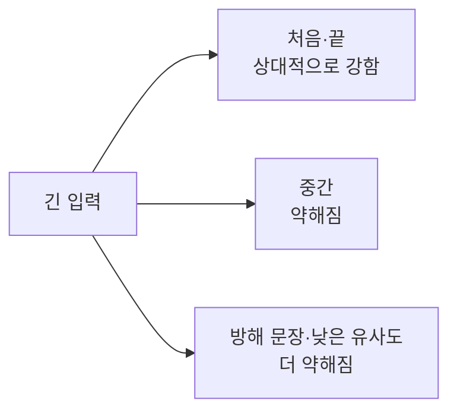
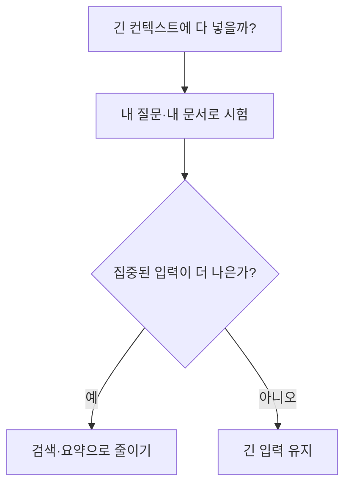

# 긴 컨텍스트의 한계

> 컨텍스트 창이 커졌다고 모델이 그 안의 모든 내용을 고르게 잘 쓰는 것은 아니다. 입력이 길어질수록 성능이 불균일해지고, 쉬운 시험(Needle in a Haystack)을 통과해도 실제 업무에서 안 맞을 수 있다.

## 쉽게 말하면
책 한 권을 통째로 건네고 "중간쯤에 나온 조건 하나만 정확히 기억해 줘"라고 하는 것과 같다. 책이 두꺼울수록 읽는 사람도 앞과 끝만 기억하고 중간은 놓치기 쉽다.

## 자세히
- **Lost in the Middle(Liu 등 2023, arXiv 2307.03172, 초록 열람)**: 다중 문서 QA와 키-값 검색에서 관련 정보가 입력의 처음이나 끝에 있을 때 성능이 가장 높고, 중간에 있으면 눈에 띄게 떨어졌다. 긴 입력용으로 만든 모델도 마찬가지였다. 저자들은 새 평가 프로토콜을 제안했다. 검색 요약에는 U자형 곡선(처음·끝 강함)으로 정리됐다.
- **Chroma "Context Rot"(열람)**: Anthropic·OpenAI·Google·Alibaba의 18개 모델(Claude Opus 4, GPT-4.1, Gemini 2.5 Pro, Qwen3-235B 등)을 시험. 핵심은 "모델은 컨텍스트를 균일하게 쓰지 않는다"는 것.
  - 바늘(정답 문장)과 질문의 유사도가 낮을수록 입력이 길어질 때 성능이 더 빨리 떨어졌고, 바늘 위치는 이 실험에서 뚜렷한 영향이 없었다고 보고.
  - 방해 문장(distractor) 하나만 있어도 정확도가 떨어지고, 넷이면 더 떨어졌다. Claude 계열은 환각이 가장 적고 종종 답을 거부했으며 GPT 계열은 환각이 가장 많았다고 보고.
  - 논리적으로 이어진 문서가 섞은 문서보다 오히려 결과가 나빴다(18개 모델 평균).
  - LongMemEval: 약 11.3만 토큰 입력보다 약 300토큰의 집중된 입력에서 모든 모델이 더 높았다.
  - 반복 단어 과제: 길이가 늘수록 모든 모델 계열의 정확도가 떨어졌고 일부 Gemini는 500~750단어 근처에서 무작위 단어를 내기 시작했다.
  - 결론: 단순 Needle in a Haystack 통과가 장문맥 신뢰성을 보장하지 않고, 정보가 어떻게 제시되는지가 존재 여부만큼 중요하다.
- **주의**: 위 수치는 보고서의 측정 조건에 한정된다. 모델은 계속 바뀌므로 현재 사용 모델로 직접 재현해야 한다. 보고서 날짜는 확인하지 못했다.

## 그림으로 보기

## 예시
- 100쪽 계약서 전체를 붙여 넣었더니 중간 조항의 예외 문구를 놓침 → 관련 조항만 추려 넣고 재시도.
- 교육 실습: 같은 질문을 (a) 문서 전체 (b) 관련 문단 3개만으로 물어 정확도와 거부 여부를 비교.

## 헷갈리는 것과 비교
| 개념 | 차이 |
|---|---|
| 긴 컨텍스트 한계 | 많이 넣어도 다 활용 못 함 |
| Needle in a Haystack | 쉬운 검색 시험(통과해도 안심 불가) |
| [질문·정답 세트 먼저 만들기](#eval-set-first) | 방식 선택 전에 자기 세트로 시험하는 원칙 |
| [근거성 지표](#groundedness-metric) | 답이 문맥에 지지되는지 |

## 더 읽을거리
- [Lost in the Middle (arXiv 2307.03172)](https://arxiv.org/abs/2307.03172) — 위치 효과(초록 열람)
- [Chroma: Context Rot](https://www.trychroma.com/research/context-rot) — 18개 모델 시험(열람)
