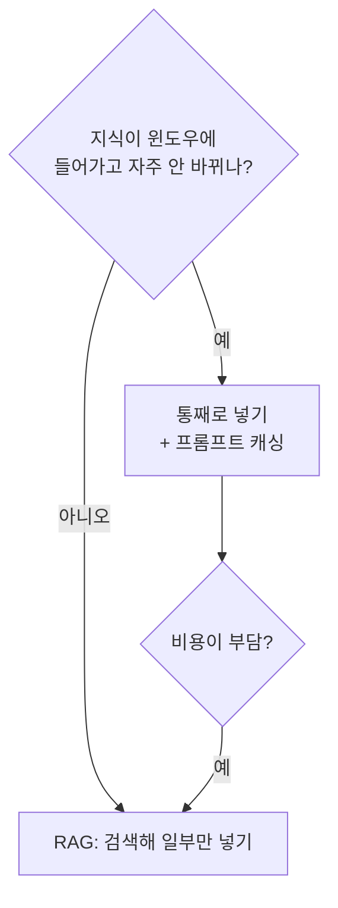
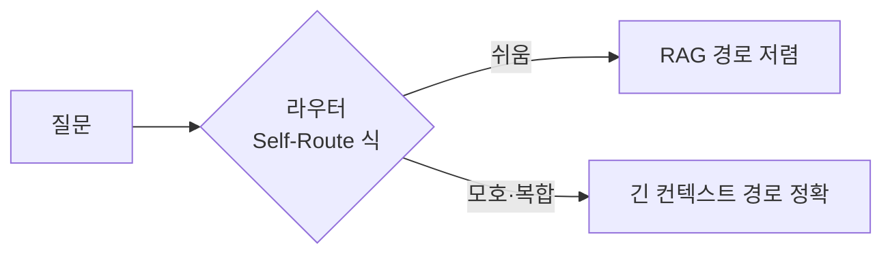

# 긴 컨텍스트 vs RAG

> 문서를 통째로 프롬프트에 넣는 방식(긴 컨텍스트)과 필요한 조각만 검색해 넣는 방식(RAG)의 선택 문제다. 지식이 작고 정확도가 중요하면 통째로, 지식이 크거나 비용·지연이 중요하면 RAG가 기본이다.

## 쉽게 말하면
시험 범위 전체를 책상에 펼쳐 놓고 푸는 것(긴 컨텍스트)과, 색인으로 해당 쪽만 찾아 보며 푸는 것(RAG)의 차이다. 범위가 얇으면 전부 펼치는 게 확실하고, 범위가 도서관만 하면 색인이 필요하다.

## 자세히
- **작으면 통째로**: Anthropic은 지식이 약 200,000 토큰(대략 500쪽) 미만이면 RAG 없이 전부 프롬프트에 넣어도 된다고 안내했다(2024-09 Contextual Retrieval 글). [프롬프트 캐싱](#prompt-caching)을 쓰면 지연이 2배 넘게, 비용이 최대 90% 줄 수 있다고 한다.
- **정확도**: 논문 "RAG or Long-Context LLMs?"(arXiv 2407.16833, 2024)는 자원이 충분하면 긴 컨텍스트가 평균 성능에서 RAG를 꾸준히 앞선다고 보고했다. 대신 RAG가 훨씬 싸다. 제안된 Self-Route는 모델 스스로 쿼리를 RAG와 긴 컨텍스트로 나눠 보내 비용을 줄이면서 성능을 유지했다.
- **긴 컨텍스트의 한계**: 입력이 길수록 [context rot](#context-rot)·위치 편향으로 회상이 떨어지고, 매 요청마다 토큰 비용이 든다. 최신 모델이 1M 토큰을 지원해도([컨텍스트 윈도우](#context-window)) 조직 전체 문서에는 모자라거나 비싸다.
- **RAG의 한계**: 검색이 틀리면 답도 틀린다. 보강책이 있다 — Contextual Retrieval은 각 조각에 맥락 설명을 붙여 상위 20개 조각 검색 실패율을 5.7%에서 임베딩+BM25 결합 시 2.9%(−49%), 리랭킹까지 하면 1.9%(−67%)로 줄였다고 보고(Anthropic 자체 측정).
- **선택 기준**: ① 지식 크기 ② 질문당 허용 비용·지연 ③ 자주 바뀌는가(RAG는 색인만 갱신) ④ 출처 인용 필요 ⑤ 접근권한 분리. 많은 시스템이 둘을 섞는다.

## 그림으로 보기

## 예시
- 사내 규정집 300쪽, 질문 하루 20건: 규정집 전체를 캐시된 시스템 프롬프트에 넣는 쪽이 단순하다.
- 위키 수십만 쪽 + 권한 분리: RAG(필요 시 [하이브리드 검색](#semantic-vs-keyword-search))로 상위 조각만 넣는다.

## 헷갈리는 것과 비교
| 개념 | 차이 |
| --- | --- |
| 긴 컨텍스트 | 단순하고 정확하나 토큰 비용·context rot |
| [RAG](#rag) | 싸고 확장되나 검색 품질에 의존 |
| [에이전틱 RAG](#agentic-rag) | 모델이 검색을 반복 호출해 스스로 찾음 |
| 미세조정 | 지식을 가중치에 넣음, 자주 바뀌는 사실엔 부적합 |

## 더 읽을거리
- [Anthropic: Introducing Contextual Retrieval](https://www.anthropic.com/news/contextual-retrieval) — 200k 토큰 기준, 검색 실패율 수치
- [RAG or Long-Context LLMs? (arXiv 2407.16833)](https://arxiv.org/abs/2407.16833) — 비교 연구와 Self-Route
