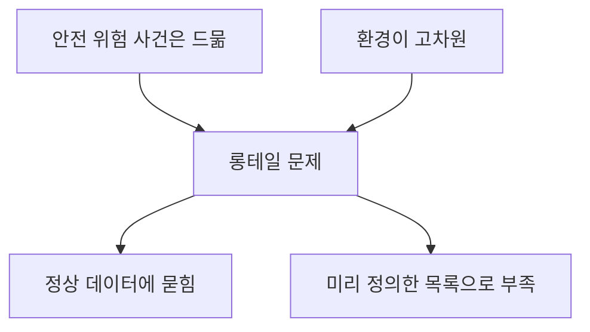
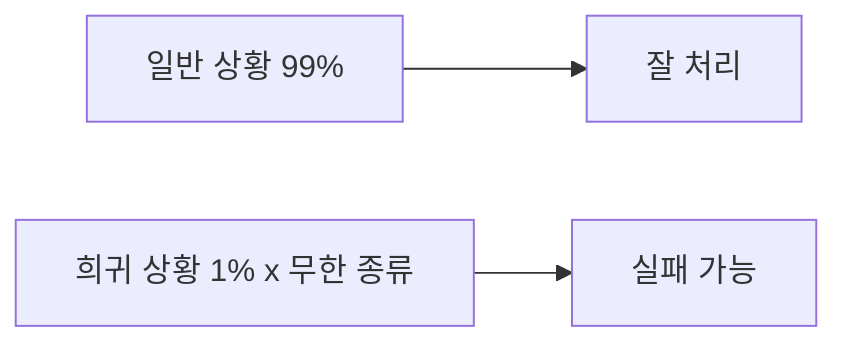

# 롱테일 문제

> 자율주행처럼 안전이 중요한 AI에서, **드물지만 위험한 상황이 끝없이 많아** 평소 데이터를 아무리 모아도 완전한 대응이 어려운 문제.

## 쉽게 말하면
수학 시험에서 쉬운 문제는 다 맞히지만, 매번 처음 보는 괴상한 문제가 한두 개씩 나오는 상황이다. 괴상한 문제의 종류가 끝이 없어 기출을 외워도 소용이 없다.

## 자세히
- 학술적 설명: Liu와 Feng의 **"curse of rarity"**(arXiv 2207.02749)는 안전에 중요한 사건이 **드물다는 점**과 주행 환경의 **고차원성(curse of dimensionality)**이 겹쳐 롱테일이 생긴다고 본다. 수백만 마일을 달려도 저확률 위험 시나리오는 끝없다는 것.
- 정상 데이터 속에 희귀 사건 정보가 묻혀 딥러닝이 배우기 어렵다.
- 2026 서베이 요약: 일반 상황에는 강하지만 임시 공사 구간·극한 날씨 같은 희귀 사건에서 급격히 성능이 떨어지고, 이는 패턴 매칭의 취약성과 전수 데이터 수집의 불가능성 때문이라고 한다.
- Voxel51 글(업체 블로그, 주장): 어려운 것은 더 모으기보다 **이미 가진 데이터 속 희귀·위험 사례를 찾아내는 일**이며, 라벨 검색은 미리 정한 클래스만 찾아 롱테일(열린 집합)을 놓친다.
- 모호성: 같은 상황에 안전한 대응이 여러 개일 수 있는데 학습 데이터는 한 사람의 선택만 담는다.
- 대응 방향: 시뮬레이션으로 희귀 시나리오 생성, 이상 사례 마이닝, 추론 능력 강화. 완전한 해결책은 아직 없다.

## 그림으로 보기

## 예시
- 도로에 쓰러진 신호등, 공사 중 수신호하는 사람, 눈에 덮인 표지판.
- 교육: 기업 AI 도입에서 "평균 정확도가 높아도 드문 사고 사례를 따로 점검하라" 사례.

## 헷갈리는 것과 비교
| 개념 | 차이 |
|---|---|
| 롱테일 | 희귀 사례가 끝없이 많음 |
| 분포 이동 | 배포 환경이 학습 분포와 다름 |
| [로보택시 안전 지표](#robotaxi-safety-metrics) | 평균 충돌률은 롱테일을 다 보여 주지 못함 |

## 더 읽을거리
- [Curse of rarity (arXiv 2207.02749)](https://arxiv.org/abs/2207.02749) — 학술 설명(검색 요약으로 확인).
- [Voxel51: long tail in autonomous driving](https://voxel51.com/blog/long-tail-autonomous-driving) — 업체 관점.
