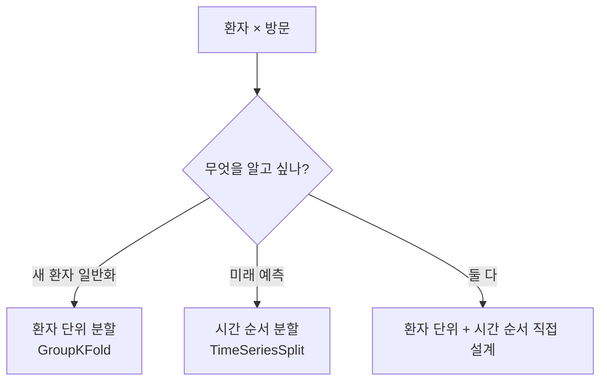
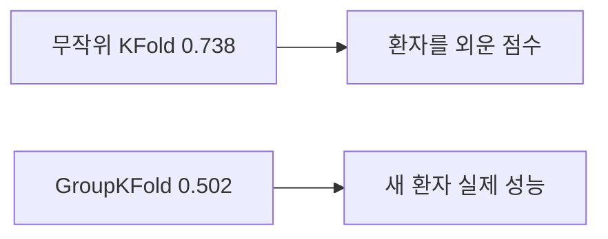

# 종단 데이터 분할

> 한 사람(환자·사용자)을 **여러 시점에 걸쳐 반복 측정한 데이터(종단 데이터)**를 학습/테스트로 나누는 방법이다. 같은 사람의 방문이 양쪽에 갈라지면 모델이 사람을 외우고, 시간 순서를 무시하면 미래 정보가 과거 예측에 새어 든다.

## 쉽게 말하면
같은 학생이 매달 본 시험 성적이 있을 때, 3월 시험은 학습에, 4월 시험은 평가에 쓰면 모델은 "이 학생은 원래 이런 학생"을 외워서 맞힌다. 새 학생을 평가하려면 학생 단위로, 미래를 예측하려면 시간 순서로 나눠야 한다.

## 자세히
- **두 가지 질문을 구분**: ① 새로운 사람에게도 통할까(일반화) → **사람 단위** 분할. ② 같은 사람의 다음 방문을 맞힐 수 있을까(예측) → **시간 단위** 분할. 목적이 다르면 분할도 다르다.
- **직접 실험(scikit-learn 1.9.1, 합성: 환자 60명×방문 8회, 환자마다 고유 "지문" 특성과 환자 수준 결과, RandomForest)**
  | 분할 | 정확도 |
  |---|---|
  | 무작위 KFold(방문 섞임) | **0.738** |
  | GroupKFold(환자 단위) | **0.502** |
  | 같은 환자·뒤 방문(0~5 학습, 6~7 평가) | 0.767 |
  | 새 환자(45명 학습, 15명 평가) | 0.525 |
  결과는 환자 수준 결과가 무작위인 합성 데이터라 새 환자에겐 맞힐 방법이 없다(약 0.5가 정답). 무작위 KFold의 0.738은 **환자를 외운 점수**였고, 같은 환자의 뒤 방문 점수도 마찬가지로 부풀려진다.
- **시간 분할(scikit-learn 가이드)**: 시계열은 인접 관측이 상관(자기상관)돼 `KFold`·`ShuffleSplit`처럼 i.i.d.를 가정하는 분할이 학습-테스트 간 비현실적 상관을 만든다. `TimeSeriesSplit`은 앞부분을 학습, 바로 뒤를 테스트로 쓰며 학습 세트가 점점 커진다(`[0 1 2]→[3]`, `[0 1 2 3]→[4]`, ...). 관측이 고정 간격이어야 폴드가 비교 가능하다.
- **둘을 결합**: 사람 단위로 나눈 뒤 각 사람 안에서도 시간 순서를 지키는 설계가 필요할 수 있다. 라이브러리에 한 번에 해 주는 분할기는 없으므로 직접 구현하거나 검증한다([그룹 겹침 검증](#group-overlap-check)).
- **함정**: 미래 정보로 만든 특성(전체 기간 평균, 사후 진단 코드), 방문 간 정보 누수(이전 방문 결과를 특성으로 넣고 같은 사람을 양쪽에 둠), 환자마다 방문 수 불균형.

## 그림으로 보기

## 예시
- 당뇨 환자의 월별 검사 기록으로 합병증 예측: 환자 단위 분할로 새 환자 성능을 재고, 별도로 "마지막 3개월 예측"은 시간 분할로 평가.
- 교육: 같은 데이터라도 질문에 따라 분할이 달라진다는 점을 보여 주는 사례.

## 헷갈리는 것과 비교
| 개념 | 차이 |
|---|---|
| 종단 데이터 | 같은 개체를 여러 시점 측정 |
| 횡단 데이터 | 한 시점에 여러 개체 |
| [그룹 분할](#group-kfold) | 개체를 한쪽에만 |
| [시계열 분할](#time-series-split) | 시간 순서 보존 |

## 더 읽을거리
- [scikit-learn 교차검증 가이드 — Time Series Split](https://scikit-learn.org/stable/modules/cross_validation.html) — 자기상관과 TimeSeriesSplit 설명.
