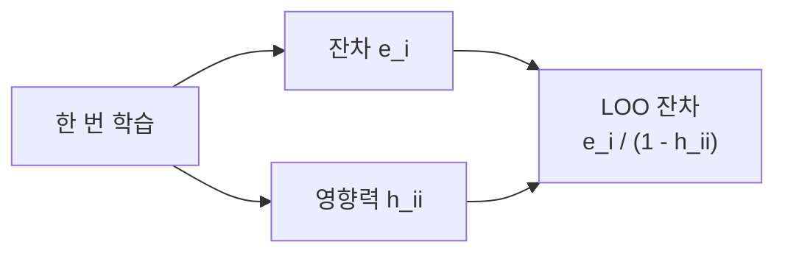
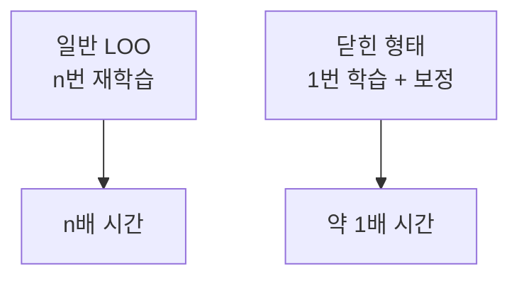

# LOO 닫힌 형태 계산

> 선형 회귀·릿지 같은 선형 모델에서는 표본을 하나씩 빼고 다시 학습하지 않아도, 한 번 학습한 결과의 잔차와 "영향력(레버리지)"만으로 LOO(Leave-One-Out) 오차를 정확히 계산할 수 있다.

## 쉽게 말하면
학급 평균에서 학생 한 명을 빼고 평균을 다시 구하려고 모든 점수를 처음부터 더할 필요는 없다. 전체 합에서 그 학생 점수를 빼고 인원수를 하나 줄이면 된다. 선형 모델도 한 번 계산한 값에 간단한 보정만 하면 "그 표본 없이 학습했다면"의 예측 오차가 나온다.

## 자세히
- **공식(최소제곱, 직접 확인)**: 잔차 e_i와 모자 행렬(hat matrix) H의 대각 원소 h_ii로 LOO 잔차 = e_i / (1 − h_ii). h_ii는 표본 i가 자기 예측에 미치는 영향이다.
- **직접 해 본 검증(당뇨병 데이터 442개, 선형 회귀)**: 이 공식으로 구한 LOO 잔차와 442번 다시 학습한 `LeaveOneOut` 교차검증의 잔차는 최대 차이가 1.63e-12(사실상 같음)였다. LOO 평균제곱오차는 두 방법 모두 3001.75였다. 직접 반복은 0.30초가 걸렸다(이 데이터가 작아서 짧다).
- **scikit-learn의 RidgeCV(공식 문서, 열람)**: `RidgeCV`는 기본(`cv=None`)에서 효율적인 LOO 교차검증을 수행한다. `store_cv_results=True`면 알파마다 값을 `cv_results_`에 저장한다(이름은 1.5에서 `store_cv_values`에서 바뀜). `cv=None`일 때만 이 경로이고 정수를 주면 K겹으로 간다. 직접 돌린 `RidgeCV` 알파 4개 탐색은 0.002초였고 선택된 알파는 0.01이었다.
- **적용 범위(해석)**: 선형 모델(최소제곱·릿지)에 한정된 정확한 지름길이다. 나무·신경망 같은 비선형 모델에는 이런 공식이 없어서 LOO는 n번 재학습한다. 커널 방법이나 일부 모델에도 근사식이 있지만 이 글에서는 확인하지 않았다.
- **언제 유용한가**: 표본이 수십~수백 개이고 하이퍼파라미터(알파)를 빠르게 고를 때. 전처리(표준화 등)가 있으면 공식이 정확히 성립하지 않을 수 있어 `Pipeline` 안에서의 처리를 따로 확인해야 한다.

## 그림으로 보기



## 예시
```python
from sklearn.linear_model import RidgeCV
r = RidgeCV(alphas=[0.01, 0.1, 1, 10], store_cv_results=True).fit(X, y)
print(r.alpha_)
```
교육 활용: 직접 재학습 LOO와 공식 결과를 나란히 비교해 "같다"를 확인하는 실습.

## 헷갈리는 것과 비교
| 개념 | 차이 |
| --- | --- |
| 일반 LOO | n번 재학습 |
| 닫힌 형태 LOO | 선형 모델에서 1번 학습으로 같은 값 |
| `RidgeCV(cv=None)` | scikit-learn의 효율적 LOO 구현 |
| [LOO](#leave-one-out) | 상위 개념 |

## 더 읽을거리
- [scikit-learn: RidgeCV](https://scikit-learn.org/stable/modules/generated/sklearn.linear_model.RidgeCV.html) — 효율적 LOO와 `store_cv_results`
