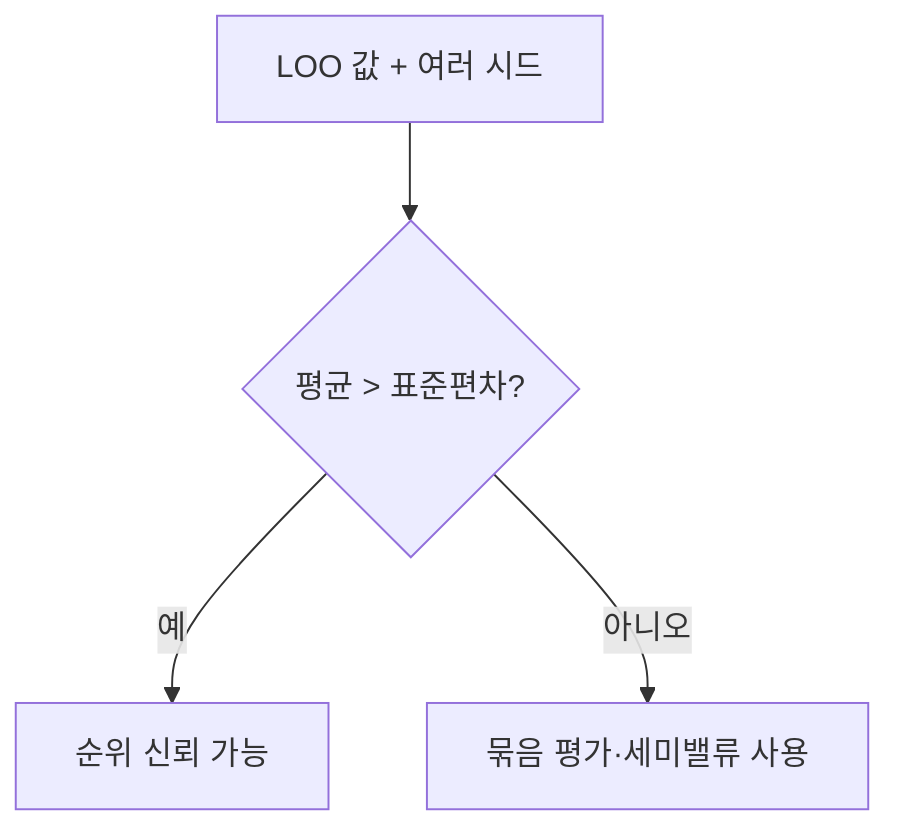

# LOO의 잡음 민감성

> 학습 데이터가 클수록 **점 하나를 빼서 생기는 성능 변화는 매우 작아지는데**, 성능 측정에 깔린 잡음(유한한 시험 세트, 학습 무작위성)은 그대로라 LOO 값이 **잡음에 묻힌다.** 큰 데이터에서 LOO 순위는 거의 무작위가 될 수 있다.

## 쉽게 말하면
1,000명이 투표한 결과에서 한 명이 빠져도 득표율이 거의 안 변한다. 득표율 측정 자체에 ±1%의 오차가 있다면, 한 명의 기여는 오차에 가려 보이지 않는다.

## 자세히
- **LOO의 정의**: φᵢ = V(D) − V(D−{i}) (Ghorbani & Zou, arXiv 1904.02868).
- **한계 기여의 감소(Beta Shapley, arXiv 2110.14049 본문 확인)**: 부분집합 크기 |S|가 충분히 크면 점 하나를 더했을 때의 성능 변화 U(S∪{z})−U(S)는 0에 가깝다. 음의 로그우도 효용에서는 **온건한 조건 아래 O_p(|S|⁻²)** 로 줄어드는 것을 보일 수 있다고 한다. 이 때문에 큰 부분집합의 한계 기여(LOO가 가중 100%를 주는 항)는 구별하기 어렵다.
- **잡음의 근원(Data Shapley 논문)**: V(S)는 학습한 모델을 **유한한 시험 세트**에서 잰 값이므로 진짜 성능의 근사이고 본래 잡음이 있다. 같은 예측기를 시험 세트 **부트스트랩 표본**에 재 보면 변동이 드러난다.
- **규모 감 잡기(직접 계산, 가상 비교)**
  | 학습 데이터 크기 n | n⁻²(변화 규모의 상대 척도) | 시험 세트 크기 | 정확도 약 90%의 표준오차 √(0.9·0.1/n_test) |
  |---|---|---|---|
  | 10 | 1×10⁻² | 200 | 0.021 |
  | 100 | 1×10⁻⁴ | 1,000 | 0.0095 |
  | 1,000 | 1×10⁻⁶ | 10,000 | 0.0030 |
  | 10,000 | 1×10⁻⁸ | | |
  n이 커지면 점 하나의 효과는 n⁻² 정도로 급감(n⁻²는 비례상수를 모르는 척도이므로 절대값이 아니라 감소 속도만 본다), 측정 잡음은 시험 세트가 커져도 1/√n_test로만 줄어든다. 잡음이 더 느리게 줄므로 **신호 대 잡음비가 나빠진다.**
- **학습 무작위성 추가**: 신경망 학습의 시드·미니배치 순서가 만드는 변동이 점 하나의 효과보다 큰 경우가 흔하다(일반 경험, 설정별 확인 필요). LOO는 점마다 한 번의 재학습이라 이 잡음을 평균하지 못한다.
- **영향 함수와의 연결**: 영향 함수는 이 재학습 잡음 없이 결정적으로 근사하는 이점이 있지만 가정 한계가 있다([영향 함수 기반 가치 평가](#influence-function-valuation)).
- **대응**
  1. 같은 LOO를 **여러 시드**로 반복해 평균·표준편차를 보고, 평균이 표준편차보다 작으면 순위를 믿지 않는다.
  2. 크기 가중을 작은 부분집합 쪽으로 옮긴 **Beta Shapley** 같은 세미밸류 사용([세미밸류](#semivalue)).
  3. 시험 세트를 크게, 손실 기반(연속적) 효용 사용.
  4. 점 단위가 아닌 **묶음 단위**(예: 100개 군집)의 영향을 평가.
- **한계**: O_p(|S|⁻²)는 음의 로그우도 효용에서의 이론이며 모든 모델·지표에 보장되지 않는다.

## 그림으로 보기



## 예시
```python
vals = []
for seed in range(10):
    vals.append(score(train_all, seed) - score(train_without(i), seed))
print(np.mean(vals), np.std(vals))     # |mean| < std 이면 LOO 값은 잡음
```
- 학습 데이터 5만 개에서 점 하나를 뺀 정확도 변화가 0.0001%이고 시험 세트 오차가 0.3%라면 그 점의 LOO는 측정 불가.

## 헷갈리는 것과 비교
| 개념 | 설명 |
|---|---|
| 한계 기여 | 부분집합에 점을 더한 변화 |
| LOO | 가장 큰 부분집합에서의 한계 기여 |
| 측정 잡음 | 시험 세트·시드로 인한 변동 |
| [중복 대체 효과](#duplicate-data-substitution) | LOO가 0이 되는 또 다른 원인 |

## 더 읽을거리
- [Beta Shapley (arXiv 2110.14049)](https://arxiv.org/abs/2110.14049) — 한계 기여 O_p(|S|⁻²) 논의(PDF 본문 확인).
- [Data Shapley (arXiv 1904.02868)](https://arxiv.org/abs/1904.02868) — V(S)의 본래 잡음·부트스트랩(PDF 본문 확인).
